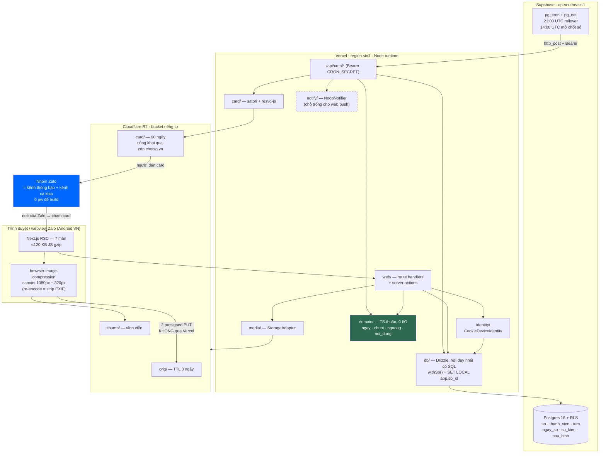

# 03 — KIẾN TRÚC KỸ THUẬT & QUYẾT ĐỊNH STACK

### Sản phẩm: **Chốt Sổ** (`chotso.vn`) — web, không app, nhóm ≤8 người, thị trường VN

> Viết 03/09/2026. Tài liệu nguồn duy nhất: `/home/huypq/teemi/docs/plan/01-dinh-nghia-san-pham-v2.md`.
> Nghiên cứu nền: `r05-tech-stack.md` (giá hạ tầng), `r06-legal-compliance.md` (pháp lý).
> Quy ước: **[FACT + nguồn]** · **[suy luận từ X]** · **[ước lượng]** · **[cần kiểm chứng]**.

> ## ✅ ĐÃ ĐỐI CHIẾU VỚI BẢNG PHÁN QUYẾT TRỌNG TÀI — 2026-09-03
>
> Tài liệu này **đã được rà soát dòng-theo-dòng** với `/home/huypq/teemi/docs/plan/_rulings.md` (ban hành 03/09/2026: 53 phán quyết mâu thuẫn · 25 phán quyết scope creep · 123 dòng từ điển giá trị chuẩn).
>
> **Mọi hằng số trong tài liệu này lấy từ `_rulings.md` mục A.** Nếu một con số ở đây khác với `_rulings.md`, **`_rulings.md` thắng** và đây là lỗi phải sửa, không phải một phương án thay thế.
>
> Chủ quyền của tài liệu này: **CHI PHÍ HẠ TẦNG** (nguyên tắc 2 của bảng phán quyết). Ba kết luận của `03` đã **thắng** ở phán quyết C17 (card TTL 90 ngày / 150 KB), C27 (Supabase Pro $25 bắt buộc từ 02/12, kỳ vọng $28–37/tháng) và C18 (không lưu năm sinh, xoá hai CHECK gọi `now()`).
>
> Tài liệu này **KHÔNG** có chủ quyền về: schema (`04` §1) · định nghĩa metric (`06`) · pháp lý (`05`) · tone/UX (`08`) · sản phẩm (`01-v2`). Ở những chỗ đó tài liệu này **chỉ tham chiếu**, không tự khai.
>
> Sổ cái pw duy nhất: **`docs/adr/pw-ledger.md`** (A87). File ADR duy nhất: **`docs/adr/ADR-000-bat-bien.md`** (A103) — mọi tham chiếu "ADR-001"/"ADR-002" trong bản cũ đã được đổi thành "ADR-000 §2"/"ADR-000 §3".

> ⚠️ **Cảnh báo đọc r05:** r05 khuyến nghị **React Native + Expo SDK 55**. Khuyến nghị đó **đã chết** cùng với quyết định "không ai cài app" ở v2 §1. Mọi con số giá của r05 (R2, Supabase, Twilio, FCM) vẫn dùng được; mọi khuyến nghị *framework* của r05 thì không. Tài liệu này thay thế r05 §1, §3, §10; giữ và tinh chỉnh r05 §2, §4, §7, §8.

---

## 0. TL;DR — bảng chốt một trang

| Lớp | **Chốt** | Bị loại | Chi phí 1k / 10k / 100k DAU |
|---|---|---|---|
| Client | **Next.js 15 App Router, React 19, không PWA, không service worker** | React Native + Expo · Zalo Mini App | (nằm trong hosting) |
| Hosting | **Vercel, region `sin1`, `output: 'standalone'`** | Cloudflare Pages/Workers · VPS tự quản | $0 / $20–35 / $150–300 |
| Database | **Supabase Postgres (ap-southeast-1), truy cập bằng Drizzle qua pooler — KHÔNG dùng `supabase-js`. Bậc Pro $25 BẮT BUỘC từ 02/12/2026** (A74) | Firebase/Firestore · Neon | $25 / $40 / $150–200 |
| Auth | **Cookie HttpOnly 400 ngày + mirror localStorage + mã sổ 6 ký tự để khôi phục. Không OTP, không OAuth** | Phone OTP (ZNS/Twilio) · Zalo Login · Google/Apple · magic link | **$0 ở mọi mốc** |
| Storage ảnh | **Cloudflare R2**, 3 prefix + lifecycle rule | Supabase Storage · Vercel Blob | $0 / $1 / $60 |
| Push | **KHÔNG CÓ. Kênh thông báo là Zalo** | FCM/web push · OneSignal | $0 / $0 / $0 |
| Cron | **pg_cron gọi HTTP endpoint có shared secret. 3 job, không job nào lúc 21:00** | Vercel Cron · GitHub Actions | $0 |
| Analytics | **Bảng `event` trong chính Postgres (schema ở `04` §1) + 6 truy vấn SQL chạy tay + 2 dòng đèn cảnh báo pháp lý. KHÔNG có UI dashboard ở MVP-0** | PostHog Cloud · Firebase Analytics | $0 (tốn dung lượng DB) |
| Error tracking | **Sentry free → Team** | Không dùng gì · GlitchTip tự host | $0 / $26 / $80 |
| CI/CD | **GitHub Actions + Vercel Git integration**, 7 check bắt buộc | CircleCI · Vercel-only | $0 |
| **TỔNG** | | | **≈$28 / ≈$93–108 / ≈$456–633/tháng** |

> **Con số $28 ở cột đầu là ngân sách beta có hiệu lực** [A74, thắng ở C27]: Supabase Pro $25 + domain ~$2,5 + Vercel Hobby $0. Dải kỳ vọng chính thức là **$28–37/tháng**. Con số "~$3/tháng" của v2 Bảng 6 giả định Supabase Free — **không còn hợp lệ từ 02/12/2026** vì Free không có backup hằng ngày. Đèn báo động chi phí: **>$60/tháng** (A75). DoD hoá đơn tháng đầu: **≤$40** (A76).

**Ba câu quan trọng nhất của tài liệu này:**
1. Ràng buộc thật không phải tiền, là **giờ code**. Ngân sách: **6,5 pw × 40 giờ = 260 giờ tập trung** (A80, A83), nhưng tốc độ thực là **13 giờ code/tuần** (20 h/tuần × hệ số 0,65 `[không có nguồn]`) ⇒ **1 pw ≈ 3,1 tuần lịch**, 6,5 pw ≈ **20 tuần lịch**, không phải 10 (A80–A82). Mọi quyết định tốn >8 giờ hạ tầng đang tiêu ~3% toàn bộ ngân sách MVP.
2. **`domain/` là code thuần, không I/O.** Mọi kịch bản thoát vendor (Vercel → Docker, Supabase → Postgres VN, R2 → VNG Cloud) đều không chạm vào nó. Đó là toàn bộ chiến lược thoát vendor, gói trong một quy tắc thư mục.
3. Kế hoạch dự phòng "Android web push +0,3 pw" ở H1 vùng xám **có thể không tồn tại** — service worker trong webview Zalo nhiều khả năng không đăng ký được. **Nó đã bị CẮT khỏi MVP-0** [S09] và **không được ghi ở bất kỳ đâu như khoản đã ngân sách**; nó là hạng mục **có điều kiện**. Phải kiểm chứng trong buổi 04/09 (A105), **trước** dòng code đầu tiên (23/09, A110).

---

## 1. RÀNG BUỘC THIẾT KẾ — dịch ra thành luật kỹ thuật

Mỗi ràng buộc phải đẻ ra một **luật kiểm tra được**, nếu không nó chỉ là lời than.

| # | Ràng buộc | Nguồn | Luật kỹ thuật rút ra | Kiểm tra bằng |
|---|---|---|---|---|
| R1 | 1 dev, 20h/tuần ⇒ **13 giờ code/tuần** (hệ số 0,65 `[không có nguồn]`). Trần backlog **6,5 pw = 260 giờ tập trung ≈ 20 tuần lịch** | A80–A83 (v2 §4.10 + `02` §3.2) | Không tự vận hành bất kỳ tiến trình nào. Không có thành phần nào cần `ssh` để sửa | Đếm số dịch vụ phải tự patch: mục tiêu **0** |
| R2 | Ngân sách hạ tầng beta **$28–37/tháng**, trần <$50, đèn báo động **>$60** | A74–A76 (`03` §2.3+§5+§9 B6, thắng ở C27) | Mọi dịch vụ phải đủ cho **≤30 sổ đợt 2** (A91) ở bậc thấp nhất, và có bậc trả tiền tuyến tính (không có bậc nhảy $200). **Supabase Pro $25 là khoản cố định, không phải tuỳ chọn** | Bảng §5 + §7 |
| R3 | Đa số user là Android VN, máy tầm trung, 4G — **">85%" là con số đang tranh chấp** `[cần kiểm chứng]`: `08` §8.2 dẫn StatCounter T7/2026 = **60,38%** | r02 / r05 §1.1 ↔ `08` §8.2. **D-08, hạn 04/09/2026** | **Ngân sách JS ≤120 KB gzip** trên route Sổ hôm nay. Ảnh nén ở client, không ở server | CI check `budget:js` |
| R4 | Mọi lưu lượng vào qua **webview Zalo** | v2 §3 bước 2 | Không dựa vào: OAuth popup, service worker, `Notification API`, `navigator.share` (có fallback), IndexedDB bền, localStorage bền | Ma trận 4 máy thật §10 |
| R5 | Nội địa hoá dữ liệu có thể bị áp | NĐ 53/2022 Điều 26 [FACT r06 §2.5] | Không dùng dịch vụ độc quyền của một vendor cho: DB, storage, cron, auth, render | Job CI `docker-compose` §6 |
| R6 | Phải thoát vendor được | v2 §9 mục 2 (**ADR-000 §2**, A103) | 4 luật portability §6.1 | Job CI `docker-compose` §6 |
| R7 | Giữ miễn trừ Điều 38.2 Luật 91/2025 | r06 §4.2 [FACT] | Strip EXIF ở client · không face detection · không toạ độ · không taxonomy sức khoẻ | Test đơn vị + review schema |
| R8 | Bus factor = 1, **SLA KÉP** [CHỐT 2026-08-28, QĐ-17 · A59]: **48 giờ** cho khiếu nại người dùng · **24 giờ, khẩn cấp 6 giờ** cho yêu cầu của cơ quan nhà nước (luật định, không thương lượng) | v2 §10(d) + Luật ANM 116/2025 + `05` BĐ#5 | Phải có **kill switch không cần deploy** (`remote_config['service_paused']`), **script khoá một sổ khẩn cấp**, và một `RUNBOOK.md` người khác đọc hiểu (nội dung bắt buộc: §10 mục 6). Trang chính sách in **cả hai** con số. Cơ chế xử report: **auto-hide TOÀN CỤC ngay ở report đầu tiên** (A60) | Diễn tập 1 lần trước beta, **và một lần nữa trước 03/02/2027** (founder về quê Tết 11 ngày, cửa sổ freeze 03/02→13/02/2027) |
| R10 | **Nghĩa vụ lưu vết ≥2 năm** (IP, login/logout, giao dịch) | `05` GIAI ĐOẠN 2 (QĐ-19) · **A49** | Bảng **`audit_log` có từ migration đầu tiên** — "rẻ nhất khi làm sớm, **không thể làm bù**". Schema ở `04` §1. **+0,15 pw đã ghi `docs/adr/pw-ledger.md`** | Migration đầu tiên phải chứa bảng này; test CI kiểm bảng tồn tại |
| R9 | Cao điểm dồn 21:00–23:00, không có san bằng ngày đêm | v2 §3, §4.1 | Cron nặng **chỉ chạy 04:00**. Provision theo đỉnh, không theo trung bình | Đo p95 trong cửa sổ 21–23h |

> **R9 là đặc điểm kiến trúc riêng của sản phẩm này và không tài liệu nào trước đó nêu.** Một app thường có tải trải đều 16 giờ. Chốt Sổ dồn ~70% toàn bộ request vào 3 giờ [suy luận từ v2 §3: giờ chốt sổ 21:00, ngày kết thúc 03:59]. Tỉ số đỉnh/trung bình ≈ **5–6×**. Hệ quả: mọi tính toán "qps trung bình" trong tài liệu này phải nhân 6 trước khi chọn cấu hình máy.

---

## 2. QUYẾT ĐỊNH STACK — từng lớp

### 2.1. Client

| | |
|---|---|
| **Chọn** | **Next.js 15 App Router + React 19 + TypeScript. Server Components mặc định. Tailwind. KHÔNG service worker, KHÔNG manifest PWA, KHÔNG offline mode ở MVP.** |
| Loại #1 | **React Native + Expo** (khuyến nghị của r05) — mâu thuẫn trực tiếp với câu bán 13 từ. Kèm EAS $1.326/tháng ở 100k MAU [FACT r05 §1.5], review store, chiến tranh ROM. |
| Loại #2 | **Zalo Mini App** — `docs.zaloplatforms.com`: không có API trả group id/danh sách thành viên khi mở từ nhóm chat [v2 §6 mục 10]; duyệt 3–5 ngày mỗi lần cập nhật, giết vòng lặp sửa lỗi ngắn — thứ v2 §9 mục 4 gọi là **moat duy nhất trong 6 tháng đầu**. |
| Loại #3 | SvelteKit / Astro — bundle nhỏ hơn thật, nhưng hệ sinh thái `satori` + hosting + tài liệu đều xoay quanh React. Với 200 giờ, tốc độ founder thắng 30 KB. |
| **Lý do** | 7 màn, mỗi màn 1–3 query. RSC cho phép render server-side, đẩy gần như toàn bộ logic ra khỏi bundle. Sửa copy = `git push`, sống 3 phút sau, không qua ai duyệt. |
| **Điều kiện đổi ý** | (a) `group-D28 ≥ 35%` trên ≥30 sổ → mở nấc app native (v2 §6 mục 2). (b) Đo được p75 Largest Contentful Paint trong webview Zalo trên Redmi tầm trung **>3,5s** → cân nhắc chuyển sang render HTML tĩnh + island (Astro), +0,5 pw. |

**Ngân sách hiệu năng — biến câu bán thành số kiểm tra được.** Toàn bộ luận điểm của v2 là "chạm card → thấy sổ" nhanh hơn "mở app". Nếu trang mất 5 giây trong webview Zalo thì luận điểm sai và không có feature nào cứu được.

| Chỉ số | Trần | Đo ở đâu |
|---|---|---|
| JS gzip route `/s/[code]` | **≤120 KB** | CI, fail build nếu vượt |
| HTML + CSS lần đầu | ≤40 KB | CI |
| LCP p75 trên Redmi Note tầm trung, 4G, webview Zalo | **≤2,5 s** | Đo tay, 4 máy, mỗi lần release |
| Ảnh trên màn Sổ hôm nay | chỉ thumb 320px (~18 KB), tối đa 8 tấm | Snapshot test |

### 2.2. Hosting / runtime

| | |
|---|---|
| **Chọn** | **Vercel**, function region **`sin1` (Singapore)**, `next.config: { output: 'standalone' }`, **Node runtime — không dùng Edge runtime**. |
| Loại #1 | **Cloudflare Workers/Pages** — Next.js chạy được qua OpenNext nhưng thêm một lớp adapter phải tự debug; `@resvg/resvg-js` là native binary, không chạy trên Workers. Đổi lấy $0 nhưng tốn giờ founder ở đúng chỗ ít giá trị nhất. |
| Loại #2 | **VPS tự quản ($6 Hetzner/Vultr)** — rẻ nhất về tiền, đắt nhất về giờ: TLS, deploy, log, restart, backup, patch kernel. Vi phạm R1. |
| **Lý do** | Preview deploy mỗi PR thay hẳn môi trường staging. Rollback 1 click — với bus factor 1 lúc 23:30 thứ Bảy, đó là tính năng an toàn, không phải tiện nghi. |
| **Điều kiện đổi ý** | (a) Luật sư trả lời "máy chủ phải ở VN" → §8 E1. (b) Hoá đơn Vercel >$150/tháng → tách riêng phần render card (§5c). (c) Có doanh thu → **bắt buộc rời Hobby lên Pro $20** (Hobby cấm dùng thương mại). |

**Bốn thứ tuyệt đối không dùng, dù Vercel mời:** Vercel Postgres · Vercel KV · Vercel Blob · `@vercel/og` trên Edge runtime. Mỗi thứ trong đó biến kịch bản E1 từ 8 giờ thành 1 tuần.

### 2.3. Database

| | |
|---|---|
| **Chọn** | **Supabase Postgres 16, region `ap-southeast-1` (Singapore).** Truy cập **chỉ từ server Next.js**, qua **Drizzle ORM + `postgres.js`** trỏ vào **Transaction Pooler (port 6543)**. **Không dùng `supabase-js`, không dùng PostgREST, không dùng Supabase Auth, không dùng Supabase Storage.** |
| Loại #1 | **Firebase / Firestore** — không phải SQL, không `pg_dump`, Security Rules khó test. Với NĐ 53/2022 treo trên đầu, chọn một DB không xuất được ra là tự khoá tay. |
| Loại #2 | **Neon / PlanetScale** — Postgres tốt, nhưng thiếu `pg_cron` (Neon có Scheduled Queries dạng beta [cần kiểm chứng]) và không rẻ hơn đáng kể ở quy mô này. |
| **Lý do** | Ta chỉ cần **một Postgres được quản lý có `pg_cron` và có backup**. Supabase là cách rẻ nhất để có đúng ba thứ đó. Việc *không* dùng 4 sản phẩm còn lại của Supabase là quyết định cố ý: nó biến Supabase thành một nhà cung cấp Postgres có thể thay trong một buổi chiều. |
| **Điều kiện đổi ý** | (a) Cần server ở VN → §8 E2. (b) Vượt 8 GB DB mà nguyên nhân là bảng `su_kien` → rollup trước, không nâng bậc. |

**Bậc giá [FACT r05 §2.1, supabase.com/pricing]:** Free (500 MB DB, 5 GB egress, **không có backup hằng ngày**, project tự ngủ sau 7 ngày không hoạt động) · Pro $25 (8 GB DB, 250 GB egress, PITR mua thêm) · compute add-on: Small $15 / Medium $60 / Large $110 / XL $210.

> **Bất đồng nhỏ với v2 Bảng 6:** "hạ tầng ~$12/tháng" giả định Supabase Free. Free **không có backup hằng ngày**. Sản phẩm này hứa giữ lưới ảnh 30 ngày và thumbnail "vĩnh viễn"; mất DB một lần là mất toàn bộ tài sản của mọi sổ và không có đường phục hồi. **Từ ngày beta chạy (02/12/2026) phải là Pro $25.** Ngân sách thật: **$28–37/tháng**, không phải $12. Vẫn dưới trần $50.

**RLS — dùng, nhưng đúng vai.** Vì mọi truy cập đều đi qua server, RLS không phải cơ chế uỷ quyền chính; nó là **lớp phòng thủ thứ hai chống một câu `WHERE` bị quên**. Một lần rò ảnh sang sổ khác là chấm dứt sản phẩm "sổ kín".

```sql
alter table tam enable row level security;
alter table tam force row level security;
create policy so_scope on tam
  using (so_id = current_setting('app.so_id', true)::uuid);
```
Repository mở transaction, `SET LOCAL app.so_id = $1`, rồi mới query. Chi phí: **~4 giờ**, một lần. Kèm lint CI: chuỗi `` sql` `` không được xuất hiện ngoài `src/db/`.

### 2.4. Auth — bài toán đắt nhất, giải bằng cách không giải

Đây là mục r06 và r05 va nhau trực diện, và v2 chọn đúng.

**Bốn phương án, giá thật:**

| Phương án | Giá/lần xác thực | Điều kiện tiên quyết | Chạy trong webview Zalo? | Có thoả NĐ 147 không? |
|---|---|---|---|---|
| **Twilio SMS → VN** | **$0,2852** (~7.500đ) [FACT twilio.com/sms/pricing/vn] | Đăng ký brandname NĐ 91/2020, duyệt hàng tuần–tháng | ✅ | ✅ |
| **Zalo ZNS OTP** | **300đ** (~$0,011) [FACT smsthuonghieu.com/gia-zns] | **Cần Zalo OA đã xác thực → cần pháp nhân** [cần kiểm chứng, nhưng nếu đúng thì đây không phải phương án dự phòng của founder chưa có pháp nhân] | ✅ | ✅ |
| **Google Sign-In** | $0 | Google Cloud project | ❌ **Google chặn OAuth trong embedded webview** (`disallowed_useragent`) → phải nhảy ra trình duyệt ngoài, phá vỡ luồng 27 giây | ❌ |
| **Apple Sign-In web** | $0 | Apple Developer $99/năm | ⚠️ | ❌ |
| **Zalo Login (OAuth của VNG)** | $0 | Đăng ký app trên developers.zalo.me + duyệt | ✅ (chạy tốt nhất trong webview Zalo) | ❌ |
| **Magic link email** | $0 (Resend free 3k/tháng) | mailbox | ✅ | ❌ |
| **Không tài khoản: cookie + mã sổ** ✅ **CHỌN** | **$0** | không có | ✅ | ❌ |

**Chốt: không có tài khoản. Danh tính là một cookie ký, phạm vi một sổ.**

Nhưng **v2 §5 viết "device token trong `localStorage`" và đó là chỗ tôi không đồng ý.** `localStorage` là script-writable storage: trên WebKit (Safari + mọi webview iOS, gồm webview Zalo) nó bị xoá sau 7 ngày không tương tác; và webview của app khác có thể bị dọn bất cứ lúc nào. Một người đi du lịch 8 ngày về mất danh tính, thấy sổ của mình như người lạ — đó là lỗi giết retention mà không ai báo cáo.

**Thiết kế danh tính 3 lớp (thay cho 1 lớp):**

| Lớp | Cơ chế | Vì sao |
|---|---|---|
| L1 — chính | **Cookie `Set-Cookie` từ server: `HttpOnly; Secure; SameSite=Lax; Max-Age=34560000` (400 ngày)** | Cookie do **HTTP header** đặt ở first-party bền hơn hẳn cookie/`localStorage` do JS đặt trên WebKit. Chrome trần 400 ngày. Rẻ như nhau, bền hơn nhiều |
| L2 — gương | Cùng token, mirror sang `localStorage`; nếu request đến mà thiếu cookie nhưng client gửi kèm token từ L2 → server cấp lại cookie | Bắt trường hợp cookie bị dọn nhưng storage còn, và ngược lại |
| L3 — khôi phục | **Mã sổ 6 ký tự + chọn tên mình trong danh sách thành viên** | Đường cuối. Không mật khẩu, không email, không SMS |

**Nói thẳng mô hình đe doạ, vì nó sẽ bị hỏi:** L3 nghĩa là **bất kỳ ai có mã sổ đều mạo danh được một thành viên**. Trong bối cảnh ≤8 người bạn ngoài đời, kẻ tấn công là bạn mình và phần thưởng là đăng hộ một tấm ảnh — rủi ro chấp nhận được. Nó **hết chấp nhận được** ngay khi: sổ >8 người · có tiền/phần thưởng thật · có người lạ · hoặc `goal_text` bị đưa ra ngoài. Ghi ngưỡng vào ADR hôm nay.

**Chỉ số phải đo từ ngày đầu:** `identity_recovery_rate` = (số lần dùng L3) ÷ (số người-tuần hoạt động).
- **<5%/tuần** → thiết kế đúng, không làm gì.
- **5–10%** → giảm ma sát L3 (link khôi phục ngay trên màn Sổ).
- **>10%/tuần** → **cắm `ZaloLoginIdentity`** (+0,4 pw). Đây là lý do `identity/` phải là một interface từ commit đầu, chi phí 0.

**Khi nào phải quay lại phone OTP:** đúng một điều kiện — **đèn đỏ pháp lý** [CHỐT 2026-08-28, QĐ-04]: `monthly_visits` chạm **8.500** HOẶC `monthly_active_persons` chạm **850** trong một tháng dương lịch. **KHÔNG dùng con số "700 người dùng thường xuyên" nữa** — ngưỡng NĐ 147/2024 là **OR** và nhánh `10.000 lượt truy cập/tháng` bind trước ~2,5 lần (`05` §0 kết luận 2), nên mốc 700 báo động **muộn 2,5 lần**. Lúc chạm đèn đỏ, xác thực bằng SĐT VN có thể là **nghĩa vụ pháp lý** [FACT r06 §2.4 — nhưng xem câu 2 gửi luật sư ở `05` §11: nghĩa vụ này **có thể áp cả cho tier Giấy xác nhận thông báo**, tức sớm hơn ~4 lần]. Chi phí tại thời điểm đó:

| Số tài khoản phải xác thực | Twilio ($0,2852) | ZNS (300đ) | SMS brandname (600–1.000đ) |
|---|---|---|---|
| 1.000 | $285 (7,5 triệu đ) | **300.000đ** | 600k–1 triệu đ |
| 10.000 | $2.852 (75 triệu đ) | **3 triệu đ** | 6–10 triệu đ |
| 100.000 | $28.520 (750 triệu đ) | **30 triệu đ** | 60–100 triệu đ |

> Tiền không phải điểm chết ở đây — **thời gian chờ mới là**: lập pháp nhân + xin OA/brandname + duyệt = hàng tuần đến hàng tháng. Vì vậy cảnh báo phải là **hai counter, đèn vàng ở 60% ngưỡng** (`monthly_visits` 6.000 / `monthly_active_persons` 600), và phải là hai dòng tự động trong `/admin`, không phải một việc để nhớ.

### 2.5. Storage ảnh

| | |
|---|---|
| **Chọn** | **Cloudflare R2**, một bucket riêng tư `chotso-media`, ba prefix, lifecycle rule thuần cấu hình. |
| Loại #1 | **Supabase Storage** — egress **$0,09/GB** [FACT supabase.com/pricing]; ở 100k DAU đắt hơn R2 ~4,6× [r05 §4.3]. |
| Loại #2 | **Vercel Blob** — tính tiền cả storage lẫn egress, và khoá cứng vào Vercel, phá E1. |
| **Lý do** | Egress **$0** [FACT developers.cloudflare.com/r2/pricing], S3-compatible (nên đổi sang VNG/Viettel là đổi endpoint), lifecycle rule làm được TTL 72h **không cần một dòng cron nào**. |
| **Điều kiện đổi ý** | Yêu cầu nội địa hoá → §8 E3. |

**Bố cục key và vòng đời:**

| Prefix | Nội dung | Kích thước | Lifecycle rule | Cách phục vụ |
|---|---|---|---|---|
| `orig/{so}/{date}/{tam_id}.jpg` | ảnh gốc đã nén 1080px | ~110 KB | **xoá sau 3 ngày** | presigned GET, TTL 10 phút |
| `thumb/{so}/{date}/{tam_id}.jpg` | 320px | ~18 KB | **không xoá** (đến khi chủ ảnh xoá) | presigned GET theo lô |
| `card/{nanoid21}.png` | card 4:5 đã render | ~150 KB | **xoá sau 90 ngày** → thay bằng ảnh tĩnh "sổ này đã cũ" | **công khai qua `cdn.chotso.vn`, cache 1 năm** |

> **Vấn đề mà v2 chưa nêu: card KHÔNG ĐƯỢC hết hạn.** Card sống trong lịch sử chat Zalo. Nếu dùng presigned URL, sau 10 phút cả nhóm cuộn lại thấy một dãy ảnh vỡ — đó là thiệt hại thương hiệu diễn ra chậm và không ai báo. Vì vậy card phải nằm ở URL **công khai, khoá không đoán được, cache dài**. Đổi lại: ai có link đều xem được card (gồm thumbnail của thành viên). Đây là **quyết định quyền riêng tư**, phải ghi vào Chính sách và hỏi founder — xem §10 câu hỏi 2. Sau 90 ngày, key được thay bằng một ảnh tĩnh trung tính thay vì 404, để lịch sử chat không bao giờ có ảnh vỡ.

### 2.6. Push notification

| | |
|---|---|
| **Chọn** | **Không có push. Kênh thông báo duy nhất là noti của Zalo, do một người thật dán card.** |
| Loại #1 | **FCM / Web Push** — xem phân tích rủi ro ở §5c. |
| Loại #2 | **ZNS nhắc nhở** — 300đ/tin × 5 người × 30 ngày = **45.000đ/sổ/tháng** [FACT r06/v2]; ở 1.000 sổ là 45 triệu đ/tháng. Không thể là mặc định. |
| **Lý do** | Zalo là app duy nhất 100% ROM Việt whitelist sẵn [suy luận từ r05 §3.2 + v2 §3]. Không có push của mình ⇒ không có gì để Xiaomi/Oppo/Vivo giết, và không có gì để spam. |
| **Điều kiện đổi ý** | H1 rơi vùng xám 40–60% (v2 §11) → Android web push, **và chỉ sau khi kiểm chứng được service worker đăng ký được ở đâu** (§5c). |

### 2.7. Cron / scheduled job

| | |
|---|---|
| **Chọn** | **`pg_cron` trong Supabase**, mỗi job chỉ làm **một việc: `pg_net.http_post` tới một endpoint Next.js có `Authorization: Bearer <CRON_SECRET>`.** Logic nằm trong Next.js, không nằm trong PL/pgSQL. |
| Loại #1 | **Vercel Cron** — bậc Hobby giới hạn 2 job, tần suất 1 lần/ngày và **chạy "trong khoảng một giờ"**, không đúng phút. Ranh giới 04:00 và cú lật 21:00 cần đúng phút. |
| Loại #2 | **GitHub Actions `schedule`** — lệch 5–15 phút là chuyện thường, và dùng hệ thống CI làm scheduler production là anti-pattern: một lần hết quota là mất rollover. |
| **Lý do** | Đúng phút, cùng nơi với dữ liệu, $0, và VN không có DST nên `04:00 ICT = 21:00 UTC` là hằng số vĩnh viễn [FACT]. |
| **Điều kiện đổi ý** | Rời Supabase → thay bằng `node-cron` trong container hoặc Cloudflare Worker Cron Trigger. **Vì logic nằm sau một HTTP endpoint, việc thay scheduler là 15 phút.** |

**Ba job, và nguyên tắc quan trọng nhất về chúng:**

| Job | Lịch (UTC) | Việc | Hỏng thì sao? |
|---|---|---|---|
| `rollover` | **`5 21 * * *` (= 04:05 ICT)** [CHỐT 2026-08-28, QĐ-21] | Chốt sổ ngày hôm trước: đếm có mặt, tính `counted`, tiêu van, cập nhật chuỗi, cập nhật cache 3 con số | **Không sao.** Chạy lại là đủ |
| ~~`mo_chot_so`~~ | — | **ĐÃ CẮT** [CHỐT 2026-08-28, QĐ-22]. Trạng thái "sẵn sàng chốt" suy ra được từ giờ server bằng một phép so sánh; v2 §4.7 nói rõ hệ thống **không gửi gì** lúc 21:00, nên job này không có tác dụng phụ nào để mất. −0,10 pw, ghi vào sổ cái | — |
| `rollup_events` | `30 21 * * *` (= 04:30 ICT) | Gộp event thô thành bảng ngày, xoá raw >90 ngày | Không sao |

> **[CHỐT 2026-08-28 — QĐ-21] Vì sao rollover phải là 04:05, không phải 04:00.** `04-data-model-va-co-che.md` §3.4 đặt **biên nộp muộn kỹ thuật 120 giây** tính trên `intent_at`: một tấm bấm Gửi lúc 03:59:40 và commit lúc 04:00:20 vẫn phải rơi vào ngày cũ. Lịch `0 21 * * *` chạy **đúng 04:00:00 ICT**, tức **trước cả biên 120 giây** — tấm đó sẽ rơi vào một `book_day` đã ghi xong, và kết quả là **hoặc mất ngày, hoặc vi phạm bất biến "book_day bất biến"** mà toàn bộ §1.5 của `04` dựa vào (trigger `book_day_monotonic` sẽ raise). `04` §3.5 đã đặt đúng: 04:05 = sau biên 120 giây + 3 phút đệm. Bảng này sửa theo.

> **Luật bất biến: cron KHÔNG được là điều kiện đúng đắn của dữ liệu.** `logical_date` là cột generated; chuỗi và số ngày tính là **hàm thuần trên bảng `tam`**; cron chỉ *vật chất hoá* kết quả vào cache. Founder ngủ quên, Supabase bảo trì, pg_net timeout — sổ vẫn đúng, chỉ là con số hiển thị chậm một nhịp. Với bus factor 1, đây là quyết định kiến trúc có giá trị cao nhất trong toàn tài liệu. Mọi job phải **idempotent**, khoá bằng `unique(so_id, logical_date, job_kind)`.

### 2.8. Analytics

| | |
|---|---|
| **Chọn** | **Bảng `su_kien` trong chính Postgres + trang `/admin` với ~8 câu SQL viết cứng.** Đơn vị hàng đầu là `so_id`. |
| Loại #1 | **PostHog Cloud** — free 1M event/tháng, nhưng: (a) mô hình tư duy xoay quanh **user**, trong khi P10 bắt buộc đơn vị là **sổ**; (b) thêm một bản sao dữ liệu cá nhân ra nước ngoài → thêm một processor phải công bố và thêm rủi ro NĐ 330/2026 (phạt tới **5% doanh thu**). |
| Loại #2 | **Firebase Analytics** — schema cứng, thuộc Google, tệ hơn ở cả hai tiêu chí trên. |
| **Lý do** | Đây là sản phẩm mà **định nghĩa chỉ số là phần khó, không phải công cụ**. `group_alive = ≥3 người nộp tấm trong 7 ngày gần nhất` là một câu SQL 6 dòng. Mua một SaaS để rồi phải bẻ nó về đơn vị sổ là tốn giờ ở sai chỗ. |
| **Điều kiện đổi ý** | Khi có >3 người cần đọc dữ liệu, **hoặc** khi thời gian truy vấn tay vượt 2 giờ/tuần → mua PostHog và công bố nó là bên thứ ba nhận dữ liệu. |

**Bốn event an toàn bắt buộc có trước dòng code đầu tiên** (v2 §8, phản biện #22): `member_left{misses_7d, was_kicked}` · `report_created` / `report_resolved` · `safety_screen_shown{reason_bucket}` · `proof_deleted_by_self`. Cộng: `identity_recovery_used`, `card_rendered`, `card_opened{within_h}` (đo H1), `submit_failed{reason}` (đo R4).

**Cảnh báo dung lượng — khoản dễ nổ thứ hai sau Vercel.** Ở 100k DAU: ~15 event/người/ngày × 100k = 1,5M/ngày = **45M dòng/tháng**, ~200 byte/dòng ⇒ **~9 GB/tháng**. Supabase Pro có 8 GB. **Phải rollup từ đầu**, không phải khi vỡ: giữ raw 90 ngày, giữ `su_kien_ngay` (so_id, ngày, tên event, count) vĩnh viễn — bảng đó ~1/500 dung lượng.

### 2.9. Error tracking

| | |
|---|---|
| **Chọn** | **Sentry**, free tier (5k lỗi/tháng, 1 user) → Team $26 khi vượt. `sendDefaultPii: false`. |
| Loại #1 | **Không dùng gì** — không chấp nhận được: rủi ro kỹ thuật số 1 của sản phẩm là "luồng nộp ảnh hỏng trên một dòng webview Zalo nào đó" và **user sẽ không báo cáo, họ chỉ bỏ**. |
| Loại #2 | **GlitchTip tự host** — $0 nhưng vi phạm R1. |
| **Lý do** | Thứ đắt giá nhất Sentry cho ở đây không phải stack trace mà là **User-Agent**: biết lỗi xảy ra trên `ZaloTheme/Android 13/MIUI` chứ không phải "một máy Android nào đó". |
| **Điều kiện đổi ý** | Yêu cầu nội địa hoá dữ liệu áp cả sang log lỗi → tự host, +0,3 pw. |

**Bắt buộc cấu hình:** tag `webview = zalo | chrome | safari | other` parse từ UA · scrub mã sổ và mọi URL R2 khỏi breadcrumb · `tracesSampleRate: 0` ở MVP (performance monitoring ăn hết quota).

### 2.10. CI/CD

**GitHub Actions + Vercel Git integration.** Preview deploy mỗi PR; `main` → production. $0 (2.000 phút/tháng free cho repo private).

**Bảy check bắt buộc — đây là cách các nguyên tắc P1–P12 của v2 trở thành thứ không vi phạm được:**

| Check | Bảo vệ nguyên tắc | Nội dung | Thời gian |
|---|---|---|---|
| `test:invariant` | **P1** | 10.000 mô phỏng 30 ngày, assert không cột nào giảm ngoài `chuoi`, và `chuoi` chỉ giảm về đúng 0 khi hết van | ~20 s (vì `domain/` thuần) |
| `test:no-named-empty` | **P2** | Quét cây render: không component nào nhận `ten` trong nhánh `status === 'vang'` | 10 s |
| `test:template-bank` | **P3** | grep `{goal}` / `{goal_text}` trong toàn bộ chuỗi chữ | 2 s |
| `test:card-snapshot` | **P4** | Render card với 6 fixture, so PNG | 30 s |
| `lint:no-magic-number` | **P6** | Cấm literal số trong `src/domain/**` trừ 0 và 1 | 5 s |
| `lint:no-raw-sql` | (thêm) | `` sql` `` chỉ được xuất hiện trong `src/db/` | 2 s |
| `budget:js` | (thêm, R3) | route `/s/[code]` ≤120 KB gzip | 15 s |
| `e2e:portable` | (thêm, R6) | `docker compose up` Postgres + MinIO, boot app, chạy 1 smoke test | ~90 s |

Tổng ~3 phút/lần chạy × ~40 push/tháng = 120 phút. Thừa quota.

> **`e2e:portable` là khoản bảo hiểm quan trọng nhất mua bằng 0,2 pw.** Nó biến câu "chi phí di chuyển ≤1 pw" ở ADR-001 từ một hi vọng thành một sự thật được kiểm tra mỗi ngày. Xem §8.

---

## 3. KIẾN TRÚC DỮ LIỆU — module, bảng, ranh giới thay thế

### 3.1. Bảy module và luật gọi nhau

| Module | Được gọi bởi | Được gọi ai | Ghi chú |
|---|---|---|---|
| `domain/` | tất cả | **không ai** — TS thuần, 0 dependency, 0 I/O | `ngay.ts` · `chuoi.ts` · `nguong.ts` · `noi_dung.ts` (bảng được nói/cấm nói §4.6) |
| `db/` | `web/`, `cron/` | Postgres | Nơi duy nhất có SQL. Xuất `withSo(soId, fn)` |
| `media/` | `web/` | R2 (qua `StorageAdapter`) | interface: `signPut` · `signGetBatch` · `publicUrl` · `remove` |
| `identity/` | `web/` | `db/` | interface: `resolve(req)` → `{so_id, thanh_vien_id} \| null`, `issue(res)` |
| `card/` | `cron/`, `web/` | `domain/noi_dung`, `db/`, `media/` | satori + resvg |
| `notify/` | `cron/` | — | **`NoopNotifier` ở MVP.** Interface tồn tại để H1-vùng-xám là *thêm một impl*, không phải refactor |
| `web/` | trình duyệt | tất cả trừ chính nó | Next.js routes |

**Luật một chiều:** `web/` và `cron/` gọi xuống; không module nào gọi ngược lên `web/`. `domain/` không import bất cứ thứ gì.

### 3.2. Bảng logic

> ### ⛔ [CHỐT 2026-08-28 — QĐ-02b] MỤC NÀY KHÔNG CÒN TỰ KHAI SCHEMA.
>
> **Schema nguồn duy nhất của dự án là `04-data-model-va-co-che.md` §1 (DDL tiếng Anh, 18 bảng, có trigger bất biến).** Bản schema tiếng Việt từng nằm ở đây đã bị gỡ vì nó là **schema thứ hai** cho cùng một hệ thống, và hai chỗ khác nhau không chỉ ở tên gọi:
>
> | Điểm khác | Bản cũ ở đây | `04` §1 — **BẢN CÓ HIỆU LỰC** |
> |---|---|---|
> | Khoá duy nhất của bảng tấm | `UNIQUE(thanh_vien_id, logical_date)` — một người chỉ nộp được 1 tấm/ngày **trên toàn hệ thống** ⇒ **khoá chết đa sổ vĩnh viễn ở tầng CSDL** | `UNIQUE(book_id, person_id, book_date)` — không chặn đa sổ. **Đây là bản đúng** |
> | Key R2 của ảnh gốc | `orig/{so}/{date}/{tam_id}.jpg` — `tam_id` do server sinh ⇒ retry upload tạo key mới ⇒ **không idempotent** | `orig/<book>/<date>/<person>/<client_proof_id>.jpg` — `client_proof_id` do client sinh ⇒ retry ghi đè đúng key, đúng như §5.2 của `04` yêu cầu |
> | Tuổi | `khai_du_16` | `person.is_16_plus` + `age_gate_at`, **không lưu năm sinh** (QĐ-20) |
> | Bảng tổng hợp ngày | `ngay_so` | `book_day`, có thêm `roster_size` (QĐ-03) |
>
> **Ngôn ngữ đặt tên: tiếng Anh** [CHỐT 2026-08-28, QĐ-02c] — `book_id`, không `group_id`, không `so_id`. Lý do: `04` là tài liệu giữ DDL, đổi tên sau commit đầu là một buổi làm việc + một lớp bug; đổi hôm nay là một lệnh `sed`. Nguyên tắc **P10 của v2 phải đọc lại thành "cột đầu tiên của mọi bảng và mọi event là KHOÁ SỔ"**, chứ không đọc theo mặt chữ "phải là `group_id`" — `06` §0 đã được sửa theo.
>
> **Những thứ của mục này vẫn còn hiệu lực** (vì chúng là quyết định kiến trúc, không phải schema):
> - `book.code` (6 ký tự) là **thông tin xác thực** — ai có nó thì **vào được** sổ. `card.share_token` là token **chỉ để xem**. Hai thứ tách rời, và quyết định QĐ-12b dưới đây phụ thuộc vào việc chúng tách rời.
> - `book_day` là **cache/bản ghi dẫn xuất**: xoá cả bảng rồi chạy lại `rollover` phải cho ra kết quả y hệt. Có một test khẳng định điều đó.
> - **Không có bảng `kèo`/`preset`**, không có `preset_id` — `goal_text` là text tự do, không index, không bao giờ `GROUP BY` (lý do pháp lý, `04` §1.3).
> - `remote_config` (P6) chứa mọi hằng số cơ chế; sửa = một `UPDATE`, không deploy.

### 3.3. Sơ đồ luồng gọi



**Ba ranh giới thay thế được, xếp theo xác suất phải dùng:**

| # | Ranh giới | Kích hoạt bởi | Đổi cái gì | Giờ |
|---|---|---|---|---|
| 1 | `media/StorageAdapter` | Luật sư nói dữ liệu phải ở VN | 1 file impl + biến môi trường + `rclone sync` | 4 giờ + thời gian copy |
| 2 | `identity/IdentityProvider` | `identity_recovery_rate` >10%/tuần, **hoặc** đèn đỏ pháp lý QĐ-04 (8.500 lượt / 850 người) | 1 file impl (`ZaloLoginIdentity` hoặc `PhoneOtpIdentity`) | 0,4 pw / 0,8 pw |
| 3 | Hosting (`web/` chạy ở đâu) | Chi phí Vercel, hoặc nội địa hoá | Dockerfile + reverse proxy | 8–16 giờ |
| 4 | `db/` (Postgres ở đâu) | Nội địa hoá | `pg_dump \| psql` + đổi `DATABASE_URL` + thay scheduler | 4–8 giờ |

`domain/` **không đổi trong cả bốn kịch bản.** Đó là lý do nó phải thuần.

---

## 4. BA BÀI TOÁN KỸ THUẬT KHÓ NHẤT

### (a) "Ngày" theo timezone + chống đổi giờ máy

**Định nghĩa (v2 §4.1):** ngày = 04:00 → 03:59 hôm sau, `Asia/Ho_Chi_Minh`, một múi giờ duy nhất.

**Nguyên tắc:** server là nguồn thời gian duy nhất. Client **không bao giờ** gửi thời điểm dùng để tính ngày.

```sql
submitted_at   timestamptz NOT NULL DEFAULT now(),
logical_date   date GENERATED ALWAYS AS (
                 ((submitted_at AT TIME ZONE INTERVAL '+07:00') - INTERVAL '4 hours')::date
               ) STORED
```

> **Cái bẫy mà không tài liệu nào trước đó nêu:** Postgres đòi biểu thức của generated column phải **IMMUTABLE**. `AT TIME ZONE 'Asia/Ho_Chi_Minh'` (tên vùng dạng text) là **STABLE**, không phải IMMUTABLE, vì bảng luật múi giờ có thể đổi ⇒ `CREATE TABLE` **sẽ báo lỗi**. Dạng `AT TIME ZONE INTERVAL '+07:00'` (offset cố định) là immutable và đúng, **vì Việt Nam không có DST** [FACT]. **[cần kiểm chứng — 5 phút, một câu `CREATE TABLE` trên Postgres 16 của Supabase, làm trước khi viết migration đầu tiên.]**
>
> Hệ quả: quyết định "một múi giờ" ở v2 §6 mục 18 **không phải "một dòng code"** — nó bị nướng vào schema. Thêm múi giờ thứ hai = drop cột generated, thêm cột thường, backfill, sửa mọi index. **~0,5 pw, không phải 0.** Ngưỡng ">5% user ngoài VN" của v2 vẫn đúng, chỉ là giá cao hơn ghi.

**Chống đổi giờ máy — câu trả lời ngắn: không có bài toán này.**

| Vector | Xử lý |
|---|---|
| Đổi giờ điện thoại về hôm qua để nộp bù | Vô hiệu. `submitted_at = now()` của server |
| Đổi giờ để "còn kịp trước 04:00" | Vô hiệu, cùng lý do |
| Nộp cho một ngày quá khứ (backdate qua API) | Một dòng check: từ chối nếu `target_date ≠ logicalToday()` |
| Đồng hồ máy sai làm đếm ngược hiển thị sai | Response luôn kèm `serverNow` (epoch ms); client tính chênh lệch từ `serverNow`, **không bao giờ từ `Date.now()`** |
| Đo gian lận | Lưu `client_ts` → `clock_skew_s`. **Chỉ để phân tích, không bao giờ chặn.** v2 §6 mục 16 đúng: không có phần thưởng thật thì không có động cơ gian lận |

**Hai luật CI đi kèm:**
1. `new Date()` / `Date.now()` bị cấm ngoài `domain/ngay.ts` và `identity/` (lint rule). Chỉ có **một** hàm `logicalToday(now: Date): string`.
2. `domain/ngay.ts` nhận `now` làm tham số ⇒ test được 10.000 ngày trong 20 giây mà không cần fake timer.

**Tết freeze:** [CHỐT 2026-08-28, QĐ-06b] `remote_config['freeze.dates']` = cửa sổ **03/02/2027 04:00 ICT → 13/02/2027 03:59 ICT** (tức các `book_date` từ `2027-02-03` đến `2027-02-12`). Ngày trong khoảng không tiêu van, không làm đứt chuỗi, không tính vào mẫu số của `q_c`. Hàm thuần, sửa bằng một `UPDATE`, không deploy.

> **Cấu hình cũ `[["2027-02-14","2027-02-20"]]` SAI và sai theo hướng tệ nhất.** Mùng 1 Tết **Đinh Mùi là 06/02/2027 (thứ Bảy)**; **17/02 là mùng 1 Tết Bính Ngọ 2026**. Cửa sổ 14–20/02 sẽ đóng băng nhầm **8–14 ngày SAU khi Tết đã kết thúc** — tức đóng băng đúng lúc nhịp đang quay lại, và **để trống đúng 10 ngày cả nước đảo nhịp**. Ba tài liệu khác cũng chép sai ngày (`04` §1.7 ví dụ `2027-02-16`, `06` BĐ-5, `07` §5/§6/§8a) và đã được sửa cùng đợt. `09` §6 là tài liệu duy nhất ghi đúng.

### (b) Media pipeline — nén, upload, hết hạn, chi phí

**Luồng client (không byte nào đi qua Vercel):**

```
<input type="file" accept="image/*">        ← KHÔNG dùng capture="environment" (v2 §4.2: không ép chụp)
  → createImageBitmap(file, {resizeWidth:1080, resizeQuality:'high'})
        ↑ giải mã ở độ phân giải giảm sẵn — tránh OOM với ảnh 48MP của Xiaomi
  → canvas.drawImage → toBlob('image/jpeg', 0.72)    → orig  ~110 KB
  → canvas 320px      → toBlob('image/jpeg', 0.70)    → thumb ~18 KB
  → POST /api/tam/sign   (trả 2 presigned PUT, TTL 5 phút)
  → 2 × fetch PUT thẳng lên R2
  → POST /api/tam/commit (ghi hàng vào `tam`)
```

> **Vì sao vòng qua canvas là bắt buộc, không phải tối ưu:** vẽ lên canvas rồi encode lại **xoá sạch EXIF**, gồm GPS. Đó chính là "10 dòng code cứu 5 năm miễn trừ" ở r06 §4.2 [FACT]. Hệ quả cứng: **không bao giờ được thêm đường tắt "upload ảnh gốc cho nét"** — nó là 3 dòng code và nó phá miễn trừ Điều 38.2.

**Bốn chế độ hỏng đã lường trước, kèm câu trả lời hợp với ngân sách 200 giờ:**

| Chế độ hỏng | Xác suất | Xử lý |
|---|---|---|
| Ảnh HEIC từ iPhone, `createImageBitmap` fail | Thấp — Safari thường trả JPEG cho `<input file>` khi máy đặt "Most Compatible" **[cần kiểm chứng trên máy thật]** | **Không xây transcoder.** Bắt lỗi → "Ảnh này chưa gửi được, thử ảnh khác" + event `submit_failed{reason:'decode'}`. Nếu event này >3% thì mới cân nhắc (+0,4 pw) |
| Ảnh 48–108 MP → OOM trong webview | Trung bình trên Redmi/Oppo | `resizeWidth` trong `createImageBitmap` giải quyết ~100% |
| Upload đứt giữa chừng trên 4G | Cao | Optimistic UI: hiện thumb local ngay; retry 3 lần backoff; nếu vẫn fail thì giữ blob trong bộ nhớ phiên và cho bấm "Gửi lại". **Không làm outbox bền/offline** (vi phạm R1) |
| Webview Zalo chặn `<input type="file">` trên một ROM nào đó | **Không rõ — đây là rủi ro tồn vong** | **Câu hỏi 2 của buổi kiểm chứng §10(h) của v2.** Nếu hỏng thì toàn bộ hướng D chết, và phải biết điều đó **trước** 23/09 |

**Vòng đời:** ba lifecycle rule của R2 theo prefix (§2.5). **Không một dòng cron nào.** Xoá theo yêu cầu user (quyền xoá 20 ngày, r06 §4.3) = xoá 2 key + soft-delete hàng `tam`; giữ lại một hàng ẩn danh trong `ngay_so` để lịch sử sổ không bị vỡ — đúng cách xử lý r06 §7 khuyến nghị, và phải ghi vào Chính sách **trước** khi user tạo nội dung.

**Chi phí R2, tính lại đầy đủ (v2 Bảng 6 bỏ sót phí thao tác).**
Quy đổi DAU → sổ [CHỐT 2026-08-28, QĐ-10 — hệ số DUY NHẤT của hồ sơ]: **`A = 4,0` người active/sổ**, `q_c = 0,53` ⇒ `DAU = số sổ × 4,0 × 0,53 = số sổ × 2,12`; `MAU ≈ số sổ × 4,0`.

> Trước ngày này hồ sơ dùng bốn hệ số cho cùng một phép quy đổi (`03`: 5 người/sổ · `10` §2.4: 4,0 · `09` §9.1: 3,6 · `05` §2: 5) và **mọi bảng chi phí, mọi ngưỡng pháp lý, mọi bảng doanh thu đều nhân qua nó** — nên trần beta pháp lý dao động 80–111 sổ chỉ vì một tham số chưa chốt. Chốt **A = 4,0**, nhãn **[ước lượng]**, thay bằng số đo thật (`avg(book_day.active_count)`) sau Bước 0. **Cảnh báo hướng lệch:** `q_c = 0,53` cũng là [suy luận, chưa đo] — nếu `q_c` thật là 0,40 thì mọi bảng dưới đây lệch ~25% theo hướng **lạc quan**.

| | 1k DAU (≈380 sổ) | 10k DAU (≈3.800 sổ) | 100k DAU (≈38.000 sổ) |
|---|---|---|---|
| Thành viên | 1.900 | 19.000 | 190.000 |
| Lưu trữ tháng 12 (20 MB/sổ/năm) | 7,6 GB | 76 GB | 760 GB |
| Tiền lưu trữ ($0,015/GB, free 10 GB) | **$0** | **$0,99** | **$11,25** |
| Class A/tháng (2 PUT/tấm + 1 card) | 72k | 718k | 7,2M |
| Tiền Class A ($4,50/M, free 1M) | $0 | $0 | **$27,8** |
| Class B/tháng (10 lượt xem thumb/người/ngày) | 566k | 5,7M | 56,6M |
| Tiền Class B ($0,36/M, free 10M) | $0 | $0 | **$16,8** |
| **Tổng R2** | **$0** | **$1** | **$56** |

> **Khoản dễ nổ:** ở 100k DAU, **79% hoá đơn R2 là phí thao tác, không phải phí byte.** v2 Bảng 6 ghi "~$3/tháng ở 10.000 sổ" — đúng về lưu trữ, thiếu phí thao tác (tổng thật ≈ $9 ở 10.000 *sổ*). Không quan trọng ở beta, quan trọng ở 100k DAU.
> **Cách hạ đã viết sẵn:** ở **~30k DAU**, chuyển `thumb/` từ presigned GET sang **key không đoán được, phục vụ công khai qua `cdn.chotso.vn` với `Cache-Control: public, max-age=31536000, immutable`**. Cache của Cloudflare hấp thụ ~90% lượt đọc ⇒ Class B về gần 0, tiết kiệm ~$17/tháng ở 100k DAU. Đánh đổi: mô hình riêng tư của thumb tụt xuống bằng mô hình của card (bảo mật bằng khoá không đoán được). Quyết định trước, đừng quyết trong lúc hoảng.

### (c) Push tới máy Android VN + throttle

**Ở MVP không có push, nên bài toán biến dạng: card CHÍNH LÀ notification.** Vì vậy throttle vẫn cần, chỉ là throttle việc render card.

**Luật render card:**
```
Mỗi sổ mỗi logical_date:
  - lần bấm đầu tiên   → render, ghi tên người bấm, đó là "chốt sổ" của tối đó
  - lần sau            → trả lại ảnh đã cache
  - render lại CHỈ KHI (có ≥1 tấm mới) VÀ (≥10 phút từ lần render trước)
  - trần cứng          6 lần render/sổ/ngày
```
Ba mục tiêu cùng lúc: chặn chi phí CPU, chặn spam xã hội trong nhóm chat, và giữ đúng ngữ nghĩa "một tối một lần chốt sổ".

**Khi H1 rơi vùng xám 40–60% → Android web push. Và đây là chỗ tôi không đồng ý với v2.**

v2 §11 ghi kế hoạch dự phòng là "+0,3 pw, 0đ, phủ >85% thị trường VN". Ba vấn đề, xếp theo mức nghiêm trọng:

| # | Vấn đề | Mức |
|---|---|---|
| 1 | **Web Push cần Service Worker + `Notification.requestPermission()`. Webview trong app (Zalo) thường không cho đăng ký service worker, và cửa sổ xin quyền hoặc không hiện hoặc không lưu.** Mà **100% lưu lượng của sản phẩm này vào qua webview Zalo** ⇒ có thể **không tồn tại một thời điểm nào để xin quyền** | **Có thể giết kế hoạch dự phòng** |
| 2 | iOS: web push chỉ chạy sau khi user "Thêm vào màn hình chính" — tức là **cài app**, đúng thứ câu bán 13 từ hứa không có | Trung bình (chỉ ~15% máy) |
| 3 | Kể cả đăng ký được, ROM Xiaomi/Oppo/Vivo vẫn có thể giết tiến trình nền của Chrome — dù Chrome thường được ROM whitelist sẵn hơn hẳn một app lạ, và **đó là lập luận mạnh nhất cho web push so với app native ở VN** | Thấp–trung bình |

**Hành động cụ thể:** thêm **câu hỏi thứ 4** vào buổi kiểm chứng nền tảng §10(h) của v2, làm ngày 04/09, trên máy thật:

> *"Mở `chotso.vn` trong webview Zalo trên Xiaomi/Oppo/Samsung: `'serviceWorker' in navigator` trả gì? `Notification.requestPermission()` có hiện hộp thoại không? Sau khi cấp quyền và đóng Zalo, `pushManager.getSubscription()` còn không?"*

Ba dòng JS, 20 phút, và nó quyết định kế hoạch dự phòng của giả thuyết trung tâm là 0,3 pw hay **không tồn tại**.

**Nếu không tồn tại**, thứ tự dự phòng thay thế (viết trước, đọc lại khi H1 xám):
1. **Thêm bước "Mở bằng Chrome" một lần** khi vào sổ, rồi xin quyền push ở đó (+0,5 pw, ma sát thật, phá một phần câu bán).
2. **Chuông trong Zalo bằng chính card**: cron 21:00 không làm gì được (không có kênh) — nhưng có thể đổi *thứ tự người được phân công* để tối nào cũng có người được nhắc bằng tên trên card hôm trước. **0 pw**, và đó là thứ v2 §4.7 đã có sẵn.
3. **ZNS 300đ/tin** — 45.000đ/sổ/tháng, cần pháp nhân + OA. Chỉ có nghĩa khi đã có doanh thu.

**Thiết kế throttle cho tương lai (viết vào `notify/` ngay, kể cả khi impl là Noop):** trần 1 tin/người/ngày · trần 1 tin/sổ/ngày · giờ im lặng 23:00–07:00 · **và một công tắc `cau_hinh.push_enabled = false` tắt được trong 5 giây không cần deploy**. Với bus factor 1, công tắc đó là dòng code có tỉ lệ giá trị/công sức cao nhất trong dự án.

---

## 5. BẢNG CHI PHÍ HẠ TẦNG ($/tháng)

Giả định: **A = 4,0 người/sổ (QĐ-10)** · `q_c = 0,53` [chưa đo] · ảnh 110 KB + thumb 18 KB [chưa đo, phải đo trên 20 ảnh Android thật trước khi tin] · giữ thumb **vĩnh viễn** (QĐ-11) · DAU = sổ × 2,12.

| Dịch vụ | 1.000 DAU (≈380 sổ) | 10.000 DAU (≈3.800 sổ) | 100.000 DAU (≈38.000 sổ) | Dễ nổ? |
|---|---|---|---|---|
| **Vercel** | $0 Hobby¹ / $20 Pro | $20 Pro + ~$0–15 usage | **$150–300** | 🔴 **Có** — CPU render card |
| **Supabase plan** | $0 Free² / **$25 Pro** | $25 Pro | $25 Pro | — |
| **Supabase compute** | included (Micro) | $15 (Small) | **$110 (Large)** | 🟠 Đỉnh 21–23h (R9) |
| **Supabase DB storage** | ~$0 | ~$1 | **~$3–30** | 🔴 **Có** — bảng `su_kien` |
| **Supabase egress** | $0 | ~$3 | ~$25 | 🟡 |
| **Cloudflare R2** | **$0** | **$1** | **$56** | 🟠 79% là phí thao tác |
| **Cloudflare DNS + Email Routing** | $0 | $0 | $0 | — |
| **Push** | **$0** | **$0** | **$0** | — |
| **Sentry** | $0 free | $26 Team | ~$80 | 🟡 |
| **GitHub Actions** | $0 | $0 | $0 | — |
| **Domain `.vn`** | ~$2,5³ | ~$2,5 | ~$2,5 | — |
| **TỔNG (cấu hình khuyến nghị)** | **$28** | **$93–108** | **$452–632** | |
| *Tối thiểu tuyệt đối (beta, chấp nhận không backup)* | *$3* | — | — | |
| **Chi phí/DAU/tháng** | **$0,028** | **$0,010** | **$0,005** | |

¹ Vercel Hobby cấm dùng thương mại. Chỉ hợp lệ khi doanh thu = 0.
² Supabase Free không có backup hằng ngày và project tự ngủ sau 7 ngày không hoạt động. Chấp nhận được đến 02/12/2026, không chấp nhận được sau đó.
³ `.vn` ~750.000đ/năm [ước lượng, cần kiểm chứng bảng giá 2026 của Mắt Bão/PA Vietnam]. Người VN đăng ký được với tư cách cá nhân — và tên miền `.vn` còn hiệu lực ≥6 tháng là điều kiện của hồ sơ Giấy phép MXH (v2 §9 mục 1), nên đây vừa là chi phí vừa là bước pháp lý.

**Đối chiếu với r05 (kiến trúc app native):** $55 / $260 / **$1.900**. Kiến trúc web này rẻ hơn **~3–3,7×** ở mốc 100k DAU, gần như toàn bộ chênh lệch đến từ ba thứ *không tồn tại*: EAS Update ($1.326 ở 100k MAU), realtime, và LLM recap.

**Ba khoản dễ nổ, theo thứ tự:**
1. **Vercel CPU cho render card.** 38.000 card/ngày × ~0,4 s CPU [ước lượng, phải đo] = ~4,2 CPU-giờ/ngày. **Ngưỡng viết trước: khi >5.000 render/ngày, tách `card/` ra một tiến trình Node riêng trên VPS $6 hoặc Cloudflare Container** (+0,3 pw). Card là công việc lô, không đồng bộ, cache được — nó là thứ dễ tách nhất trong toàn hệ thống.
2. **Bảng `su_kien`.** ~9 GB/tháng ở 100k DAU. Rollup + giữ raw 90 ngày là bắt buộc **từ commit đầu**, không phải khi vỡ.
3. **R2 Class A/B.** Cách hạ đã viết ở §4(b).

---

## 6. KẾ HOẠCH THOÁT VENDOR

### 6.1. Bốn luật portability, có hiệu lực từ commit đầu tiên

| # | Luật | Vi phạm phát hiện bằng |
|---|---|---|
| PV1 | **Không dùng sản phẩm nào của Vercel ngoài hosting.** Không KV, không Blob, không Postgres, không Edge runtime, không `@vercel/og` | grep `@vercel/` trong `package.json` |
| PV2 | **Không dùng sản phẩm nào của Supabase ngoài Postgres và pg_cron.** Không `supabase-js`, không PostRest, không Auth, không Storage, không Realtime | grep `supabase` trong `package.json` |
| PV3 | **Mọi truy cập media qua `StorageAdapter`.** Không có `S3Client` ngoài `src/media/` | lint CI |
| PV4 | **Mọi logic cron nằm sau một HTTP endpoint.** `pg_cron` chỉ được gọi `http_post`, không được chứa business logic trong PL/pgSQL | Review `supabase/migrations/*.sql` |

### 6.2. Ba kịch bản thoát, thời gian và chi phí

| Kịch bản | Kích hoạt | Việc phải làm | **Giờ** | Downtime | Chi phí sau khi thoát |
|---|---|---|---|---|---|
| **E1 — rời Vercel** | Hoá đơn >$150/tháng · hoặc "máy chủ phải ở VN" | `output:'standalone'` + Dockerfile 12 dòng + Caddy + 1 VPS | **8–16 giờ** | ~15 phút (đổi DNS) | VPS $10–40/tháng + tự ôm uptime |
| **E2 — rời Supabase** | Nội địa hoá · hoặc giá | `pg_dump \| psql` sang Neon/RDS/VNG Cloud PostgreSQL. **Rủi ro duy nhất: `pg_cron` có thể không có trên Postgres quản lý của VN** → thay bằng `node-cron` trong container hoặc Cloudflare Worker Cron Trigger, **15 phút vì logic đã nằm sau endpoint (PV4)** | **4–8 giờ** | ~30 phút ở quy mô beta | Tương đương hoặc cao hơn 1,5–2× |
| **E3 — rời R2** | Nội địa hoá | 1 impl `StorageAdapter` + `rclone sync` sang S3-compatible của VNG vStorage / Viettel / FPT / CMC. Egress **rời R2 = $0** | **4 giờ code** + 3–6 giờ copy (200 GB) | 0 (chạy song song, đổi đọc sau) | **Ước lượng 5–10× giá R2, và egress ≠ 0** [cần kiểm chứng bảng giá VNG vStorage/Viettel 2026] |

**Kịch bản đầy đủ "chuyển toàn bộ về VN" = E1 + E2 + E3.**

> **Bất đồng với v2 §9 mục 2.** ADR-001 ghi *"nếu luật sư nói phải đặt tại VN, chi phí di chuyển dự kiến ≤1 pw"*. Con số đó **chỉ đúng có điều kiện**, và điều kiện chưa được ghi:
>
> - Với PV1–PV4 được thực thi **và** có job CI `e2e:portable`: **~1–1,5 pw (30–40 giờ)**. Hợp lý.
> - Không có job CI đó: **2–3 pw**, vì bốn thứ chỉ lộ ra lúc di chuyển — hành vi presign khác nhau giữa R2 và S3-compatible của VN, cấu hình CORS, `pg_cron` vắng mặt, và một lần đồng bộ dữ liệu không được mất sổ cái của một ngày.
>
> **Cách mua sự chắc chắn đó bằng 0,2 pw:** thêm `docker-compose.yml` (Postgres 16 + MinIO) và một job CI khởi động app trên hai thứ đó rồi chạy 1 smoke test. Từ tuần đầu, mỗi ngày CI **chứng minh** app chạy được ngoài Vercel + Supabase + R2. Câu "≤1 pw" chuyển từ hi vọng thành sự thật được kiểm tra. Đây là hạng mục có tỉ lệ giá trị/chi phí cao nhất mà tôi đề xuất thêm — và theo luật đánh đổi 1-1 (P7), nó **phải** trả bằng một thứ bị cắt: xem §10 câu hỏi 7.

### 6.3. Điều KHÔNG thoát được

- **Zalo.** Không có bản dự phòng. Nếu VNG cảnh báo/chặn domain thì kênh phân phối về 0 trong một đêm. Giảm nhẹ duy nhất: **mã sổ 6 ký tự gõ tay** (v2 §9 mục 7) và một domain có thương hiệu, HTTPS, nội dung thật. Đây là rủi ro **chết nhanh, rẻ** — biết sau vài ngày, không sau bốn tháng.
- **Font tiếng Việt trong satori.** Phải nhúng file `.ttf` có đủ dấu (Be Vietnam Pro hoặc Inter). Subset xuống bộ chữ thật dùng ⇒ ~150–300 KB trong bundle deploy. Không phải rủi ro, chỉ là thứ hay bị quên đến khi card render ra "Ch?t S?".

---

## 7. KHÔNG DÙNG Ở MVP — và tại sao

| Thứ | Lý do bằng số hoặc bằng luật | Điều kiện mở lại |
|---|---|---|
| **Realtime / WebSocket** | Supabase tính $10/1.000 kết nối đỉnh + $2,50/triệu tin ⇒ ~$207/tháng ở 100k DAU [FACT r05 §5] cho độ trễ 30 giây mà không ai nhận ra. Refresh khi focus + kéo xuống là đủ | Có khiếu nại thật về độ trễ (v2 §6 mục 15) |
| **LLM / AI recap / vector DB** | Câu cà khịa hay nhất đang do **thành viên trong nhóm Zalo viết**, miễn phí, đúng giọng. Sản phẩm này cố ý không sinh chữ. Cộng: app AI có retention 12 tháng tệ hơn 36% [v2 §6 mục 11] | Không trong 12 tháng đầu |
| **Microservice / hàng đợi / k8s** | 7 màn, ~11 bảng, 1 dev, 200 giờ. Một Next.js app + một Postgres là **kiến trúc đúng**, không phải kiến trúc tạm | Khi có ≥3 dev |
| **Redis / cache layer** | Thứ duy nhất đáng cache là card, và R2 + CDN **đã là** cache đó | Khi p95 query >200 ms sau khi đã đánh index |
| **Service Worker / PWA / offline** | Thêm một lớp bug staleness bên trong webview, đổi lại không được gì khi chưa có push. Và "Thêm vào màn hình chính" chính là "cài app" | Cùng lúc với Android web push (H1 xám) |
| **App native + widget** | EAS $1.326/tháng ở 100k MAU, review store, chiến tranh ROM. Widget là **phần thưởng cho retention đã có**, không phải công cụ tạo ra nó | `group-D28 ≥ 35%` trên ≥30 sổ (v2 §6 mục 2) |
| **Môi trường staging riêng** | Preview deploy mỗi PR của Vercel đã là staging, tự sinh, $0, tự dọn | Khi có người thứ 2 |
| **Bộ test E2E (Playwright)** | Không mô phỏng được webview Zalo — tức không test được đúng thứ rủi ro nhất. Test bất biến `domain/` bắt được nhiều lỗi hơn trên mỗi giờ bỏ ra | Khi có người làm QA |
| **Terraform / IaC** | 4 dịch vụ, mỗi cái cấu hình một lần. IaC ở đây là nghi thức, không phải kiểm soát | Khi >1 môi trường production |
| **Storybook / design system** | 7 màn. Design system cho 7 màn là chi phí thuần | Không trong 12 tháng đầu |
| **i18n** | Một thị trường, một ngôn ngữ, một múi giờ | >5% user ngoài VN (khớp v2 §6 mục 18) |
| **Feature-flag SaaS** | `cau_hinh` trong Postgres đã làm đúng việc đó, $0, và P6 đòi remote config đọc từ DB | Không bao giờ ở quy mô này |
| **Kiểm duyệt ảnh tự động (Vision API)** | r06 §8 mục 5 nói Apple đòi "method for filtering". **Không lên App Store ở MVP ⇒ Apple không bắn.** NĐ 147/ANM 116 vẫn đòi gỡ nội dung — đáp bằng **báo cáo + tự động ẩn TOÀN CỤC ngay ở report ĐẦU TIÊN (N = 1, QĐ-16) + SLA kép 48h/24h-6h**, tức quy trình, không phải model | Khi lên store, **hoặc** khi `report_created` >5/tuần |

**Đánh giá thẳng:** danh sách này tiết kiệm khoảng **3–4 pw** so với một kiến trúc "làm cho đúng chuẩn". Với trần 6,5 pw, nó là điều kiện để MVP tồn tại chứ không phải là sự lười biếng.

---

## 8. VIỆC KỸ THUẬT TUẦN NÀY — và thứ tuyệt đối không làm

v2 §12 cấm viết code sản phẩm cho tới **22/09/2026**. Tài liệu này tuân thủ. Chỉ có ba việc kỹ thuật hợp lệ trước ngày đó:

| Ngày | Việc | Thời gian | Output |
|---|---|---|---|
| 04/09 | **Buổi kiểm chứng nền tảng §10(h) — thêm câu hỏi thứ 4 về Service Worker** (§4c). 4 máy thật: Redmi (HyperOS), Oppo (ColorOS), Samsung A (One UI), iPhone | 2 giờ | Ảnh chụp màn hình, ghi vào ADR-002 |
| 04/09 | **Kiểm chứng generated column**: một câu `CREATE TABLE` với `AT TIME ZONE INTERVAL '+07:00'` trên Postgres 16 [§4a] | 5 phút | Một dòng trong ADR-000 |
| 06/09 | **ADR-001 "Ranh giới thoát vendor"**: chép PV1–PV4 và ba kịch bản E1/E2/E3 vào file, commit | 1 giờ | File đã commit |

**Không làm:** khởi tạo repo sản phẩm · mua Vercel/Supabase · thiết kế schema chi tiết · vẽ UI. Tất cả nằm sau ngày 23/09, và tất cả có thể sai nếu Bước 0 trả kết quả khác.

**Ngày 23/09, ba việc đầu tiên theo đúng thứ tự này:**
1. `docker-compose.yml` + job CI `e2e:portable` — **trước** dòng code nghiệp vụ đầu tiên. Retrofit thì đắt, làm trước thì gần như free.
2. `domain/ngay.ts` + `domain/chuoi.ts` + test bất biến 10.000 mô phỏng — **trước** khi có UI. Đây là phần duy nhất mà một lỗi tạo ra thiệt hại không thể sửa (số liệu Bước 0 và beta không so sánh được với nhau).
3. Bảng `su_kien` + 4 event an toàn — **trước** màn hình đầu tiên. Thêm event sau khi có dữ liệu = mất toàn bộ lịch sử (v2 §8 phản biện #22).

---

## 9. Bất đồng với định nghĩa sản phẩm v2

Bảy điểm. Không điểm nào đòi đổi hướng; tất cả đều là **sửa số hoặc bịt lỗ**, và mỗi điểm kèm giá.

**B1 — `localStorage` không đủ bền để làm danh tính (§5, §4.10 hạng mục 1).**
Trên WebKit, storage do script ghi bị xoá sau 7 ngày không tương tác; webview trong app có thể bị dọn bất kỳ lúc nào. Một người vắng 8 ngày quay lại thành người lạ với chính sổ của mình — và họ sẽ không báo, họ sẽ bỏ.
**Sửa:** cookie `HttpOnly` do server đặt, 400 ngày, là lớp chính; `localStorage` là gương; mã 6 ký tự là lớp cuối. **+0,1 pw.** Cộng chỉ số `identity_recovery_rate` với ngưỡng >10%/tuần → cắm Zalo Login.

**B2 — Link trên card vừa là link xem vừa là link vào sổ (§4.6).**
Card được thiết kế để lan truyền. Nếu link trên card cũng là đường vào sổ, thì bất kỳ ai được forward card đều vào được sổ kín của một nhóm bạn — và với mô hình danh tính L3, còn mạo danh được. Đây là lỗ hổng, không phải đánh đổi đã cân nhắc.
**Sửa:** tách `view_key` (nanoid 16, chỉ xem, đúng như màn 1 mô tả: ảnh mờ + tên + nút thả tim) khỏi `code6` (vào sổ). **+0,1 pw.** Nhưng nó làm chậm vòng lan truyền ở §8 phản biện #5 ⇒ là **quyết định sản phẩm**, xem §10 câu 1.

**B3 — Card KHÔNG ĐƯỢC hết hạn theo góc nhìn của nhóm chat (§4.6 không nêu).**
Card sống trong lịch sử chat. Presigned URL hoặc TTL ngắn ⇒ vài tuần sau nhóm cuộn lại thấy một dãy ảnh vỡ. Thiệt hại chậm, không ai báo.
**Sửa:** card ở khoá không đoán được, phục vụ công khai, cache 1 năm, sau 90 ngày **thay bằng ảnh tĩnh trung tính chứ không 404**. **+0,05 pw.** Kèm một dòng trong Chính sách.

**B4 — Kế hoạch dự phòng "Android web push +0,3 pw" của H1 có thể không tồn tại (§11 H1 vùng xám).**
Service Worker nhiều khả năng không đăng ký được trong webview Zalo, mà 100% lưu lượng vào qua đó. Nếu đúng, vùng xám của H1 **không có hành động nào rẻ**, và ba lựa chọn thay thế đều đắt hơn hoặc phá câu bán.
**Sửa:** thêm câu hỏi thứ 4 vào buổi §10(h) ngày 04/09. **20 phút.** Đây là bất đồng quan trọng nhất trong danh sách, vì nó kiểm tra một kế hoạch dự phòng mà v2 đang dựa vào.

**B5 — "Một múi giờ = một dòng code" (§6 mục 18) không đúng.**
Ranh giới 04:00 nằm trong một generated column immutable với offset cố định `+07:00`. Thêm múi giờ thứ hai = drop cột, thêm cột thường, backfill, sửa index: **~0,5 pw, không phải 0**. Ngưỡng ">5% user ngoài VN" vẫn đúng, chỉ là giá cao hơn ghi trong bảng.

**B6 — Ngân sách hạ tầng $12/tháng (Bảng 6) giả định Supabase Free, tức không có backup hằng ngày.**
Sản phẩm hứa giữ thumbnail "vĩnh viễn". Mất DB một lần là mất tài sản của mọi sổ, không có đường về.
**Sửa:** Supabase Pro **$25/tháng từ ngày beta chạy (02/12/2026)**. Ngân sách thật **$28–37/tháng**. Vẫn dưới trần $50. Cộng: Bảng 6 tính thiếu phí thao tác R2 (~$9 chứ không ~$3 ở 10.000 sổ) — không quan trọng ở beta, quan trọng ở 100k DAU.

**B7 — Lập luận pháp lý về `preset_id` (§4.8) yếu hơn nó tự nghĩ.**
v2 lưu preset thành **chuỗi text nguyên văn** vào `goal_text` và không lưu `preset_id` per-user, nhằm tránh "taxonomy sức khoẻ" (r06 §4.2). Nhưng nếu 8 preset được copy nguyên văn, server nắm một tập **8 chuỗi chính xác trải trên toàn bộ user** — về mặt thực chất đó vẫn là taxonomy, chỉ là taxonomy bằng chuỗi. Một câu `GROUP BY goal_text` cho ra đúng bảng phân loại mà điều khoản muốn tránh.
**Sửa (rẻ, và thật):** (a) **không index `goal_text`**; (b) **cấm `GROUP BY`/`WHERE goal_text = …` bằng lint CI**; (c) preset thêm một hậu tố ngẫu nhiên vô hại hoặc cho user sửa được trước khi lưu, để hai người chọn cùng preset không cho ra hai chuỗi bằng nhau **[đề xuất, cần founder cân nhắc vì nó làm xấu chữ hiển thị]**; (d) ghi thời hạn lưu `goal_text` trong Chính sách. Tối thiểu phải làm (a) và (b): **+0,05 pw**. Và **đừng viết trong bất kỳ tài liệu nào rằng miễn trừ Điều 38.2 đã được bảo đảm** — nó mới chỉ được *phòng thủ*, và đó là câu cho luật sư, không phải cho kiến trúc sư.

---

## 10. Câu hỏi mở cần founder quyết

| # | Câu hỏi | Vì sao phải quyết trước 23/09 | Mặc định nếu không trả lời |
|---|---|---|---|
| 1 | **Link trên card cho phép VÀO SỔ hay chỉ XEM?** Cho vào = vòng lan truyền §8 #5 giữ nguyên nhưng ai được forward card đều vào được sổ kín. Chỉ xem = an toàn nhưng thêm một bước gõ mã 6 ký tự | Quyết định schema (`view_key` vs `code6`) và toàn bộ luồng mời | **Thoả hiệp:** link cho vào **khi sổ <8 người VÀ link <7 ngày tuổi**, có rate limit; quá đó phải gõ mã |
| 2 | **Chấp nhận card là ảnh CÔNG KHAI (bảo mật bằng khoá không đoán được) trong 90 ngày không?** Card chứa thumbnail của thành viên | Phải viết vào Chính sách **trước** khi user tạo nội dung (r06 §4.3) | Có, và ghi rõ trong Chính sách, kèm nút "gỡ card này" ở màn Của tôi |
| 3 | **Supabase Pro $25/tháng từ ngày beta — đồng ý không?** | Không có backup = một sự cố xoá sạch tài sản của mọi sổ | Có |
| 4 | **Có bất kỳ doanh thu nào trong 12 tháng tới không?** Nếu có, Vercel Hobby không hợp lệ → Pro $20 từ ngày đầu | Điều khoản, không phải kỹ thuật | Không có doanh thu ⇒ Hobby, và xem lại khi §10(b) tính xong eCPM |
| 5 | **Nếu luật sư trả lời "máy chủ phải ở VN": nhà cung cấp nào, và founder có chấp nhận việc gần như mọi cloud VN đòi pháp nhân/tài khoản cư trú VN không?** | Nó kéo mốc "lập TNHH" (v2 §6 mục 20) từ mốc 30 sổ / đèn vàng QĐ-04 lên **ngày 0**. Đây là **câu 7** trong bảy câu gửi luật sư (`05` §11, QĐ-14) | Chờ luật sư; giữ PV1–PV4 để giá thoát không tăng trong lúc chờ |
| 6 | **Ai là người thứ hai?** SLA gỡ nội dung 48h + bus factor 1 = không ốm, không đi chơi, không Tết | Nghĩa vụ pháp lý, không phải nghĩa vụ đạo đức | Viết `RUNBOOK.md` + trao cho một người tin cậy: công tắc `cau_hinh.service_paused`, một login Supabase chỉ đọc, và một câu trả lời mẫu cho khiếu nại |
| 7 | **Theo P7 (đánh đổi 1-1), ba hạng mục tôi đề xuất thêm — `e2e:portable` 0,2 pw + danh tính 3 lớp 0,1 pw + tách view/join key 0,1 pw + card không hết hạn 0,05 pw + lint `goal_text` 0,05 pw = +0,5 pw — phải trả bằng gì?** Đề xuất cắt: **nút thả tim ẩn danh** (0,2 pw, hạng mục 2 §4.10) và **màn Ảnh chi tiết gộp vào Sổ hôm nay dạng overlay** (~0,3 pw) | 6,5 pw là trần cứng; vượt là vi phạm P7 | Cắt nút thả tim (nó phục vụ người **chưa** vào sổ — tệp ít quan trọng nhất ở beta 30 sổ) |
| 8 | **`goal_text` được lưu bao lâu sau khi một người rời sổ?** | Bắt buộc công bố thời hạn lưu trữ (r06 §4.3) | Xoá cùng lúc với soft-delete thành viên; giữ 0 ngày |
