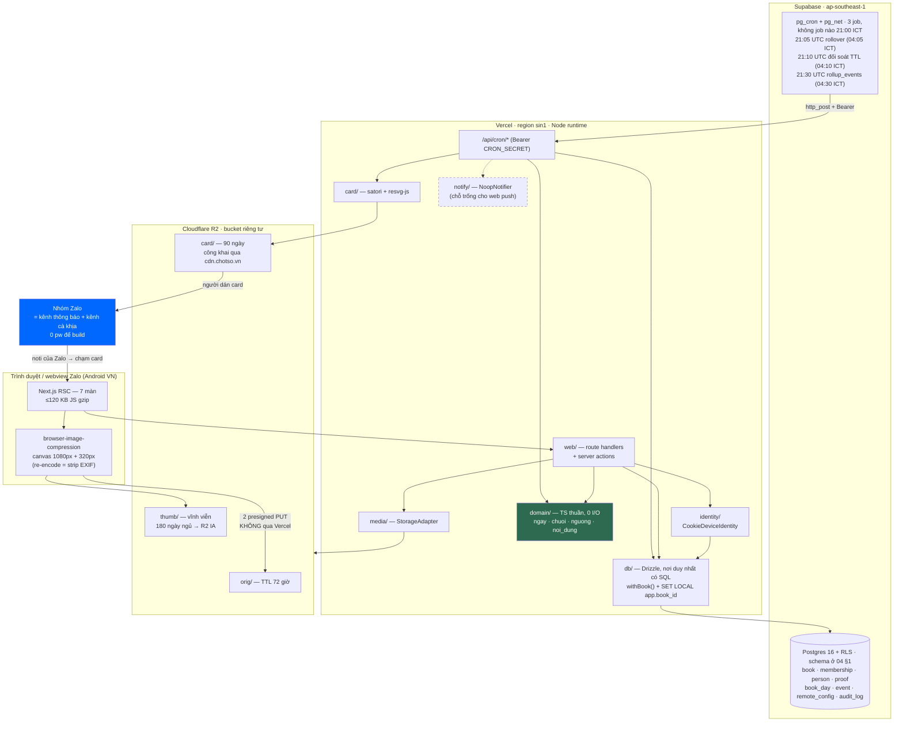

# 03 — KIẾN TRÚC KỸ THUẬT & QUYẾT ĐỊNH STACK

### Sản phẩm: **Chốt Sổ** (`chotso.vn`) — web, không app, nhóm ≤8 người, thị trường VN

> Viết 03/09/2026. Tài liệu nguồn duy nhất: `/home/huypq/teemi/docs/plan/01-dinh-nghia-san-pham-v2.md`.
> Nghiên cứu nền: `r05-tech-stack.md` (giá hạ tầng), `r06-legal-compliance.md` (pháp lý).
> Quy ước: **[FACT + nguồn]** · **[suy luận từ X]** · **[ước lượng]** · **[cần kiểm chứng]**.

> ## ✅ ĐÃ ĐỐI CHIẾU VỚI BẢNG PHÁN QUYẾT TRỌNG TÀI — 2026-09-03
>
> Tài liệu này **đã được rà soát dòng-theo-dòng** với `/home/huypq/teemi/docs/plan/_rulings.md` (ban hành 03/09/2026: 53 phán quyết mâu thuẫn · 25 phán quyết scope creep · 123 dòng từ điển giá trị chuẩn).
>
> **Mọi hằng số trong tài liệu này lấy từ `_rulings.md` mục A.** Nếu một con số ở đây khác với `_rulings.md`, **`_rulings.md` thắng** và đây là lỗi phải sửa, không phải một phương án thay thế.
>
> Chủ quyền của tài liệu này: **CHI PHÍ HẠ TẦNG** (nguyên tắc 2 của bảng phán quyết). Ba kết luận của `03` đã **thắng** ở phán quyết C17 (card TTL 90 ngày / 150 KB), C27 (Supabase Pro $25 bắt buộc từ 02/12, kỳ vọng $28–37/tháng) và C18 (không lưu năm sinh, xoá hai CHECK gọi `now()`).
>
> Tài liệu này **KHÔNG** có chủ quyền về: schema (`04` §1) · định nghĩa metric (`06`) · pháp lý (`05`) · tone/UX (`08`) · sản phẩm (`01-v2`). Ở những chỗ đó tài liệu này **chỉ tham chiếu**, không tự khai.
>
> Sổ cái pw duy nhất: **`docs/adr/pw-ledger.md`** (A87). File ADR duy nhất: **`docs/adr/ADR-000-bat-bien.md`** (A103) — mọi tham chiếu "ADR-001"/"ADR-002" trong bản cũ đã được đổi thành "ADR-000 §2"/"ADR-000 §3".

> ⚠️ **Cảnh báo đọc r05:** r05 khuyến nghị **React Native + Expo SDK 55**. Khuyến nghị đó **đã chết** cùng với quyết định "không ai cài app" ở v2 §1. Mọi con số giá của r05 (R2, Supabase, Twilio, FCM) vẫn dùng được; mọi khuyến nghị *framework* của r05 thì không. Tài liệu này thay thế r05 §1, §3, §10; giữ và tinh chỉnh r05 §2, §4, §7, §8.

---

## 0. TL;DR — bảng chốt một trang

| Lớp | **Chốt** | Bị loại | Chi phí 1k / 10k / 100k DAU |
|---|---|---|---|
| Client | **Next.js 15 App Router, React 19, không PWA, không service worker** | React Native + Expo · Zalo Mini App | (nằm trong hosting) |
| Hosting | **Vercel, region `sin1`, `output: 'standalone'`** | Cloudflare Pages/Workers · VPS tự quản | $0 / $20–35 / $150–300 |
| Database | **Supabase Postgres (ap-southeast-1), truy cập bằng Drizzle qua pooler — KHÔNG dùng `supabase-js`. Bậc Pro $25 BẮT BUỘC từ 02/12/2026** (A74) | Firebase/Firestore · Neon | $25 / $40 / $150–200 |
| Auth | **Cookie HttpOnly 400 ngày + mirror localStorage + mã sổ 6 ký tự để khôi phục. Không OTP, không OAuth** | Phone OTP (ZNS/Twilio) · Zalo Login · Google/Apple · magic link | **$0 ở mọi mốc** |
| Storage ảnh | **Cloudflare R2**, 3 prefix + lifecycle rule | Supabase Storage · Vercel Blob | $0 / $1 / $60 |
| Push | **KHÔNG CÓ. Kênh thông báo là Zalo** | FCM/web push · OneSignal | $0 / $0 / $0 |
| Cron | **pg_cron gọi HTTP endpoint có shared secret. 3 job, không job nào lúc 21:00** | ~~Vercel Cron~~ (loại — xem dưới) · GitHub Actions | $0 |
| Analytics | **Bảng `event` trong chính Postgres (schema ở `04` §1) + 6 truy vấn SQL chạy tay + 2 dòng đèn cảnh báo pháp lý. KHÔNG có UI dashboard ở MVP-0** | PostHog Cloud · Firebase Analytics | $0 (tốn dung lượng DB) |
| Error tracking | **Sentry free → Team** | Không dùng gì · GlitchTip tự host | $0 / $26 / $80 |
| CI/CD | **GitHub Actions + Vercel Git integration**, **9 check bắt buộc** | CircleCI · Vercel-only | $0 |
| **TỔNG** | | | **≈$28 / ≈$93–108 / ≈$456–633/tháng** |

> **Con số $28 ở cột đầu là ngân sách beta có hiệu lực** [A74, thắng ở C27]: Supabase Pro $25 + domain ~$2,5 + Vercel Hobby $0. Dải kỳ vọng chính thức là **$28–37/tháng**. Con số **"~$12/tháng" của v2 Bảng 6** giả định Supabase Free — **không còn hợp lệ từ 02/12/2026** vì Free không có backup hằng ngày. (Dòng R2 riêng của Bảng 6 ghi "~$3/tháng ở 10.000 sổ"; tính lại ở A = 4,0 nó là **~$6** — xem §4b.) Đèn báo động chi phí: **>$60/tháng** (A75). DoD hoá đơn tháng đầu: **≤$40** (A76).

**Ba câu quan trọng nhất của tài liệu này:**
1. Ràng buộc thật không phải tiền, là **giờ code**. Ngân sách: **6,5 pw × 40 giờ = 260 giờ tập trung** (A80, A83), nhưng tốc độ thực là **13 giờ code/tuần** (20 h/tuần × hệ số 0,65 `[không có nguồn]`) ⇒ **1 pw ≈ 3,1 tuần lịch**, 6,5 pw ≈ **20 tuần lịch**, không phải 10 (A80–A82). Mọi quyết định tốn >8 giờ hạ tầng đang tiêu ~3% toàn bộ ngân sách MVP.
2. **`domain/` là code thuần, không I/O.** Mọi kịch bản thoát vendor (Vercel → Docker, Supabase → Postgres VN, R2 → VNG Cloud) đều không chạm vào nó. Đó là toàn bộ chiến lược thoát vendor, gói trong một quy tắc thư mục.
3. Kế hoạch dự phòng "Android web push +0,3 pw" ở H1 vùng xám **có thể không tồn tại** — service worker trong webview Zalo nhiều khả năng không đăng ký được. **Nó đã bị CẮT khỏi MVP-0** [S09] và **không được ghi ở bất kỳ đâu như khoản đã ngân sách**; nó là hạng mục **có điều kiện**. Phải kiểm chứng trong buổi 04/09 (A105), **trước** dòng code đầu tiên (23/09, A110).

---

> ## ➕ BỔ SUNG 04/09/2026 — bốn hạng mục kỹ thuật đã CHUYỂN CHỦ QUYỀN sang `11`
>
> Tài liệu mới **`11-hang-rao-ky-thuat-phap-ly-tien.md`** nhận chủ quyền bốn thứ mà `03` viện dẫn nhưng chưa bao giờ đặc tả. Trích từ `03` phải trích kèm mục của `11`:
>
> | Thứ | Trước 04/09 | Nay ở |
> |---|---|---|
> | **Ai xem được ảnh của ai** (mô hình truy cập, độ khó đoán của từng URL) | chỉ có khối D-06b hỏi founder | **`11` §1** — kèm bản vá bắt buộc: key card phải có `asset_nonce`, vì bản cũ cho phép **đi bộ theo ngày** để tải toàn bộ card của một sổ từ MỘT link bị forward |
> | **Rate limit và chống lạm dụng** | không có dòng nào | **`11` §2** — 7 luật, một bảng `rate_bucket`, 0,10 pw. Trong đó luật `code6` là load-bearing: không có nó, ở 60 sổ một script tìm ra một sổ sống trong **2,2 giờ** |
> | **Xử lý khi vượt quota / chi phí bất thường** | chỉ có đèn >$60 (A75) | **`11` §3** — thang 4 nấc nối vào `signup_paused`/`service_paused` đã có, 0 pw. Kèm chứng minh **R2 = $0 trong toàn bộ vòng đời hợp pháp** |
> | **Backup & khôi phục** | chữ "backup" xuất hiện 9 lần làm lý do mua Pro $25, **không lần nào nói khôi phục thế nào** | **`11` §4** — R2 hiện **KHÔNG có bản sao nào**; `rclone sync` hằng tuần + 1 diễn tập trước 02/12, 0,05 pw |
>
> Bốn hạng mục cộng **+0,25 pw**, **CHƯA ghi vào `docs/adr/pw-ledger.md`** (A87). Xem `11` §8 khối **D-11**.

## 1. RÀNG BUỘC THIẾT KẾ — dịch ra thành luật kỹ thuật

Mỗi ràng buộc phải đẻ ra một **luật kiểm tra được**, nếu không nó chỉ là lời than.

| # | Ràng buộc | Nguồn | Luật kỹ thuật rút ra | Kiểm tra bằng |
|---|---|---|---|---|
| R1 | 1 dev, 20h/tuần ⇒ **13 giờ code/tuần** (hệ số 0,65 `[không có nguồn]`). Trần backlog **6,5 pw = 260 giờ tập trung ≈ 20 tuần lịch** | A80–A83 (v2 §4.10 + `02` §3.2) | Không tự vận hành bất kỳ tiến trình nào. Không có thành phần nào cần `ssh` để sửa | Đếm số dịch vụ phải tự patch: mục tiêu **0** |
| R2 | Ngân sách hạ tầng beta **$28–37/tháng**, trần <$50, đèn báo động **>$60** | A74–A76 (`03` §2.3+§5+§9 B6, thắng ở C27) | Mọi dịch vụ phải đủ cho **≤30 sổ đợt 2** (A91) ở bậc thấp nhất, và có bậc trả tiền tuyến tính (không có bậc nhảy $200). **Supabase Pro $25 là khoản cố định, không phải tuỳ chọn** | Bảng §5 + §7 |
| R3 | Android là đa số nhưng **KHÔNG phải ">85%"** — ✅ **D-08 đã đóng 04/09/2026**: StatCounter T8/2026 VN = **Android 57,33% · iOS 42,64%**; nhãn `[FACT]` của ">85%" **bị thu hồi** | `docs/adr/ADR-003-thi-phan-android-vn.md` (thay r02 / r05 §1.1 / `08` §8.2) | **Ngân sách JS ≤120 KB gzip** trên route Sổ hôm nay. Ảnh nén ở client, không ở server | CI check `budget:js` |
| R4 | Mọi lưu lượng vào qua **webview Zalo** | v2 §3 bước 2 | Không dựa vào: OAuth popup, service worker, `Notification API`, `navigator.share` (có fallback), IndexedDB bền, localStorage bền | **Ma trận ≥3 máy Android thật + 1 iPhone**, buổi kiểm chứng **04/09/2026, 7 câu** (§8, A105). Phương án B cho `navigator.share` đã viết sẵn: §10 khối **D-09** |
| R5 | Nội địa hoá dữ liệu có thể bị áp | NĐ 53/2022 Điều 26 [FACT r06 §2.5] | Không dùng dịch vụ độc quyền của một vendor cho: DB, storage, cron, auth, render | Job CI `docker-compose` §6 |
| R6 | Phải thoát vendor được | v2 §9 mục 2 (**ADR-000 §2**, A103) | 4 luật portability §6.1 | Job CI `docker-compose` §6 |
| R7 | Giữ miễn trừ Điều 38.2 Luật 91/2025 | r06 §4.2 [FACT] | Strip EXIF ở client · không face detection · không toạ độ · không taxonomy sức khoẻ | Test đơn vị + review schema |
| R8 | Bus factor = 1, **SLA KÉP** [CHỐT 2026-08-28, QĐ-17 · A59]: **48 giờ** cho khiếu nại người dùng · **24 giờ, khẩn cấp 6 giờ** cho yêu cầu của cơ quan nhà nước (luật định, không thương lượng) | v2 §10(d) + Luật ANM 116/2025 + `05` BĐ#5 | Phải có **kill switch không cần deploy** (`remote_config['service_paused']`), **script khoá một sổ khẩn cấp**, và một `RUNBOOK.md` người khác đọc hiểu (nội dung bắt buộc: **§10 khối D-07**, ba thứ). Trang chính sách in **cả hai** con số. Cơ chế xử report: **auto-hide TOÀN CỤC ngay ở report đầu tiên** (A60) | Diễn tập 1 lần trước beta, **và một lần nữa trước 03/02/2027** (founder vắng 03–13/02/2027; cửa sổ freeze = **10 ngày sổ**, `book_date` 2027-02-03 → 2027-02-12, A120) |
| R10 | **Nghĩa vụ lưu vết ≥2 năm** (IP, login/logout, giao dịch) | `05` GIAI ĐOẠN 2 (QĐ-19) · **A49** | Bảng **`audit_log` có từ migration đầu tiên** — "rẻ nhất khi làm sớm, **không thể làm bù**". Schema ở `04` §1. **+0,15 pw đã ghi `docs/adr/pw-ledger.md`** | Migration đầu tiên phải chứa bảng này; test CI kiểm bảng tồn tại |
| R9 | Cao điểm dồn 21:00–23:00, không có san bằng ngày đêm | v2 §3, §4.1 | Cả **ba** cron nằm gọn trong cửa sổ **04:05–04:30 ICT** (A03/A05), **không job nào chạm 21:00** (A04 đã cắt `mo_chot_so`). Provision theo đỉnh, không theo trung bình | Đo p95 trong cửa sổ 21–23h |

> **R9 là đặc điểm kiến trúc riêng của sản phẩm này và không tài liệu nào trước đó nêu.** Một app thường có tải trải đều 16 giờ. Chốt Sổ dồn ~70% toàn bộ request vào 3 giờ [suy luận từ v2 §3: giờ chốt sổ 21:00, ngày kết thúc 03:59]. Tỉ số đỉnh/trung bình ≈ **5–6×**. Hệ quả: mọi tính toán "qps trung bình" trong tài liệu này phải nhân 6 trước khi chọn cấu hình máy.

---

## 2. QUYẾT ĐỊNH STACK — từng lớp

### 2.1. Client

| | |
|---|---|
| **Chọn** | **Next.js 15 App Router + React 19 + TypeScript. Server Components mặc định. Tailwind. KHÔNG service worker, KHÔNG manifest PWA, KHÔNG offline mode ở MVP.** |
| Loại #1 | **React Native + Expo** (khuyến nghị của r05) — mâu thuẫn trực tiếp với câu bán 13 từ. Kèm EAS $1.326/tháng ở 100k MAU [FACT r05 §1.5], review store, chiến tranh ROM. |
| Loại #2 | **Zalo Mini App** — `docs.zaloplatforms.com`: không có API trả group id/danh sách thành viên khi mở từ nhóm chat [v2 §6 mục 10]; duyệt 3–5 ngày mỗi lần cập nhật, giết vòng lặp sửa lỗi ngắn — thứ v2 §9 mục 4 gọi là **moat duy nhất trong 6 tháng đầu**. |
| Loại #3 | SvelteKit / Astro — bundle nhỏ hơn thật, nhưng hệ sinh thái `satori` + hosting + tài liệu đều xoay quanh React. Với 260 giờ (6,5 pw × 40 giờ, A80/A83), tốc độ founder thắng 30 KB. |
| **Lý do** | 7 màn, mỗi màn 1–3 query. RSC cho phép render server-side, đẩy gần như toàn bộ logic ra khỏi bundle. Sửa copy = `git push`, sống 3 phút sau, không qua ai duyệt. |
| **Điều kiện đổi ý** | (a) **`sổ-D28 ≥ 35%` trên n ≥ 24 sổ, in kèm KTC 95% ±17 điểm** (A24-A25), đọc ở cổng G2 **26/01/2027** (A118) → mở nấc app native (v2 §6 mục 2). (b) Đo được p75 Largest Contentful Paint trong webview Zalo trên Redmi tầm trung **>3,5s** → cân nhắc chuyển sang render HTML tĩnh + island (Astro), +0,5 pw. |

**Ngân sách hiệu năng — biến câu bán thành số kiểm tra được.** Toàn bộ luận điểm của v2 là "chạm card → thấy sổ" nhanh hơn "mở app". Nếu trang mất 5 giây trong webview Zalo thì luận điểm sai và không có feature nào cứu được.

| Chỉ số | Trần | Đo ở đâu |
|---|---|---|
| JS gzip route `/s/[code]` | **≤120 KB** | CI, fail build nếu vượt |
| HTML + CSS lần đầu | ≤40 KB | CI |
| LCP p75 trên Redmi Note tầm trung, 4G, webview Zalo | **≤2,5 s** | Đo tay, 4 máy, mỗi lần release |
| Ảnh trên màn Sổ hôm nay | chỉ thumb 320px (~18 KB), tối đa 8 tấm | Snapshot test |

### 2.2. Hosting / runtime

| | |
|---|---|
| **Chọn** | **Vercel**, function region **`sin1` (Singapore)**, `next.config: { output: 'standalone' }`, **Node runtime — không dùng Edge runtime**. |
| Loại #1 | **Cloudflare Workers/Pages** — Next.js chạy được qua OpenNext nhưng thêm một lớp adapter phải tự debug; `@resvg/resvg-js` là native binary, không chạy trên Workers. Đổi lấy $0 nhưng tốn giờ founder ở đúng chỗ ít giá trị nhất. |
| Loại #2 | **VPS tự quản ($6 Hetzner/Vultr)** — rẻ nhất về tiền, đắt nhất về giờ: TLS, deploy, log, restart, backup, patch kernel. Vi phạm R1. |
| **Lý do** | Preview deploy mỗi PR thay hẳn môi trường staging. Rollback 1 click — với bus factor 1 lúc 23:30 thứ Bảy, đó là tính năng an toàn, không phải tiện nghi. |
| **Điều kiện đổi ý** | (a) Luật sư trả lời "máy chủ phải ở VN" → §8 E1. (b) Hoá đơn Vercel >$150/tháng → tách riêng phần render card (§5c). (c) Có doanh thu → **bắt buộc rời Hobby lên Pro $20** (Hobby cấm dùng thương mại). **Nhánh (c) KHÔNG kích hoạt trong 6 tháng đầu**: doanh thu = **0đ TUYỆT ĐỐI**, kể cả quảng cáo, kể cả donate (A62/C01) ⇒ Hobby hợp lệ, $0. |

**Bốn thứ tuyệt đối không dùng, dù Vercel mời:** Vercel Postgres · Vercel KV · Vercel Blob · `@vercel/og` trên Edge runtime. Mỗi thứ trong đó biến kịch bản E1 từ 8 giờ thành 1 tuần.

### 2.3. Database

| | |
|---|---|
| **Chọn** | **Supabase Postgres 16, region `ap-southeast-1` (Singapore).** Truy cập **chỉ từ server Next.js**, qua **Drizzle ORM + `postgres.js`** trỏ vào **Transaction Pooler (port 6543)**. **Không dùng `supabase-js`, không dùng PostgREST, không dùng Supabase Auth, không dùng Supabase Storage.** |
| Loại #1 | **Firebase / Firestore** — không phải SQL, không `pg_dump`, Security Rules khó test. Với NĐ 53/2022 treo trên đầu, chọn một DB không xuất được ra là tự khoá tay. |
| Loại #2 | **Neon / PlanetScale** — Postgres tốt, nhưng thiếu `pg_cron` (Neon có Scheduled Queries dạng beta [cần kiểm chứng]) và không rẻ hơn đáng kể ở quy mô này. |
| **Lý do** | Ta chỉ cần **một Postgres được quản lý có `pg_cron` và có backup**. Supabase là cách rẻ nhất để có đúng ba thứ đó. Việc *không* dùng 4 sản phẩm còn lại của Supabase là quyết định cố ý: nó biến Supabase thành một nhà cung cấp Postgres có thể thay trong một buổi chiều. |
| **Điều kiện đổi ý** | (a) Cần server ở VN → §8 E2. (b) Vượt 8 GB DB mà nguyên nhân là bảng `event` → rollup trước, không nâng bậc. |

**Bậc giá [FACT r05 §2.1, supabase.com/pricing]:** Free (500 MB DB, 5 GB egress, **không có backup hằng ngày**, project tự ngủ sau 7 ngày không hoạt động) · Pro $25 (8 GB DB, 250 GB egress, PITR mua thêm) · compute add-on: Small $15 / Medium $60 / Large $110 / XL $210.

> **Bất đồng nhỏ với v2 Bảng 6:** "hạ tầng ~$12/tháng" giả định Supabase Free. Free **không có backup hằng ngày**. Sản phẩm này hứa giữ **thumbnail VĨNH VIỄN** (A38 — 180 ngày ngủ ⇒ R2 IA, **không xoá**; chỉ xoá khi `archived` + báo trước 30 ngày + có đường tải về); mất DB một lần là mất toàn bộ tài sản của mọi sổ và không có đường phục hồi. (**Lưới 30 ngày đã bị CẮT khỏi MVP-0** — A86/S14, đẩy sang T13+ — nên lời hứa còn sống chỉ là thumbnail, và đúng lời hứa đó mới là thứ đòi backup.) **Từ ngày beta chạy (02/12/2026) phải là Pro $25.** Ngân sách thật: **$28–37/tháng**, không phải $12. Vẫn dưới trần $50.

**RLS — dùng, nhưng đúng vai.** Vì mọi truy cập đều đi qua server, RLS không phải cơ chế uỷ quyền chính; nó là **lớp phòng thủ thứ hai chống một câu `WHERE` bị quên**. Một lần rò ảnh sang sổ khác là chấm dứt sản phẩm "sổ kín".

```sql
-- tên bảng/cột theo `04` §1 (A29-A33). Tài liệu này KHÔNG tự khai schema.
alter table proof enable row level security;
alter table proof force row level security;
create policy book_scope on proof
  using (book_id = current_setting('app.book_id', true)::uuid);
```
Repository mở transaction, `SET LOCAL app.book_id = $1`, rồi mới query. Chi phí: **~4 giờ**, một lần. Kèm lint CI: chuỗi `` sql` `` không được xuất hiện ngoài `src/db/`.

### 2.4. Auth — bài toán đắt nhất, giải bằng cách không giải

Đây là mục r06 và r05 va nhau trực diện, và v2 chọn đúng.

**Bốn phương án, giá thật:**

| Phương án | Giá/lần xác thực | Điều kiện tiên quyết | Chạy trong webview Zalo? | Có thoả NĐ 147 không? |
|---|---|---|---|---|
| **Twilio SMS → VN** | **$0,2852** (~7.500đ) [FACT twilio.com/sms/pricing/vn] | Đăng ký brandname NĐ 91/2020, duyệt hàng tuần–tháng | ✅ | ✅ |
| **Zalo ZNS OTP** | **300đ** (~$0,011) [FACT smsthuonghieu.com/gia-zns] | **Cần Zalo OA đã xác thực → cần pháp nhân** [cần kiểm chứng, nhưng nếu đúng thì đây không phải phương án dự phòng của founder chưa có pháp nhân] | ✅ | ✅ |
| **Google Sign-In** | $0 | Google Cloud project | ❌ **Google chặn OAuth trong embedded webview** (`disallowed_useragent`) → phải nhảy ra trình duyệt ngoài, phá vỡ luồng 27 giây | ❌ |
| **Apple Sign-In web** | $0 | Apple Developer $99/năm | ⚠️ | ❌ |
| **Zalo Login (OAuth của VNG)** | $0 | Đăng ký app trên developers.zalo.me + duyệt | ✅ (chạy tốt nhất trong webview Zalo) | ❌ |
| **Magic link email** | $0 (Resend free 3k/tháng) | mailbox | ✅ | ❌ |
| **Không tài khoản: cookie + mã sổ** ✅ **CHỌN** | **$0** | không có | ✅ | ❌ |

**Chốt: không có tài khoản. Danh tính là một cookie ký, phạm vi một sổ.**

Nhưng **v2 §5 viết "device token trong `localStorage`" và đó là chỗ tôi không đồng ý.** `localStorage` là script-writable storage: trên WebKit (Safari + mọi webview iOS, gồm webview Zalo) nó bị xoá sau 7 ngày không tương tác; và webview của app khác có thể bị dọn bất cứ lúc nào. Một người đi du lịch 8 ngày về mất danh tính, thấy sổ của mình như người lạ — đó là lỗi giết retention mà không ai báo cáo.

**Thiết kế danh tính 3 lớp (thay cho 1 lớp):**

| Lớp | Cơ chế | Vì sao |
|---|---|---|
| L1 — chính | **Cookie `Set-Cookie` từ server: `HttpOnly; Secure; SameSite=Lax; Max-Age=34560000` (400 ngày)** | Cookie do **HTTP header** đặt ở first-party bền hơn hẳn cookie/`localStorage` do JS đặt trên WebKit. Chrome trần 400 ngày. Rẻ như nhau, bền hơn nhiều |
| L2 — gương | Cùng token, mirror sang `localStorage`; nếu request đến mà thiếu cookie nhưng client gửi kèm token từ L2 → server cấp lại cookie | Bắt trường hợp cookie bị dọn nhưng storage còn, và ngược lại |
| L3 — khôi phục | **Mã sổ 6 ký tự + chọn tên mình trong danh sách thành viên** | Đường cuối. Không mật khẩu, không email, không SMS |

**Nói thẳng mô hình đe doạ, vì nó sẽ bị hỏi:** L3 nghĩa là **bất kỳ ai có mã sổ đều mạo danh được một thành viên**. Trong bối cảnh ≤8 người bạn ngoài đời, kẻ tấn công là bạn mình và phần thưởng là đăng hộ một tấm ảnh — rủi ro chấp nhận được. Nó **hết chấp nhận được** ngay khi: sổ >8 người · có tiền/phần thưởng thật · có người lạ · hoặc `goal_text` bị đưa ra ngoài. Ghi ngưỡng vào ADR hôm nay.

**Chỉ số phải đo từ ngày đầu:** `identity_recovery_rate` = (số lần dùng L3) ÷ (số người-tuần hoạt động).
- **<5%/tuần** → thiết kế đúng, không làm gì.
- **5–10%** → giảm ma sát L3 (link khôi phục ngay trên màn Sổ).
- **>10%/tuần** → **cắm `ZaloLoginIdentity`** (+0,4 pw). Đây là lý do `identity/` phải là một interface từ commit đầu, chi phí 0.

**Khi nào phải quay lại phone OTP:** đúng một điều kiện — **đèn đỏ pháp lý** [CHỐT 2026-08-28, QĐ-04]: `monthly_visits` chạm **8.500** HOẶC `monthly_active_persons` chạm **850** trong một tháng dương lịch. **KHÔNG dùng con số "700 người dùng thường xuyên" nữa** — ngưỡng NĐ 147/2024 là **OR** và nhánh `10.000 lượt truy cập/tháng` bind trước ~2,5 lần (`05` §0 kết luận 2), nên mốc 700 báo động **muộn 2,5 lần**. Lúc chạm đèn đỏ, xác thực bằng SĐT VN có thể là **nghĩa vụ pháp lý** [FACT r06 §2.4 — nhưng xem câu 2 gửi luật sư ở `05` §11: nghĩa vụ này **có thể áp cả cho tier Giấy xác nhận thông báo**, tức sớm hơn ~4 lần]. Chi phí tại thời điểm đó:

| Số tài khoản phải xác thực | Twilio ($0,2852) | ZNS (300đ) | SMS brandname (600–1.000đ) |
|---|---|---|---|
| 1.000 | $285 (7,5 triệu đ) | **300.000đ** | 600k–1 triệu đ |
| 10.000 | $2.852 (75 triệu đ) | **3 triệu đ** | 6–10 triệu đ |
| 100.000 | $28.520 (750 triệu đ) | **30 triệu đ** | 60–100 triệu đ |

> Tiền không phải điểm chết ở đây — **thời gian chờ mới là**: lập pháp nhân + xin OA/brandname + duyệt = hàng tuần đến hàng tháng. Vì vậy cảnh báo phải là **hai counter, đèn vàng ở 60% ngưỡng** (`monthly_visits` 6.000 / `monthly_active_persons` 600), và phải là hai dòng tự động trong `/admin`, không phải một việc để nhớ.

**Hành động bắt buộc ở mỗi mức đèn — đây là quy trình, không phải gợi ý:**

| Đèn | Ngưỡng (OR, chạm một trong hai là kích hoạt) | Hành động **trong ngày** |
|---|---|---|
| 🟡 **Vàng** | `monthly_visits ≥ 6.000` **HOẶC** `monthly_active_persons ≥ 600` (A54) | Bắt đầu **soạn hồ sơ Giấy phép MXH** (A57 — 3–6 tháng, cần pháp nhân VN + người chịu trách nhiệm nội dung quốc tịch VN). Chưa đụng tới kiến trúc. |
| 🔴 **Đỏ** | `monthly_visits ≥ 8.500` **HOẶC** `monthly_active_persons ≥ 850` (A54) | **DỪNG NHẬN SỔ MỚI NGAY TRONG NGÀY** — tắt bằng `remote_config['signup_paused'] = true`, không cần deploy — **cộng** cân nhắc bật phone OTP (A58). Hai việc, không phải một. |

> **Định nghĩa hai counter (tạm, chờ luật sư — A56):** `monthly_active_persons` = số `person` khác nhau có ≥1 `proof` trong 30 ngày · `monthly_visits` = số phiên khác nhau (phiên mới sau **30 phút** không hoạt động) chạm **bất kỳ route nào, kể cả trang public**. **Đếm rộng, báo động sớm.** Hệ quả kiến trúc: `monthly_visits` phải đếm session **từ dòng code đầu tiên** — nó **không backfill được** (A55).
>
> **Quy đổi sang số sổ (A73, dùng A = 4,0 và 25 lượt/người/tháng):** đèn vàng 6.000 lượt ÷ 25 = 240 người ÷ 4,0 = **60 sổ** · đèn đỏ 8.500 lượt ≈ **85 sổ** · ngưỡng luật 10.000 lượt ≈ **100 sổ**. **60 sổ là trần PHÁP LÝ, không phải mục tiêu vận hành** (A93) — trần vận hành thấp hơn: **35 sổ sống cùng lúc** (A92).

### 2.5. Storage ảnh

| | |
|---|---|
| **Chọn** | **Cloudflare R2**, một bucket riêng tư `chotso-media`, ba prefix, lifecycle rule thuần cấu hình. |
| Loại #1 | **Supabase Storage** — egress **$0,09/GB** [FACT supabase.com/pricing]; ở 100k DAU đắt hơn R2 ~4,6× [r05 §4.3]. |
| Loại #2 | **Vercel Blob** — tính tiền cả storage lẫn egress, và khoá cứng vào Vercel, phá E1. |
| **Lý do** | Egress **$0** [FACT developers.cloudflare.com/r2/pricing], S3-compatible (nên đổi sang VNG/Viettel là đổi endpoint), lifecycle rule làm phần chính của TTL 72h (A36); **job đối soát 04:10 ICT (A05) chỉ là lưới an toàn, không phải cơ chế chính**. |
| **Điều kiện đổi ý** | Yêu cầu nội địa hoá → §8 E3. |

**Bố cục key và vòng đời:**

| Prefix | Nội dung | Kích thước | Lifecycle rule | Cách phục vụ |
|---|---|---|---|---|
| `orig/<book>/<date>/<person>/<client_proof_id>.jpg` **(A34)** | ảnh gốc đã nén 1080px | **~110 KB** `[chưa đo — phải đo trên 20 ảnh Android thật trước khi tin]` (A37) | **TTL 72 giờ** (A36) — R2 Lifecycle **+ job đối soát 04:10 ICT** (A05) | presigned GET, TTL 10 phút |
| `thumb/<book>/<date>/<person>/<client_proof_id>.jpg` **(A35)** | 320px | **~18 KB** (A39) | **VĨNH VIỄN** (A38) — chỉ xoá khi `book.status='archived'` + báo trước **30 ngày** + có đường tải về. ⚠️ Vế *"180 ngày sổ ngủ ⇒ chuyển R2 Infrequent Access"* của A38 **KHÔNG thi hành ở MVP-0**: biểu giá công bố 04/09 cho thấy IA tiết kiệm **$0,00** ở trần 60 sổ (0,83 GB, nằm trong free tier 10 GB) nhưng làm **Class B đắt 2,5×** và thêm **phí lấy dữ liệu $0,01/GB** — xem `11` §7.4 + Bất đồng #1. Mở lại khi `thumb/` > 100 GB | presigned GET theo lô |
| `card/<book>/<date>-<asset_nonce>.png` **(A35 + bản vá `11` §1.2, 04/09)** | card 4:5 đã render | **150 KB** (A41 — một con số duy nhất, thay "180 KB" của bản `04` cũ) | **TTL 90 ngày** (A40) → thay bằng **ảnh tĩnh trung tính, KHÔNG 404** | **công khai qua `cdn.chotso.vn`, cache 1 năm** |

> **Vì sao key ảnh gốc phải là bản của `04` §5.2 (A34), không phải `orig/{so}/{date}/{tam_id}.jpg` của bản cũ:** `tam_id` do **server** sinh ⇒ mỗi lần retry upload tạo một key mới ⇒ upload đứt trên 4G để lại rác và **không idempotent**. `client_proof_id` do **client** sinh ⇒ retry ghi đè đúng key. Đây là phán quyết C02.
>
> **Vì sao key card không cần nanoid:** `<book>` là `book_id` (UUID v4) ⇒ đã không đoán được. Chuỗi để **xem** trang public là `card.share_token` — **độc lập hoàn toàn** với `book.code`, **TTL 7 ngày**, `noindex` + `robots.txt` (A42). Ba chuỗi, ba vai, không suy ra được từ nhau: `book.code` (VÀO) · `share_token` (XEM trang) · `book_id` (khoá R2).

> **Vấn đề mà v2 chưa nêu: card KHÔNG ĐƯỢC hết hạn.** Card sống trong lịch sử chat Zalo. Nếu dùng presigned URL, sau 10 phút cả nhóm cuộn lại thấy một dãy ảnh vỡ — đó là thiệt hại thương hiệu diễn ra chậm và không ai báo. Vì vậy card phải nằm ở URL **công khai, khoá không đoán được, cache dài**. Đổi lại: ai có link đều xem được card (gồm thumbnail của thành viên). Đây là **quyết định quyền riêng tư**, phải ghi vào Chính sách và hỏi founder — xem **§10 khối D-06b**, hạn **07/09/2026**. Sau 90 ngày, key được thay bằng một ảnh tĩnh trung tính thay vì 404, để lịch sử chat không bao giờ có ảnh vỡ.

### 2.6. Push notification

| | |
|---|---|
| **Chọn** | **Không có push. Kênh thông báo duy nhất là noti của Zalo, do một người thật dán card.** |
| Loại #1 | **FCM / Web Push** — xem phân tích rủi ro ở §5c. |
| Loại #2 | **ZNS nhắc nhở** — 300đ/tin × **4,0 người/sổ** (A70) × 30 ngày = **36.000đ/sổ/tháng** [giá tin: FACT r06/v2; hệ số người/sổ: A70]; ở 1.000 sổ là **36 triệu đ/tháng**. Không thể là mặc định. _(Bản cũ tính ở 5 người/sổ ⇒ 45.000đ — hệ số 5 đã bị A70 bác.)_ |
| **Lý do** | Zalo là app duy nhất 100% ROM Việt whitelist sẵn [suy luận từ r05 §3.2 + v2 §3]. Không có push của mình ⇒ không có gì để Xiaomi/Oppo/Vivo giết, và không có gì để spam. |
| **Điều kiện đổi ý** | H1 rơi vùng xám 40–60% (v2 §11) → Android web push, **và chỉ sau khi kiểm chứng được service worker đăng ký được ở đâu** (§5c). |

### 2.7. Cron / scheduled job

> ✅ **[KIỂM CHỨNG 04/09/2026 — quyết định chọn `pg_cron` được xác minh là BẮT BUỘC, không phải sở thích]** Vercel Cron trên gói **Hobby** bị giới hạn **tối đa 1 lần/ngày mỗi job**, và **thời điểm chỉ được đảm bảo trong phạm vi MỘT GIỜ** — một job đặt 04:05 có thể chạy bất kỳ lúc nào trước 05:00. Biên **120 giây** mà `04` §3.5 dựng cho `rollover` **không thể** đạt bằng Vercel Cron ở gói Hobby. Nếu ai đó sau này định "đơn giản hoá" bằng cách chuyển sang Vercel Cron, đây là dòng chặn việc đó. Nguồn: `11` §7.1.

| | |
|---|---|
| **Chọn** | **`pg_cron` trong Supabase**, mỗi job chỉ làm **một việc: `pg_net.http_post` tới một endpoint Next.js có `Authorization: Bearer <CRON_SECRET>`.** Logic nằm trong Next.js, không nằm trong PL/pgSQL. |
| Loại #1 | **Vercel Cron** — bậc Hobby giới hạn 2 job, tần suất 1 lần/ngày và **chạy "trong khoảng một giờ"**, không đúng phút. Ranh giới 04:00 và cú lật 21:00 cần đúng phút. |
| Loại #2 | **GitHub Actions `schedule`** — lệch 5–15 phút là chuyện thường, và dùng hệ thống CI làm scheduler production là anti-pattern: một lần hết quota là mất rollover. |
| **Lý do** | Đúng phút, cùng nơi với dữ liệu, $0, và VN không có DST nên `04:00 ICT = 21:00 UTC` là hằng số vĩnh viễn [FACT]. |
| **Điều kiện đổi ý** | Rời Supabase → thay bằng `node-cron` trong container hoặc Cloudflare Worker Cron Trigger. **Vì logic nằm sau một HTTP endpoint, việc thay scheduler là 15 phút.** |

**Ba job, và nguyên tắc quan trọng nhất về chúng:**

| Job | Lịch (UTC) | Việc | Hỏng thì sao? |
|---|---|---|---|
| `rollover` | **`5 21 * * *` (= 04:05 ICT)** [CHỐT 2026-08-28, QĐ-21] | Chốt sổ ngày hôm trước: đếm có mặt, tính `counted`, tiêu van, cập nhật chuỗi, cập nhật cache 3 con số | **Không sao.** Chạy lại là đủ |
| ~~`mo_chot_so`~~ | — | **ĐÃ CẮT** [CHỐT 2026-08-28, QĐ-22]. Trạng thái "sẵn sàng chốt" suy ra được từ giờ server bằng một phép so sánh; v2 §4.7 nói rõ hệ thống **không gửi gì** lúc 21:00, nên job này không có tác dụng phụ nào để mất. −0,10 pw, ghi vào sổ cái | — |
| `orig_ttl_audit` | **`10 21 * * *` (= 04:10 ICT)** [A05, `04` §6.1] | **Đối soát TTL ảnh gốc:** liệt kê `orig/` cũ hơn 72 giờ (A36) mà R2 Lifecycle bỏ sót, xoá thẳng, ghi số lượng vào `audit_log`. Lifecycle rule của R2 là *eventually consistent*; lời hứa "xoá sau 72 giờ" nằm trong Chính sách quyền riêng tư nên phải có bên kiểm | **Có sao.** Bỏ 1 ngày = ảnh gốc sống quá hạn công bố ⇒ phải chạy bù ngay, và ghi lại trong `RUNBOOK.md` |
| `rollup_events` | `30 21 * * *` (= 04:30 ICT) | Gộp event thô thành bảng ngày, xoá raw >90 ngày | Không sao |

> **Vì sao ba job vẫn là ba dù đã cắt `mo_chot_so`:** `mo_chot_so` (21:00 ICT) bị **CẮT** (A04/C15, −0,10 pw đã ghi `docs/adr/pw-ledger.md`) và chỗ trống của nó được lấp bởi `orig_ttl_audit` 04:10 (A05) — một job **nghĩa vụ pháp lý**, không phải một job tính năng. Cả ba job đều nằm trong cửa sổ 04:05–04:30 ICT, tức **không job nào chạm giờ cao điểm 21:00–23:00** (R9).

> **[CHỐT 2026-08-28 — QĐ-21] Vì sao rollover phải là 04:05, không phải 04:00.** `04-data-model-va-co-che.md` §3.4 đặt **biên nộp muộn kỹ thuật 120 giây** tính trên `intent_at`: một tấm bấm Gửi lúc 03:59:40 và commit lúc 04:00:20 vẫn phải rơi vào ngày cũ. Lịch `0 21 * * *` chạy **đúng 04:00:00 ICT**, tức **trước cả biên 120 giây** — tấm đó sẽ rơi vào một `book_day` đã ghi xong, và kết quả là **hoặc mất ngày, hoặc vi phạm bất biến "book_day bất biến"** mà toàn bộ §1.5 của `04` dựa vào (trigger `book_day_monotonic` sẽ raise). `04` §3.5 đã đặt đúng: 04:05 = sau biên 120 giây + 3 phút đệm. Bảng này sửa theo.

> **Luật bất biến: cron KHÔNG được là điều kiện đúng đắn của dữ liệu.** `book_date` là cột generated; chuỗi và số ngày tính là **hàm thuần trên bảng `proof`**; cron chỉ *vật chất hoá* kết quả vào cache. Founder ngủ quên, Supabase bảo trì, pg_net timeout — sổ vẫn đúng, chỉ là con số hiển thị chậm một nhịp. Với bus factor 1, đây là quyết định kiến trúc có giá trị cao nhất trong toàn tài liệu. Mọi job phải **idempotent**, khoá bằng `unique(book_id, book_date, job_kind)`.

### 2.8. Analytics

| | |
|---|---|
| **Chọn** | **Bảng `event` trong chính Postgres (schema ở `04` §1, danh mục 32 event ở `04` §7.1) + trang `/admin` với đúng **6 truy vấn SQL viết cứng** (S08 — không có UI dashboard ở MVP-0).** Đơn vị hàng đầu là `book_id` (A30). |
| Loại #1 | **PostHog Cloud** — free 1M event/tháng, nhưng: (a) mô hình tư duy xoay quanh **user**, trong khi P10 bắt buộc đơn vị là **sổ**; (b) thêm một bản sao dữ liệu cá nhân ra nước ngoài → thêm một processor phải công bố và thêm rủi ro NĐ 330/2026 (phạt tới **5% doanh thu**). |
| Loại #2 | **Firebase Analytics** — schema cứng, thuộc Google, tệ hơn ở cả hai tiêu chí trên. |
| **Lý do** | Đây là sản phẩm mà **định nghĩa chỉ số là phần khó, không phải công cụ**. `group_alive = ≥3 người nộp tấm trong 7 ngày gần nhất` là một câu SQL 6 dòng. Mua một SaaS để rồi phải bẻ nó về đơn vị sổ là tốn giờ ở sai chỗ. |
| **Điều kiện đổi ý** | Khi có >3 người cần đọc dữ liệu, **hoặc** khi thời gian truy vấn tay vượt 2 giờ/tuần → mua PostHog và công bố nó là bên thứ ba nhận dữ liệu. |

**Bốn event an toàn bắt buộc có trước dòng code đầu tiên** (v2 §8, phản biện #22): `member_left{misses_7d, was_removed_by_moderation}` (A52 — `was_kicked` đã đổi tên, `hearts_recv_14d` không tồn tại) · `report_created` / `report_resolved` · `safety_screen_shown{reason_bucket}` · `proof_deleted_by_self`. Cộng: `identity_recovery_used`, `card_rendered`, `card_opened{within_h}`, `submit_failed{reason}` (đo R4), và hai event đèn pháp lý `visits_alert` (28) / `persons_alert` (29) (A55). Danh mục đầy đủ **32 event** ở `04` §7.1 (A51) — tài liệu này chỉ tham chiếu, không tự khai.

> **Lưu ý đo H1 ở Bước 0:** `card_opened` **chưa tồn tại** trong 14 ngày Bước 0 (08–21/09) vì chưa có dòng code sản phẩm nào. Thiết bị đo H1 ở Bước 0 là **shortlink 8 sổ × 14 ngày = 112 link** của bên thứ ba (A22), và H1 lúc đó **chỉ có quyền DỪNG khi `click-shortlink < 40%`** (A21).

**Cảnh báo dung lượng — khoản dễ nổ thứ hai sau Vercel.** Ở 100k DAU: ~15 event/người/ngày × 100k = 1,5M/ngày = **45M dòng/tháng**, ~200 byte/dòng ⇒ **~9 GB/tháng**. Supabase Pro có 8 GB. **Phải rollup từ đầu**, không phải khi vỡ: giữ raw 90 ngày, giữ bảng gộp ngày (`book_id`, ngày, tên event, count — tên và cột theo `04` §1) vĩnh viễn; bảng đó ~1/500 dung lượng.

### 2.9. Error tracking

| | |
|---|---|
| **Chọn** | **Sentry**, free tier (5k lỗi/tháng, 1 user) → Team $26 khi vượt. `sendDefaultPii: false`. |
| Loại #1 | **Không dùng gì** — không chấp nhận được: rủi ro kỹ thuật số 1 của sản phẩm là "luồng nộp ảnh hỏng trên một dòng webview Zalo nào đó" và **user sẽ không báo cáo, họ chỉ bỏ**. |
| Loại #2 | **GlitchTip tự host** — $0 nhưng vi phạm R1. |
| **Lý do** | Thứ đắt giá nhất Sentry cho ở đây không phải stack trace mà là **User-Agent**: biết lỗi xảy ra trên `ZaloTheme/Android 13/MIUI` chứ không phải "một máy Android nào đó". |
| **Điều kiện đổi ý** | Yêu cầu nội địa hoá dữ liệu áp cả sang log lỗi → tự host, +0,3 pw. |

**Bắt buộc cấu hình:** tag `webview = zalo | chrome | safari | other` parse từ UA · scrub mã sổ và mọi URL R2 khỏi breadcrumb · `tracesSampleRate: 0` ở MVP (performance monitoring ăn hết quota).

### 2.10. CI/CD

**GitHub Actions + Vercel Git integration.** Preview deploy mỗi PR; `main` → production. $0 (2.000 phút/tháng free cho repo private).

**Chín check bắt buộc — đây là cách các nguyên tắc P1–P12 của v2 trở thành thứ không vi phạm được:**

| Check | Bảo vệ nguyên tắc | Nội dung | Thời gian |
|---|---|---|---|
| `test:invariant` | **P1** | 10.000 mô phỏng 30 ngày, assert không cột nào giảm ngoài `chuoi`, và `chuoi` chỉ giảm về đúng 0 khi hết van | ~20 s (vì `domain/` thuần) |
| `test:no-named-empty` | **P2** | Quét cây render: không component nào nhận `ten` trong nhánh `status === 'vang'` | 10 s |
| `test:template-bank` | **P3** | grep `{goal}` / `{goal_text}` trong toàn bộ chuỗi chữ | 2 s |
| `test:card-snapshot` | **P4** | Render card với 6 fixture, so PNG. **Bắt buộc có fixture 8 người** (lưới thích ứng 1 · 1×2 · 2×2 · 2×3 · 2×4; **ô của người vắng KHÔNG TỒN TẠI** — A100) | 30 s |
| `lint:no-magic-number` | **P6** | Cấm literal số trong `src/domain/**` trừ 0 và 1 | 5 s |
| `lint:no-raw-sql` | (thêm) | `` sql` `` chỉ được xuất hiện trong `src/db/` | 2 s |
| `budget:js` | (thêm, R3) | route `/s/[code]` ≤120 KB gzip | 15 s |
| `e2e:portable` | (thêm, R6) | `docker compose up` Postgres + MinIO, boot app, chạy 1 smoke test | ~90 s |
| `test:slug-no-code` | (thêm, **A44**) | Slug công khai **không được chứa `code6` như substring** — `chotso.vn/s/k7qm2pv4nx` với mã `K7QM2P` là lỗ hổng thật (QĐ-12b) | 2 s |
| `test:audit-log-exists` | (thêm, **A49/R10**) | Migration đầu tiên phải chứa bảng `audit_log` — nghĩa vụ lưu vết ≥2 năm, "**không thể làm bù**" | 3 s |

Tổng ~3 phút/lần chạy × ~40 push/tháng = 120 phút. Thừa quota (2.000 phút free).

> **`e2e:portable` là khoản bảo hiểm quan trọng nhất mua bằng 0,2 pw.** Nó biến câu "chi phí di chuyển ≤1 pw" ở **ADR-000 §2** từ một hi vọng thành một sự thật được kiểm tra mỗi ngày. Xem §8.

---

## 3. KIẾN TRÚC DỮ LIỆU — module, bảng, ranh giới thay thế

### 3.1. Bảy module và luật gọi nhau

| Module | Được gọi bởi | Được gọi ai | Ghi chú |
|---|---|---|---|
| `domain/` | tất cả | **không ai** — TS thuần, 0 dependency, 0 I/O | `ngay.ts` · `chuoi.ts` · `nguong.ts` · `noi_dung.ts` (bảng được nói/cấm nói §4.6) |
| `db/` | `web/`, `cron/` | Postgres | Nơi duy nhất có SQL. Xuất `withBook(bookId, fn)` |
| `media/` | `web/` | R2 (qua `StorageAdapter`) | interface: `signPut` · `signGetBatch` · `publicUrl` · `remove` |
| `identity/` | `web/` | `db/` | interface: `resolve(req)` → `{book_id, person_id} \| null`, `issue(res)` |
| `card/` | `cron/`, `web/` | `domain/noi_dung`, `db/`, `media/` | satori + resvg |
| `notify/` | `cron/` | — | **`NoopNotifier` ở MVP.** Interface tồn tại để H1-vùng-xám là *thêm một impl*, không phải refactor |
| `web/` | trình duyệt | tất cả trừ chính nó | Next.js routes |

**Luật một chiều:** `web/` và `cron/` gọi xuống; không module nào gọi ngược lên `web/`. `domain/` không import bất cứ thứ gì.

### 3.2. Bảng logic

> ### ⛔ [CHỐT 2026-08-28 — QĐ-02b] MỤC NÀY KHÔNG CÒN TỰ KHAI SCHEMA.
>
> **Schema nguồn duy nhất của dự án là `04-data-model-va-co-che.md` §1 (DDL tiếng Anh, 18 bảng, có trigger bất biến).** Bản schema tiếng Việt từng nằm ở đây đã bị gỡ vì nó là **schema thứ hai** cho cùng một hệ thống, và hai chỗ khác nhau không chỉ ở tên gọi:
>
> | Điểm khác | Bản cũ ở đây | `04` §1 — **BẢN CÓ HIỆU LỰC** |
> |---|---|---|
> | Khoá duy nhất của bảng tấm | `UNIQUE(thanh_vien_id, logical_date)` — một người chỉ nộp được 1 tấm/ngày **trên toàn hệ thống** ⇒ **khoá chết đa sổ vĩnh viễn ở tầng CSDL** | `UNIQUE(book_id, person_id, book_date)` — không chặn đa sổ. **Đây là bản đúng** |
> | Key R2 của ảnh gốc | `orig/{so}/{date}/{tam_id}.jpg` — `tam_id` do server sinh ⇒ retry upload tạo key mới ⇒ **không idempotent** | `orig/<book>/<date>/<person>/<client_proof_id>.jpg` — `client_proof_id` do client sinh ⇒ retry ghi đè đúng key, đúng như §5.2 của `04` yêu cầu |
> | Tuổi | `khai_du_16` | `person.is_16_plus` + `age_gate_at`, **không lưu năm sinh** (QĐ-20) |
> | Bảng tổng hợp ngày | `ngay_so` | `book_day`, có thêm `roster_size` (QĐ-03) |
>
> **Ngôn ngữ đặt tên: tiếng Anh** [CHỐT 2026-08-28, QĐ-02c] — `book_id`, không `group_id`, không `so_id`. Lý do: `04` là tài liệu giữ DDL, đổi tên sau commit đầu là một buổi làm việc + một lớp bug; đổi hôm nay là một lệnh `sed`. Nguyên tắc **P10 của v2 phải đọc lại thành "cột đầu tiên của mọi bảng và mọi event là KHOÁ SỔ"**, chứ không đọc theo mặt chữ "phải là `group_id`" — `06` §0 đã được sửa theo.
>
> **Những thứ của mục này vẫn còn hiệu lực** (vì chúng là quyết định kiến trúc, không phải schema):
> - `book.code` (6 ký tự) là **thông tin xác thực** — ai có nó thì **vào được** sổ. `card.share_token` là token **chỉ để xem**. Hai thứ tách rời, và quyết định QĐ-12b dưới đây phụ thuộc vào việc chúng tách rời.
> - `book_day` là **cache/bản ghi dẫn xuất**: xoá cả bảng rồi chạy lại `rollover` phải cho ra kết quả y hệt. Có một test khẳng định điều đó.
> - **Không có bảng `kèo`/`preset`**, không có `preset_id` — `goal_text` là text tự do, không index, không bao giờ `GROUP BY` (lý do pháp lý, `04` §1.3).
> - `remote_config` (P6) chứa mọi hằng số cơ chế; sửa = một `UPDATE`, không deploy.

### 3.3. Sơ đồ luồng gọi



**Ba ranh giới thay thế được, xếp theo xác suất phải dùng:**

| # | Ranh giới | Kích hoạt bởi | Đổi cái gì | Giờ |
|---|---|---|---|---|
| 1 | `media/StorageAdapter` | Luật sư nói dữ liệu phải ở VN | 1 file impl + biến môi trường + `rclone sync` | 4 giờ + thời gian copy |
| 2 | `identity/IdentityProvider` | `identity_recovery_rate` >10%/tuần, **hoặc** đèn đỏ pháp lý QĐ-04 (8.500 lượt / 850 người) | 1 file impl (`ZaloLoginIdentity` hoặc `PhoneOtpIdentity`) | 0,4 pw / 0,8 pw |
| 3 | Hosting (`web/` chạy ở đâu) | Chi phí Vercel, hoặc nội địa hoá | Dockerfile + reverse proxy | 8–16 giờ |
| 4 | `db/` (Postgres ở đâu) | Nội địa hoá | `pg_dump \| psql` + đổi `DATABASE_URL` + thay scheduler | 4–8 giờ |

`domain/` **không đổi trong cả bốn kịch bản.** Đó là lý do nó phải thuần.

---

## 4. BA BÀI TOÁN KỸ THUẬT KHÓ NHẤT

### (a) "Ngày" theo timezone + chống đổi giờ máy

**Định nghĩa (A01, `04` §3, ADR-000):** `book_date` = **04:00:00 → 03:59:59 ICT (UTC+7)**, một múi giờ duy nhất. Kèm **biên nộp muộn kỹ thuật 120 giây** tính trên `intent_at` (A02) — chính con số này bắt `rollover` phải chạy 04:05, không 04:00 (§2.7).

**Nguyên tắc:** server là nguồn thời gian duy nhất. Client **không bao giờ** gửi thời điểm dùng để tính ngày.

```sql
-- minh hoạ cơ chế; DDL có hiệu lực nằm ở `04` §1.4 (A29-A33). Tên cột: book_date.
submitted_at   timestamptz NOT NULL DEFAULT now(),
book_date      date GENERATED ALWAYS AS (
                 ((submitted_at AT TIME ZONE INTERVAL '+07:00') - INTERVAL '4 hours')::date
               ) STORED
```

> **Cái bẫy mà không tài liệu nào trước đó nêu:** Postgres đòi biểu thức của generated column phải **IMMUTABLE**. `AT TIME ZONE 'Asia/Ho_Chi_Minh'` (tên vùng dạng text) là **STABLE**, không phải IMMUTABLE, vì bảng luật múi giờ có thể đổi ⇒ `CREATE TABLE` **sẽ báo lỗi**. Dạng `AT TIME ZONE INTERVAL '+07:00'` (offset cố định) là immutable và đúng, **vì Việt Nam không có DST** [FACT]. **[cần kiểm chứng — 5 phút, một câu `CREATE TABLE` trên Postgres 16 của Supabase, làm trước khi viết migration đầu tiên.]**
>
> Hệ quả: quyết định "một múi giờ" ở v2 §6 mục 18 **không phải "một dòng code"** — nó bị nướng vào schema. Thêm múi giờ thứ hai = drop cột generated, thêm cột thường, backfill, sửa mọi index. **~0,5 pw, không phải 0.** Ngưỡng ">5% user ngoài VN" của v2 vẫn đúng, chỉ là giá cao hơn ghi.

**Chống đổi giờ máy — câu trả lời ngắn: không có bài toán này.**

| Vector | Xử lý |
|---|---|
| Đổi giờ điện thoại về hôm qua để nộp bù | Vô hiệu. `submitted_at = now()` của server |
| Đổi giờ để "còn kịp trước 04:00" | Vô hiệu, cùng lý do |
| Nộp cho một ngày quá khứ (backdate qua API) | Một dòng check: từ chối nếu `target_date ≠ bookDateToday()`. **Ngoại lệ duy nhất: biên 120 giây của A02** — tấm có `intent_at` trước 04:00:00 vẫn ghi vào ngày cũ dù commit sau đó |
| Đồng hồ máy sai làm đếm ngược hiển thị sai | Response luôn kèm `serverNow` (epoch ms); client tính chênh lệch từ `serverNow`, **không bao giờ từ `Date.now()`** |
| Đo gian lận | Lưu `client_ts` → `clock_skew_s`. **Chỉ để phân tích, không bao giờ chặn.** v2 §6 mục 16 đúng: không có phần thưởng thật thì không có động cơ gian lận |

**Hai luật CI đi kèm:**
1. `new Date()` / `Date.now()` bị cấm ngoài `domain/ngay.ts` và `identity/` (lint rule). Chỉ có **một** hàm `bookDateToday(now: Date): string`.
2. `domain/ngay.ts` nhận `now` làm tham số ⇒ test được 10.000 ngày trong 20 giây mà không cần fake timer.

**Tết freeze:** [CHỐT 2026-08-28, QĐ-06b] `remote_config['freeze.dates']` = cửa sổ **03/02/2027 04:00 ICT → 13/02/2027 03:59 ICT** (tức các `book_date` từ `2027-02-03` đến `2027-02-12`). Ngày trong khoảng không tiêu van, không làm đứt chuỗi, không tính vào mẫu số của `q_c`. Hàm thuần, sửa bằng một `UPDATE`, không deploy.

> **Cấu hình cũ `[["2027-02-14","2027-02-20"]]` SAI và sai theo hướng tệ nhất.** Mùng 1 Tết **Đinh Mùi là 06/02/2027 (thứ Bảy)**; **17/02 là mùng 1 Tết Bính Ngọ 2026**. Cửa sổ 14–20/02 sẽ đóng băng nhầm **8–14 ngày SAU khi Tết đã kết thúc** — tức đóng băng đúng lúc nhịp đang quay lại, và **để trống đúng 10 ngày cả nước đảo nhịp**. Ba tài liệu khác cũng chép sai ngày (`04` §1.7 ví dụ `2027-02-16`, `06` BĐ-5, `07` §5/§6/§8a) và đã được sửa cùng đợt. `09` §6 là tài liệu duy nhất ghi đúng.

### (b) Media pipeline — nén, upload, hết hạn, chi phí

**Luồng client (không byte nào đi qua Vercel):**

```
<input type="file" accept="image/*">        ← KHÔNG dùng capture="environment" (v2 §4.2: không ép chụp)
  → createImageBitmap(file, {resizeWidth:1080, resizeQuality:'high'})
        ↑ giải mã ở độ phân giải giảm sẵn — tránh OOM với ảnh 48MP của Xiaomi
  → canvas.drawImage → toBlob('image/jpeg', 0.72)    → orig  ~110 KB  [CHƯA ĐO — A37; phải đo 20 ảnh Android thật]
  → canvas 320px      → toBlob('image/jpeg', 0.70)    → thumb ~18 KB
  → POST /api/tam/sign   (trả 2 presigned PUT, TTL 5 phút)
  → 2 × fetch PUT thẳng lên R2
  → POST /api/tam/commit (ghi hàng vào `tam`)
```

> **Vì sao vòng qua canvas là bắt buộc, không phải tối ưu:** vẽ lên canvas rồi encode lại **xoá sạch EXIF**, gồm GPS. Đó chính là "10 dòng code cứu 5 năm miễn trừ" ở r06 §4.2 [FACT]. Hệ quả cứng: **không bao giờ được thêm đường tắt "upload ảnh gốc cho nét"** — nó là 3 dòng code và nó phá miễn trừ Điều 38.2.

**Bốn chế độ hỏng đã lường trước, kèm câu trả lời hợp với ngân sách 260 giờ (A80/A83):**

| Chế độ hỏng | Xác suất | Xử lý |
|---|---|---|
| Ảnh HEIC từ iPhone, `createImageBitmap` fail | Thấp — Safari thường trả JPEG cho `<input file>` khi máy đặt "Most Compatible" **[cần kiểm chứng trên máy thật]** | **Không xây transcoder.** Bắt lỗi → "Ảnh này chưa gửi được, thử ảnh khác" + event `submit_failed{reason:'decode'}`. Nếu event này >3% thì mới cân nhắc (+0,4 pw) |
| Ảnh 48–108 MP → OOM trong webview | Trung bình trên Redmi/Oppo | `resizeWidth` trong `createImageBitmap` giải quyết ~100% |
| Upload đứt giữa chừng trên 4G | Cao | Optimistic UI: hiện thumb local ngay; retry 3 lần backoff; nếu vẫn fail thì giữ blob trong bộ nhớ phiên và cho bấm "Gửi lại". **Không làm outbox bền/offline** (vi phạm R1) |
| Webview Zalo chặn `<input type="file">` trên một ROM nào đó | **Không rõ — đây là rủi ro tồn vong** | **Câu 2 trong 7 câu của buổi kiểm chứng 04/09** (A105). Nếu hỏng thì toàn bộ hướng D chết, và phải biết điều đó **trước** 23/09 |

**Vòng đời:** ba lifecycle rule của R2 theo prefix (§2.5), **cộng đúng một job đối soát lúc 04:10 ICT** (A05) để bắt trường hợp lifecycle rule không chạy — R2 Lifecycle là *eventually consistent*, còn lời hứa "ảnh gốc xoá sau 72 giờ" là lời hứa trong Chính sách quyền riêng tư, nên phải có bên kiểm. Xoá theo yêu cầu user (quyền xoá 20 ngày, r06 §4.3) = xoá 2 key + soft-delete hàng `proof`; giữ lại một hàng ẩn danh trong `book_day` để lịch sử sổ không bị vỡ — đúng cách xử lý r06 §7 khuyến nghị, và phải ghi vào Chính sách **trước** khi user tạo nội dung.

**Chi phí R2, tính lại đầy đủ (v2 Bảng 6 bỏ sót phí thao tác).**
Quy đổi DAU → sổ [CHỐT 2026-08-28, QĐ-10 — hệ số DUY NHẤT của hồ sơ]: **`A = 4,0` người active/sổ**, `q_c = 0,53` ⇒ `DAU = số sổ × 4,0 × 0,53 = số sổ × 2,12`; `MAU ≈ số sổ × 4,0`.

> Trước ngày này hồ sơ dùng bốn hệ số cho cùng một phép quy đổi (`03`: 5 người/sổ · `10` §2.4: 4,0 · `09` §9.1: 3,6 · `05` §2: 5) và **mọi bảng chi phí, mọi ngưỡng pháp lý, mọi bảng doanh thu đều nhân qua nó** — nên trần beta pháp lý dao động 80–111 sổ chỉ vì một tham số chưa chốt. Chốt **A = 4,0**, nhãn **[ước lượng]**, thay bằng số đo thật (`avg(book_day.active_count)`) sau Bước 0. **Cảnh báo hướng lệch:** `q_c = 0,53` cũng là [suy luận, chưa đo] — nếu `q_c` thật là 0,40 thì mọi bảng dưới đây lệch ~25% theo hướng **lạc quan**.

> **Đã tính lại toàn bộ bảng dưới đây theo `DAU = sổ × 2,12`** (A71). Bản cũ chia cho **2,65** (hệ số đã chết) và nhân số thành viên với **5** (hệ số đã chết) ⇒ mọi cột "sổ" cũ thấp ~20%.

| | 1k DAU (**≈472 sổ**) | 10k DAU (**≈4.717 sổ**) | 100k DAU (**≈47.170 sổ**) |
|---|---|---|---|
| Thành viên (= sổ × 4,0) | **≈1.890** | **≈18.900** | **≈188.700** |
| Lưu trữ tháng 12 (20 MB/sổ/năm) | **9,4 GB** | **94 GB** | **943 GB** |
| Tiền lưu trữ ($0,015/GB, free 10 GB) | **$0** | **$1,26** | **$14,0** |
| Class A/tháng (2 PUT/tấm + 1 card) | **74k** | **742k** | **7,42M** |
| Tiền Class A ($4,50/M, free 1M) | $0 | $0 | **$28,9** |
| Class B/tháng (10 lượt xem thumb/người/ngày) | **566k** | **5,66M** | **56,6M** |
| Tiền Class B ($0,36/M, free 10M) | $0 | $0 | **$16,8** |
| **Tổng R2** | **$0** | **≈$1** | **≈$60** |

> **Khoản dễ nổ:** ở 100k DAU, **~77% hoá đơn R2 là phí thao tác, không phải phí byte** ($45,7 / $59,7). v2 Bảng 6 ghi "~$3/tháng ở 10.000 sổ" — đúng về lưu trữ, thiếu phí thao tác. **Tính lại ở A = 4,0** (10.000 sổ = 21.200 DAU = 40.000 thành viên): lưu trữ $2,85 + Class A $2,57 + Class B $0,72 ⇒ **tổng thật ≈ $6/tháng ở 10.000 *sổ***, không phải $3. (Bản cũ ghi $9 vì tính ở A = 5.) Không quan trọng ở beta, quan trọng ở 100k DAU.
> **Cách hạ đã viết sẵn:** ở **~30k DAU**, chuyển `thumb/` từ presigned GET sang **key không đoán được, phục vụ công khai qua `cdn.chotso.vn` với `Cache-Control: public, max-age=31536000, immutable`**. Cache của Cloudflare hấp thụ ~90% lượt đọc ⇒ Class B về gần 0, tiết kiệm **~$17/tháng ở 100k DAU** (toàn bộ dòng Class B $16,8). Đánh đổi: mô hình riêng tư của thumb tụt xuống bằng mô hình của card (bảo mật bằng khoá không đoán được). Quyết định trước, đừng quyết trong lúc hoảng.

### (c) Push tới máy Android VN + throttle

**Ở MVP không có push, nên bài toán biến dạng: card CHÍNH LÀ notification.** Vì vậy throttle vẫn cần, chỉ là throttle việc render card.

**Luật render card:**
```
Mỗi sổ mỗi book_date:
  - lần bấm đầu tiên   → render, ghi tên người bấm, đó là "chốt sổ" của tối đó
  - lần sau            → trả lại ảnh đã cache
  - render lại CHỈ KHI (có ≥1 tấm mới) VÀ (≥10 phút từ lần render trước)
  - trần cứng          6 lần render/sổ/ngày
```
Ba mục tiêu cùng lúc: chặn chi phí CPU, chặn spam xã hội trong nhóm chat, và giữ đúng ngữ nghĩa "một tối một lần chốt sổ".

**Khi H1 rơi vùng xám 40–60% → Android web push. Và đây là chỗ tôi không đồng ý với v2.**

v2 §11 ghi kế hoạch dự phòng là "+0,3 pw, 0đ, phủ >85% thị trường VN". ⚠️ **Vế "phủ >85%" đã sai** — D-08 đóng ngày 04/09/2026: Android VN = **57,33%** (ADR-003). Ba vấn đề còn lại, xếp theo mức nghiêm trọng:

| # | Vấn đề | Mức |
|---|---|---|
| 1 | **Web Push cần Service Worker + `Notification.requestPermission()`. Webview trong app (Zalo) thường không cho đăng ký service worker, và cửa sổ xin quyền hoặc không hiện hoặc không lưu.** Mà **100% lưu lượng của sản phẩm này vào qua webview Zalo** ⇒ có thể **không tồn tại một thời điểm nào để xin quyền** | **Có thể giết kế hoạch dự phòng** |
| 2 | iOS: web push chỉ chạy sau khi user "Thêm vào màn hình chính" — tức là **cài app**, đúng thứ câu bán 13 từ hứa không có | Trung bình (chỉ ~15% máy) |
| 3 | Kể cả đăng ký được, ROM Xiaomi/Oppo/Vivo vẫn có thể giết tiến trình nền của Chrome — dù Chrome thường được ROM whitelist sẵn hơn hẳn một app lạ, và **đó là lập luận mạnh nhất cho web push so với app native ở VN** | Thấp–trung bình |

**Hành động cụ thể:** đây là **câu 4 trong 7 câu** của buổi kiểm chứng nền tảng ngày **04/09/2026** (A105 — buổi này đã nở từ 3 lên 7 câu: Zalo cảnh báo domain `.vn` · `chooseImage`/`<input type=file>` · OG preview 4:5 crop · **Service Worker trong webview** · `navigator.share({files})` · danh sách "Đã xem" của Zalo · generated column `AT TIME ZONE` + `CREATE TABLE`), chạy trên **ma trận ≥3 máy Android thật**:

> *"Mở `chotso.vn` trong webview Zalo trên Xiaomi/Oppo/Samsung: `'serviceWorker' in navigator` trả gì? `Notification.requestPermission()` có hiện hộp thoại không? Sau khi cấp quyền và đóng Zalo, `pushManager.getSubscription()` còn không?"*

Ba dòng JS, 20 phút, và nó quyết định kế hoạch dự phòng của giả thuyết trung tâm là 0,3 pw hay **không tồn tại**.

**Nếu không tồn tại**, thứ tự dự phòng thay thế (viết trước, đọc lại khi H1 xám):
1. **Thêm bước "Mở bằng Chrome" một lần** khi vào sổ, rồi xin quyền push ở đó (+0,5 pw, ma sát thật, phá một phần câu bán).
2. **Chuông trong Zalo bằng chính card**: cron 21:00 không làm gì được (không có kênh) — nhưng có thể đổi *thứ tự người được phân công* để tối nào cũng có người được nhắc bằng tên trên card hôm trước. **0 pw**, và đó là thứ v2 §4.7 đã có sẵn.
3. **ZNS 300đ/tin** — **36.000đ/sổ/tháng** (300đ × 4,0 người/sổ × 30 ngày — A70; bản cũ ghi 45.000đ vì tính ở 5 người/sổ), cần pháp nhân + OA. Chỉ có nghĩa khi đã có doanh thu.

**Thiết kế throttle cho tương lai (viết vào `notify/` ngay, kể cả khi impl là Noop):** trần 1 tin/người/ngày · trần 1 tin/sổ/ngày · giờ im lặng 23:00–07:00 · **và một công tắc `remote_config['push.enabled'] = false` tắt được trong 5 giây không cần deploy**. Với bus factor 1, công tắc đó là dòng code có tỉ lệ giá trị/công sức cao nhất trong dự án.

---

## 5. BẢNG CHI PHÍ HẠ TẦNG ($/tháng)

Giả định: **A = 4,0 người/sổ** `[ước lượng cho tới khi Bước 0 đo được]` (A70, QĐ-10) · **`q_c = 0,53`** `[suy luận, chưa đo — đây là giả thuyết H2]` (A17) · ảnh gốc **~110 KB** + thumb **~18 KB** `[chưa đo — phải đo trên 20 ảnh Android thật trước khi tin]` (A37/A39) · giữ thumb **VĨNH VIỄN**, 180 ngày ngủ ⇒ R2 IA (A38, QĐ-11) · **DAU = sổ × 2,12** (A71).

> ⚠️ **Đọc hai cột phải của bảng này như bài kiểm sức chịu tải, không phải như kế hoạch.** Trần **pháp lý** là **60 sổ** (đèn vàng `monthly_visits` 6.000, A93/A73) và trần **vận hành** là **35 sổ sống cùng lúc** (A92). Cột "10.000 DAU ≈ 4.717 sổ" ở trên **cao gấp ~79 lần trần pháp lý**; nó tồn tại để chứng minh không có bậc nhảy $200 nào trong kiến trúc, chứ không phải để lập ngân sách. **Ngân sách có hiệu lực duy nhất là cột đầu: $28–37/tháng** (A74).

| Dịch vụ | 1.000 DAU (**≈472 sổ**) | 10.000 DAU (**≈4.717 sổ**) | 100.000 DAU (**≈47.170 sổ**) | Dễ nổ? |
|---|---|---|---|---|
| **Vercel** | $0 Hobby¹ / $20 Pro | $20 Pro + ~$0–15 usage | **$150–300** | 🔴 **Có** — CPU render card |
| **Supabase plan** | $0 Free² / **$25 Pro** | $25 Pro | $25 Pro | — |
| **Supabase compute** | included (Micro) | $15 (Small) | **$110 (Large)** | 🟠 Đỉnh 21–23h (R9) |
| **Supabase DB storage** | ~$0 | ~$1 | **~$3–30** | 🔴 **Có** — bảng `event` |
| **Supabase egress** | $0 | ~$3 | ~$25 | 🟡 |
| **Cloudflare R2** | **$0** | **≈$1** | **≈$60** | 🟠 ~77% là phí thao tác |
| **Cloudflare DNS + Email Routing** | $0 | $0 | $0 | — |
| **Push** | **$0** | **$0** | **$0** | — |
| **Sentry** | $0 free | $26 Team | ~$80 | 🟡 |
| **GitHub Actions** | $0 | $0 | $0 | — |
| **Domain `.vn`** | ~$2,5³ | ~$2,5 | ~$2,5 | — |
| **TỔNG (cấu hình khuyến nghị)** | **$28** | **$93–108** | **$456–633** | |
| ~~*Tối thiểu tuyệt đối (beta, chấp nhận không backup) $3*~~ | **KHÔNG CÒN LÀ MỘT PHƯƠNG ÁN** — Supabase Pro $25 là **bắt buộc** từ 02/12 (A74/C27). Dòng này giữ lại chỉ để chỉ rõ con số $3 của v2 Bảng 6 đến từ đâu | — | — | |
| **Chi phí/DAU/tháng** | **$0,028** | **$0,010** | **$0,005** | |

¹ Vercel Hobby cấm dùng thương mại. Chỉ hợp lệ khi doanh thu = 0 — và **A62 khoá doanh thu về 0đ tuyệt đối trong 6 tháng đầu**, nên cột này hợp lệ suốt beta.
² Supabase Free không có backup hằng ngày và project tự ngủ sau 7 ngày không hoạt động. Chấp nhận được đến 02/12/2026, không chấp nhận được sau đó.
³ `.vn` **770.000đ năm đầu** (lệ phí đăng ký 200.000 + phí duy trì 350.000 + dịch vụ quản trị 200.000, **đã gồm VAT**) và **460.000đ/năm** từ năm thứ hai — [KIỂM CHỨNG 04/09/2026, biểu phí VNNIC/Thông tư 20/2023/TT-BTC; xem `11` §7.2]. Con số ~750.000đ của A67 **thấp hơn thực tế 20.000đ**; ba con số cũ (460k/550–770k/750k) nay hoà giải được: 460k là phí năm sau, 770k là năm đầu. Người VN đăng ký được với tư cách cá nhân — và tên miền `.vn` còn hiệu lực ≥6 tháng là điều kiện của hồ sơ Giấy phép MXH (v2 §9 mục 1), nên đây vừa là chi phí vừa là bước pháp lý.

**Đối chiếu với r05 (kiến trúc app native):** $55 / $260 / **$1.900**. Kiến trúc web này rẻ hơn **~3,0–4,2×** ở mốc 100k DAU ($1.900 ÷ $633 = 3,0× · $1.900 ÷ $456 = 4,2×), gần như toàn bộ chênh lệch đến từ ba thứ *không tồn tại*: EAS Update ($1.326 ở 100k MAU), realtime, và LLM recap.

**Ba khoản dễ nổ, theo thứ tự:**
1. **Vercel CPU cho render card.** **47.170 card/ngày** (tính lại ở A = 4,0) × ~0,4 s CPU `[ước lượng, phải đo]` = **~5,2 CPU-giờ/ngày**. **Ngưỡng viết trước: khi >5.000 render/ngày, tách `card/` ra một tiến trình Node riêng trên VPS $6 hoặc Cloudflare Container** (+0,3 pw). Card là công việc lô, không đồng bộ, cache được — nó là thứ dễ tách nhất trong toàn hệ thống.
2. **Bảng `event`.** ~9 GB/tháng ở 100k DAU. Rollup + giữ raw 90 ngày là bắt buộc **từ commit đầu**, không phải khi vỡ.
3. **R2 Class A/B.** Cách hạ đã viết ở §4(b).

---

## 6. KẾ HOẠCH THOÁT VENDOR

### 6.1. Bốn luật portability, có hiệu lực từ commit đầu tiên

| # | Luật | Vi phạm phát hiện bằng |
|---|---|---|
| PV1 | **Không dùng sản phẩm nào của Vercel ngoài hosting.** Không KV, không Blob, không Postgres, không Edge runtime, không `@vercel/og` | grep `@vercel/` trong `package.json` |
| PV2 | **Không dùng sản phẩm nào của Supabase ngoài Postgres và pg_cron.** Không `supabase-js`, không PostRest, không Auth, không Storage, không Realtime | grep `supabase` trong `package.json` |
| PV3 | **Mọi truy cập media qua `StorageAdapter`.** Không có `S3Client` ngoài `src/media/` | lint CI |
| PV4 | **Mọi logic cron nằm sau một HTTP endpoint.** `pg_cron` chỉ được gọi `http_post`, không được chứa business logic trong PL/pgSQL | Review `supabase/migrations/*.sql` |

### 6.2. Ba kịch bản thoát, thời gian và chi phí

| Kịch bản | Kích hoạt | Việc phải làm | **Giờ** | Downtime | Chi phí sau khi thoát |
|---|---|---|---|---|---|
| **E1 — rời Vercel** | Hoá đơn >$150/tháng · hoặc "máy chủ phải ở VN" | `output:'standalone'` + Dockerfile 12 dòng + Caddy + 1 VPS | **8–16 giờ** | ~15 phút (đổi DNS) | VPS $10–40/tháng + tự ôm uptime |
| **E2 — rời Supabase** | Nội địa hoá · hoặc giá | `pg_dump \| psql` sang Neon/RDS/VNG Cloud PostgreSQL. **Rủi ro duy nhất: `pg_cron` có thể không có trên Postgres quản lý của VN** → thay bằng `node-cron` trong container hoặc Cloudflare Worker Cron Trigger, **15 phút vì logic đã nằm sau endpoint (PV4)** | **4–8 giờ** | ~30 phút ở quy mô beta | Tương đương hoặc cao hơn 1,5–2× |
| **E3 — rời R2** | Nội địa hoá | 1 impl `StorageAdapter` + `rclone sync` sang S3-compatible của VNG vStorage / Viettel / FPT / CMC. Egress **rời R2 = $0** | **4 giờ code** + 3–6 giờ copy (200 GB) | 0 (chạy song song, đổi đọc sau) | **Ước lượng 5–10× giá R2, và egress ≠ 0** [cần kiểm chứng bảng giá VNG vStorage/Viettel 2026] |

**Kịch bản đầy đủ "chuyển toàn bộ về VN" = E1 + E2 + E3.**

> **Bất đồng với v2 §9 mục 2.** **ADR-000 §2** ghi *"nếu luật sư nói phải đặt tại VN, chi phí di chuyển dự kiến ≤1 pw"*. Con số đó **chỉ đúng có điều kiện**, và điều kiện chưa được ghi:
>
> - Với PV1–PV4 được thực thi **và** có job CI `e2e:portable`: **~1–1,5 pw (30–40 giờ)**. Hợp lý.
> - Không có job CI đó: **2–3 pw**, vì bốn thứ chỉ lộ ra lúc di chuyển — hành vi presign khác nhau giữa R2 và S3-compatible của VN, cấu hình CORS, `pg_cron` vắng mặt, và một lần đồng bộ dữ liệu không được mất sổ cái của một ngày.
>
> **Cách mua sự chắc chắn đó bằng 0,2 pw:** thêm `docker-compose.yml` (Postgres 16 + MinIO) và một job CI khởi động app trên hai thứ đó rồi chạy 1 smoke test. Từ tuần đầu, mỗi ngày CI **chứng minh** app chạy được ngoài Vercel + Supabase + R2. Câu "≤1 pw" chuyển từ hi vọng thành sự thật được kiểm tra. Đây là hạng mục có tỉ lệ giá trị/chi phí cao nhất mà tôi đề xuất thêm. **Trạng thái sổ cái:** khoản 0,2 pw này là **đề xuất CHƯA được ghi vào `docs/adr/pw-ledger.md`** (A87 — sổ cái pw là nơi DUY NHẤT, và **một khoản cắt chỉ được chi MỘT LẦN**). Tài liệu này **không** tự chỉ định khoản đối trừ: nút thả tim đã bị CẮT sẵn ở MVP-0 (S01) nên **nó không còn là tiền**, và mọi đề xuất chi phải đi qua D-01.

### 6.3. Điều KHÔNG thoát được

- **Zalo.** Không có bản dự phòng. Nếu VNG cảnh báo/chặn domain thì kênh phân phối về 0 trong một đêm. Giảm nhẹ duy nhất: **mã sổ 6 ký tự gõ tay** (v2 §9 mục 7) và một domain có thương hiệu, HTTPS, nội dung thật. Đây là rủi ro **chết nhanh, rẻ** — biết sau vài ngày, không sau bốn tháng.
- **Font tiếng Việt trong satori.** Phải nhúng file `.ttf` có đủ dấu (Be Vietnam Pro hoặc Inter). Subset xuống bộ chữ thật dùng ⇒ ~150–300 KB trong bundle deploy. Không phải rủi ro, chỉ là thứ hay bị quên đến khi card render ra "Ch?t S?".

---

## 7. KHÔNG DÙNG Ở MVP — và tại sao

| Thứ | Lý do bằng số hoặc bằng luật | Điều kiện mở lại |
|---|---|---|
| **Realtime / WebSocket** | Supabase tính $10/1.000 kết nối đỉnh + $2,50/triệu tin ⇒ ~$207/tháng ở 100k DAU [FACT r05 §5] cho độ trễ 30 giây mà không ai nhận ra. Refresh khi focus + kéo xuống là đủ | Có khiếu nại thật về độ trễ (v2 §6 mục 15) |
| **LLM / AI recap / vector DB** | Câu cà khịa hay nhất đang do **thành viên trong nhóm Zalo viết**, miễn phí, đúng giọng. Sản phẩm này cố ý không sinh chữ. Cộng: app AI có retention 12 tháng tệ hơn 36% [v2 §6 mục 11] | Không trong 12 tháng đầu |
| **Microservice / hàng đợi / k8s** | 7 màn, 18 bảng (`04` §1, A32), 1 dev, 260 giờ. Một Next.js app + một Postgres là **kiến trúc đúng**, không phải kiến trúc tạm | Khi có ≥3 dev |
| **Redis / cache layer** | Thứ duy nhất đáng cache là card, và R2 + CDN **đã là** cache đó | Khi p95 query >200 ms sau khi đã đánh index |
| **Service Worker / PWA / offline** | Thêm một lớp bug staleness bên trong webview, đổi lại không được gì khi chưa có push. Và "Thêm vào màn hình chính" chính là "cài app" | Cùng lúc với Android web push (H1 xám) |
| **App native + widget** | EAS $1.326/tháng ở 100k MAU, review store, chiến tranh ROM. Widget là **phần thưởng cho retention đã có**, không phải công cụ tạo ra nó | **`sổ-D28 ≥ 35%` trên n ≥ 24 sổ (KTC 95% ±17 điểm)**, cổng G2 **26/01/2027** — A24/A25/A118 |
| **Môi trường staging riêng** | Preview deploy mỗi PR của Vercel đã là staging, tự sinh, $0, tự dọn | Khi có người thứ 2 |
| **Bộ test E2E (Playwright)** | Không mô phỏng được webview Zalo — tức không test được đúng thứ rủi ro nhất. Test bất biến `domain/` bắt được nhiều lỗi hơn trên mỗi giờ bỏ ra | Khi có người làm QA |
| **Terraform / IaC** | 4 dịch vụ, mỗi cái cấu hình một lần. IaC ở đây là nghi thức, không phải kiểm soát | Khi >1 môi trường production |
| **Storybook / design system** | 7 màn. Design system cho 7 màn là chi phí thuần | Không trong 12 tháng đầu |
| **i18n** | Một thị trường, một ngôn ngữ, một múi giờ | >5% user ngoài VN (khớp v2 §6 mục 18) |
| **Feature-flag SaaS** | `remote_config` trong Postgres đã làm đúng việc đó, $0, và P6 đòi remote config đọc từ DB | Không bao giờ ở quy mô này |
| **Kiểm duyệt ảnh tự động (Vision API)** | r06 §8 mục 5 nói Apple đòi "method for filtering". **Không lên App Store ở MVP ⇒ Apple không bắn.** NĐ 147/ANM 116 vẫn đòi gỡ nội dung — đáp bằng **báo cáo + tự động ẩn TOÀN CỤC ngay ở report ĐẦU TIÊN (N = 1, QĐ-16) + SLA kép 48h/24h-6h**, tức quy trình, không phải model | Khi lên store, **hoặc** khi `report_created` >5/tuần |

**Đánh giá thẳng:** danh sách này tiết kiệm khoảng **3–4 pw** so với một kiến trúc "làm cho đúng chuẩn". Với trần 6,5 pw, nó là điều kiện để MVP tồn tại chứ không phải là sự lười biếng.

---

## 8. VIỆC KỸ THUẬT TUẦN NÀY — và thứ tuyệt đối không làm

v2 §12 cấm viết code sản phẩm cho tới **22/09/2026**. Tài liệu này tuân thủ. Chỉ có ba việc kỹ thuật hợp lệ trước ngày đó:

| Ngày | Việc | Thời gian | Output |
|---|---|---|---|
| 04/09 | **Buổi kiểm chứng nền tảng — 7 câu** (A105), gồm câu 4 về Service Worker (§4c) và câu 7 về generated column (§4a). Ma trận **≥3 máy Android thật**: Redmi (HyperOS), Oppo (ColorOS), Samsung A (One UI) + 1 iPhone | 2 giờ | Ảnh chụp màn hình, ghi vào **ADR-000 §1** |
| 04/09 | **Câu 7/7 — kiểm chứng generated column**: một câu `CREATE TABLE` với `AT TIME ZONE INTERVAL '+07:00'` trên Postgres 16 của Supabase [§4a] | 5 phút | Một dòng trong `ADR-000` §1 |
| 06/09 | **Mục §2 của `docs/adr/ADR-000-bat-bien.md` — "Ranh giới thoát vendor"**: chép PV1–PV4 và ba kịch bản E1/E2/E3 vào **file ADR DUY NHẤT** (A103 — không tạo ADR-001/ADR-002 riêng), commit | 1 giờ | File đã commit |

**Không làm:** khởi tạo repo sản phẩm · mua Vercel/Supabase · thiết kế schema chi tiết · vẽ UI. Tất cả nằm sau ngày 23/09, và tất cả có thể sai nếu Bước 0 trả kết quả khác.

**Ngày 23/09, ba việc đầu tiên theo đúng thứ tự này:**
1. `docker-compose.yml` + job CI `e2e:portable` — **trước** dòng code nghiệp vụ đầu tiên. Retrofit thì đắt, làm trước thì gần như free.
2. `domain/ngay.ts` + `domain/chuoi.ts` + test bất biến 10.000 mô phỏng — **trước** khi có UI. Đây là phần duy nhất mà một lỗi tạo ra thiệt hại không thể sửa (số liệu Bước 0 và beta không so sánh được với nhau).
3. Bảng `event` (schema `04` §1) + `audit_log` (A49, R10) + 4 event an toàn — **trước** màn hình đầu tiên. Thêm event sau khi có dữ liệu = mất toàn bộ lịch sử (v2 §8 phản biện #22).

---

## 9. Bất đồng với định nghĩa sản phẩm v2

Bảy điểm. Không điểm nào đòi đổi hướng; tất cả đều là **sửa số hoặc bịt lỗ**, và mỗi điểm kèm giá.

**B1 — `localStorage` không đủ bền để làm danh tính (§5, §4.10 hạng mục 1).**
Trên WebKit, storage do script ghi bị xoá sau 7 ngày không tương tác; webview trong app có thể bị dọn bất kỳ lúc nào. Một người vắng 8 ngày quay lại thành người lạ với chính sổ của mình — và họ sẽ không báo, họ sẽ bỏ.
**Sửa:** cookie `HttpOnly` do server đặt, 400 ngày, là lớp chính; `localStorage` là gương; mã 6 ký tự là lớp cuối. **+0,1 pw.** Cộng chỉ số `identity_recovery_rate` với ngưỡng >10%/tuần → cắm Zalo Login.

**B2 — Link trên card vừa là link xem vừa là link vào sổ (§4.6).**
Card được thiết kế để lan truyền. Nếu link trên card cũng là đường vào sổ, thì bất kỳ ai được forward card đều vào được sổ kín của một nhóm bạn — và với mô hình danh tính L3, còn mạo danh được. Đây là lỗ hổng, không phải đánh đổi đã cân nhắc.
**Phát hiện này ĐÃ ĐƯỢC XỬ — giải pháp chốt ở C32/A42–A45, không còn là câu hỏi mở:**

| Chuỗi | Vai | Ràng buộc đã chốt |
|---|---|---|
| **`book.code`** (6 ký tự) | **Khoá VÀO sổ.** CÓ in lên card — đó là đường thoát hiểm khi Zalo chặn domain (A45) | Bảng chữ **28 ký tự `23456789ACDEFGHJKMNPQRTUVWXY`**, độ dài 6 ⇒ 28⁶ ≈ 481 triệu (A43). **Chỉ dùng được khi sổ < 8 người VÀ card ≤ 7 ngày tuổi** (A45) — không bao giờ là khoá vào vô điều kiện |
| **`card.share_token`** | **Chỉ để XEM** trang public | **Độc lập hoàn toàn** với `book.code`, sinh riêng, **không suy ra được từ nhau**. **TTL 7 ngày**, `noindex` + `robots.txt` (A42). Slug công khai **KHÔNG được chứa `code6` như substring**, có **test CI** kiểm (A44) |

**Chi phí:** **+0,1 pw** cho việc tách hai cột — **đã ghi vào `docs/adr/pw-ledger.md`** (C32). Bản cũ của mục này đề xuất `view_key` "nanoid 16, ảnh mờ + tên + **nút thả tim**": tên chuỗi đổi thành `share_token`, và **nút thả tim đã bị CẮT khỏi MVP-0** (S01/C03) nên không còn nằm trên trang public — xem §11.

**B3 — Card KHÔNG ĐƯỢC hết hạn theo góc nhìn của nhóm chat (§4.6 không nêu).**
Card sống trong lịch sử chat. Presigned URL hoặc TTL ngắn ⇒ vài tuần sau nhóm cuộn lại thấy một dãy ảnh vỡ. Thiệt hại chậm, không ai báo.
**Sửa:** card ở khoá không đoán được, phục vụ công khai, cache 1 năm, sau 90 ngày **thay bằng ảnh tĩnh trung tính chứ không 404**. **+0,05 pw.** Kèm một dòng trong Chính sách.

**B4 — Kế hoạch dự phòng "Android web push +0,3 pw" của H1 có thể không tồn tại (§11 H1 vùng xám).**
Service Worker nhiều khả năng không đăng ký được trong webview Zalo, mà 100% lưu lượng vào qua đó. Nếu đúng, vùng xám của H1 **không có hành động nào rẻ**, và ba lựa chọn thay thế đều đắt hơn hoặc phá câu bán.
**Sửa:** đây là **câu 4 trong 7 câu** của buổi kiểm chứng 04/09 (A105). **20 phút.** Và ghi rõ hệ quả sổ cái: Android web push **đã bị CẮT khỏi MVP-0** [S09] ⇒ **0,3 pw này KHÔNG phải khoản đã ngân sách, KHÔNG được ghi vào `docs/adr/pw-ledger.md` như một khoản đã chi, và KHÔNG được dùng làm tiền để đối trừ cho bất cứ hạng mục nào** (A87: một khoản cắt chỉ được chi MỘT LẦN). Nó là hạng mục **có điều kiện**, chỉ sống lại nếu (a) H1 rơi vùng xám **và** (b) buổi 04/09 chứng minh Service Worker đăng ký được trong webview Zalo. Đây là bất đồng quan trọng nhất trong danh sách, vì nó kiểm tra một kế hoạch dự phòng mà v2 đang dựa vào.

**B5 — "Một múi giờ = một dòng code" (§6 mục 18) không đúng.**
Ranh giới 04:00 nằm trong một generated column immutable với offset cố định `+07:00`. Thêm múi giờ thứ hai = drop cột, thêm cột thường, backfill, sửa index: **~0,5 pw, không phải 0**. Ngưỡng ">5% user ngoài VN" vẫn đúng, chỉ là giá cao hơn ghi trong bảng.

**B6 — Ngân sách hạ tầng $12/tháng (Bảng 6) giả định Supabase Free, tức không có backup hằng ngày.**
Sản phẩm hứa giữ thumbnail "vĩnh viễn". Mất DB một lần là mất tài sản của mọi sổ, không có đường về.
**Sửa:** Supabase Pro **$25/tháng từ ngày beta chạy (02/12/2026)**. Ngân sách thật **$28–37/tháng**. Vẫn dưới trần $50. Cộng: Bảng 6 tính thiếu phí thao tác R2 (**~$6 tính lại ở A = 4,0**, chứ không ~$3, ở 10.000 sổ — xem §4b) — không quan trọng ở beta, quan trọng ở 100k DAU.

**B7 — Lập luận pháp lý về `preset_id` (§4.8) yếu hơn nó tự nghĩ.**
v2 lưu preset thành **chuỗi text nguyên văn** vào `goal_text` và không lưu `preset_id` per-user, nhằm tránh "taxonomy sức khoẻ" (r06 §4.2). Nhưng nếu 8 preset được copy nguyên văn, server nắm một tập **8 chuỗi chính xác trải trên toàn bộ user** — về mặt thực chất đó vẫn là taxonomy, chỉ là taxonomy bằng chuỗi. Một câu `GROUP BY goal_text` cho ra đúng bảng phân loại mà điều khoản muốn tránh.
**Sửa (rẻ, và thật):** (a) **không index `goal_text`**; (b) **cấm `GROUP BY`/`WHERE goal_text = …` bằng lint CI**; (c) preset thêm một hậu tố ngẫu nhiên vô hại hoặc cho user sửa được trước khi lưu, để hai người chọn cùng preset không cho ra hai chuỗi bằng nhau **[đề xuất, cần founder cân nhắc vì nó làm xấu chữ hiển thị]**; (d) ghi thời hạn lưu `goal_text` trong Chính sách. Tối thiểu phải làm (a) và (b): **+0,05 pw**. Và **đừng viết trong bất kỳ tài liệu nào rằng miễn trừ Điều 38.2 đã được bảo đảm** — nó mới chỉ được *phòng thủ*, và đó là câu cho luật sư, không phải cho kiến trúc sư.

---

## 10. Câu hỏi mở — cái nào đã CHỐT, cái nào còn chờ founder

**Tám câu của bản cũ đã được bảng phán quyết trọng tài xử 5/8.** Năm câu dưới đây **không còn là câu hỏi**; ai đọc tài liệu này phải đọc chúng như hằng số:

| # cũ | Câu hỏi cũ | Trạng thái | Giá trị chuẩn có hiệu lực |
|---|---|---|---|
| 1 | Link trên card cho VÀO SỔ hay chỉ XEM? | ✅ **ĐÃ CHỐT** — C32 | **Tách hai chuỗi.** `book.code` = khoá VÀO, có in lên card nhưng **chỉ dùng được khi sổ < 8 người VÀ card ≤ 7 ngày tuổi** (A45). `card.share_token` = **chỉ XEM**, độc lập hoàn toàn với `book.code`, **TTL 7 ngày**, `noindex` + `robots.txt` (A42), slug **không chứa `code6`** + test CI (A44). Xem §9 B2 |
| 3 | Supabase Pro $25/tháng từ ngày beta? | ✅ **ĐÃ CHỐT** — C27/A74 | **CÓ, bắt buộc từ 02/12/2026.** Free không có backup hằng ngày. Ngân sách **$28–37/tháng**, đèn báo động **>$60** (A75), DoD hoá đơn tháng đầu **≤$40** (A76) |
| 4 | Có doanh thu nào trong 12 tháng tới không? | ✅ **ĐÃ CHỐT** — C01/A62 | **0đ TUYỆT ĐỐI trong 6 tháng đầu** — kể cả quảng cáo, kể cả donate, kể cả bán một cuốn sổ in. ⇒ **Vercel Hobby hợp lệ**. Điều khoản Hobby cấm dùng thương mại, và ở đây không có thương mại để cấm. Sau 6 tháng: phụ thuộc câu 3 của luật sư (D-03) |
| 5 | Nếu luật sư nói "máy chủ phải ở VN" thì dùng ai? | 🕐 **CHỜ LUẬT SƯ, không chờ founder** | Đây là **câu 7 trong BẢY câu, gửi trong MỘT email, trả phí MỘT lần** (A65, hạn gửi **03/09/2026**, ngân sách **5–15 triệu đ**, A66). Trong lúc chờ: giữ PV1–PV4 để giá thoát không tăng. Kịch bản thực thi đã viết sẵn ở §6.2 E1+E2+E3 |
| 8 | `goal_text` lưu bao lâu sau khi một người rời sổ? | ✅ **ĐÃ CHỐT** — A69 | **Xoá cùng sổ; KHÔNG giữ sau khi thành viên rời.** Cộng ràng buộc P3: mọi copy **không bao giờ** tham chiếu `goal_text`, và lint CI cấm `GROUP BY`/`WHERE goal_text = …` (§9 B7) |

---

### Ba khối còn lại — founder phải quyết, tài liệu này KHÔNG tự quyết

> ### ⚠️ D-06b · Card là ảnh CÔNG KHAI trong 90 ngày — chấp nhận hay không?
>
> **Bối cảnh.** Card 4:5 chứa **thumbnail thật của 1–8 thành viên**. Để card không vỡ trong lịch sử chat Zalo (§9 B3), nó phải nằm ở URL **công khai, cache 1 năm**, bảo mật chỉ bằng khoá không đoán được (`book_id` UUID). Điều này **phải in vào Chính sách quyền riêng tư TRƯỚC khi người dùng đầu tiên tạo nội dung** (r06 §4.3) — không sửa lại được sau.
>
> | | **Lựa chọn A — giữ card công khai 90 ngày** | **Lựa chọn B — card chỉ phục vụ qua presigned URL** |
> |---|---|---|
> | Được | Lịch sử chat Zalo không bao giờ có ảnh vỡ. Vòng lan truyền giữ nguyên. 0 pw thêm | Không có ảnh cá nhân nào nằm ở URL công khai. Lập luận "không phải MXH" của `05` mạnh hơn |
> | Mất | Ai được forward link đều xem được lưới thumbnail của một nhóm bạn kín | **Sau 10 phút cả nhóm cuộn lại thấy một dãy ảnh vỡ** — thiệt hại thương hiệu chậm và không ai báo (§9 B3). Phá đúng cơ chế phân phối duy nhất |
>
> **Khuyến nghị: A**, kèm ba điều kiện không thương lượng: (1) in nguyên văn vào Chính sách trước 07/09; (2) TTL **90 ngày** rồi thay bằng **ảnh tĩnh trung tính, KHÔNG 404** (A40); (3) có một đường "gỡ card này" — **và đường đó KHÔNG nằm ở màn "Của tôi"**, vì màn Của tôi đã bị **CẮT xuống 0,00 pw** (A86). Chỗ duy nhất còn sống để đặt nó là **màn 4, ngay dưới card**.
>
> **Hạn: 07/09/2026** (cùng hạn ToS/Privacy nháp, A106). Nếu quá hạn không trả lời ⇒ **A tự động có hiệu lực**, và phải ghi vào `ADR-000` kèm dòng "quyết định mặc định do quá hạn".

> ### ⚠️ D-07 · Ai là "người thứ hai" trực SLA trong 10 ngày Tết (`book_date` 03/02 → 12/02/2027)?
>
> **Bối cảnh.** Bus factor = 1. SLA đã công bố là **SLA KÉP** (A59): **48 giờ** cho khiếu nại người dùng · **24 giờ, khẩn cấp 6 giờ** cho yêu cầu của cơ quan nhà nước — vế thứ hai là **luật định, không thương lượng**. Founder về quê 03–13/02/2027. Máy không có một cái tên thật để điền.
>
> | | **Lựa chọn (a) — có người thứ hai** | **Lựa chọn (b) — tạm dừng dịch vụ** |
> |---|---|---|
> | Việc phải làm | Một người bạn có **login Supabase CHỈ-ĐỌC** + **câu trả lời mẫu** cho khiếu nại + số điện thoại founder + `RUNBOOK.md` đọc hiểu được | Bật `remote_config['service_paused']` và **thông báo trước 14 ngày** (tức trước **20/01/2027**) |
> | Được | Sổ vẫn chạy đúng dịp cao điểm nhất của năm | Nghĩa vụ SLA không bị bỏ trống |
> | Mất | Người đó phải thật sự cầm máy trong 10 ngày Tết | **Mất đúng 10 ngày cả nước đảo nhịp** — cũng chính là cửa sổ freeze A120, tức mất luôn phép đo Tết |
>
> **Khuyến nghị: (a).** Nếu **không có tên thật trước 25/01/2027** (A121) ⇒ chuyển sang (b) và gửi thông báo ngay hôm đó. Diễn tập bắt buộc **hai lần**: một lần trước beta 02/12, một lần nữa trước 03/02/2027 (R8).
>
> **`RUNBOOK.md` phải chứa đủ ba thứ (C24), không phải một:** (1) công tắc `remote_config['service_paused']` — tắt toàn dịch vụ, không cần deploy; (2) **script khoá MỘT sổ khẩn cấp** — khi yêu cầu của cơ quan nhà nước chỉ nhắm một sổ; (3) quy trình auto-hide: **ẩn TOÀN CỤC ngay ở report ĐẦU TIÊN** (A60), founder xử trong SLA, khôi phục nếu report sai.

> ### ⚠️ D-01 (phần thuộc `03`) · +0,50 pw kiến trúc này đề xuất — trả bằng gì?
>
> **Năm hạng mục `03` đề xuất thêm:** `e2e:portable` **0,2** · danh tính 3 lớp **0,1** · tách `share_token`/`code6` **0,1** · card không hết hạn **0,05** · lint `goal_text` **0,05** = **+0,50 pw**.
>
> **Tài liệu này KHÔNG tự chỉ định khoản đối trừ,** và đây là chỗ bản cũ sai. Bản cũ đề nghị "trả bằng **nút thả tim** (0,2 pw)". Nút thả tim **đã bị CẮT sẵn khỏi MVP-0** (S01/C03) ⇒ theo A87, **một khoản cắt chỉ được chi MỘT LẦN**, và khoản này đã bị bán ba lần ở ba tài liệu khác nhau ⇒ **nó không còn là tiền, nó chỉ là một khoản cắt.**
>
> | | **Lựa chọn A — chi cả 0,50 pw** | **Lựa chọn B — chỉ chi 0,25 pw bắt buộc** |
> |---|---|---|
> | Nội dung | Cả năm hạng mục | Giữ tách `share_token`/`code6` (0,1 — nghĩa vụ an toàn, C32 đã ghi sổ), card không hết hạn (0,05 — C17 đã thắng), lint `goal_text` (0,05 — nghĩa vụ pháp lý B7) + danh tính 3 lớp rút gọn (0,05: **chỉ cookie HttpOnly, bỏ lớp gương localStorage**) |
> | Mất | Phải tìm 0,50 pw trong 1,08 pw mà D-01 đang buộc cắt | Mất `e2e:portable` ⇒ câu "chi phí di chuyển ≤1 pw" tụt về **2–3 pw** (§6.2) và không ai biết cho tới ngày phải di chuyển thật |
>
> **Khuyến nghị: A**, vì `e2e:portable` là hạng mục duy nhất trong danh sách **biến một lời hứa thành một thứ CI kiểm mỗi ngày**. Nhưng khoản đối trừ phải do **D-01 của bảng phán quyết** quyết, không do tài liệu này. **Trạng thái sổ cái hôm nay:** trong năm khoản trên, **0,10 pw (tách `share_token`/`code6`) đã ghi vào `docs/adr/pw-ledger.md`**; **0,40 pw còn lại CHƯA ghi**. Không PR nào được merge nếu tổng vượt trần **6,5 pw** (A83).

> ### ✅ D-08 · Thị phần Android VN — ĐÃ ĐÓNG 04/09/2026
>
> **Kết quả.** StatCounter Global Stats, Mobile OS Việt Nam, **T8/2026: Android 57,33% · iOS 42,64% · khác 0,03%**. Ghi ở `docs/adr/ADR-003-thi-phan-android-vn.md`. **Nhãn `[FACT]` của ">85%" bị THU HỒI.** R3 của tài liệu này đã sửa. Cảnh báo phương pháp: StatCounter đo **lưu lượng web**, thiên vị iOS so với thị phần thiết bị — nhưng sản phẩm này *là* web trong webview, nên đây đúng là thước đo cần dùng.
>
> **Hệ quả kiến trúc, phải thi hành:** biện minh "Android web push phủ >85% thị trường" ở kế hoạch dự phòng H1 (§4c, §9 B4) **không còn đứng được**. Ở **57,33%**, kế hoạch dự phòng đó phủ **hơn một nửa một chút**, bỏ sót ~43% người dùng — và nó vốn đã có thể **không tồn tại** vì Service Worker (S09). ⇒ **0,3 pw web push là khoản chi tệ hơn hồ sơ đang giả định**; nếu H1 rơi vùng xám thì phải cân nhắc lại chứ không được ship theo quán tính.
>
> **Việc còn lại:** iOS là ~43% người dùng, không ~15%. Mọi câu "để iOS sau" trong hồ sơ phải xem lại — đó là gần một nửa tệp.

> ### ⚠️ D-09 · Nếu buổi 04/09 trả lời KHÔNG cho `navigator.share({files})` trong webview Zalo?
>
> `08` BĐ#6 ước lượng mất **15–30 điểm phần trăm** ở đúng kênh phân phối **duy nhất** của sản phẩm, và không tài liệu nào có phương án B. **Phương án B phải viết trước buổi test, không phải sau:** **long-press → "Lưu ảnh" + một dòng hướng dẫn ngay dưới card** (**0,05 pw**), cộng đo tỉ lệ `card_shared / card_rendered` để biết thiệt hại thật thay vì đoán. R4 của tài liệu này đã ghi `navigator.share` là "có fallback" — đây chính là fallback đó, và nó phải được đặt tên, định giá, ghi ra.

---

## 11. ĐÃ CẮT — sổ theo dõi, kèm điều kiện mở lại

> Mọi mục dưới đây từng nằm trong tài liệu này và **đã bị gỡ theo mục C của bảng phán quyết** (nguyên tắc 4: scope creep = CẮT; thứ đã bị cắt mà quay lại thì **mặc định bị cắt lần nữa**, trừ khi có khoản đối trừ đã ghi vào `docs/adr/pw-ledger.md`).

| # | Mục đã cắt | Từng ở đâu trong file này | Phán quyết | **Điều kiện mở lại — phải đủ TẤT CẢ** |
|---|---|---|---|---|
| 1 | **Job cron `mo_chot_so` lúc 21:00 ICT** (−0,10 pw) | §2.7 bảng job | **A04 / C15 / QĐ-22** | Không có. Trạng thái "sẵn sàng chốt" suy ra được từ giờ server bằng **một phép so sánh**, và v2 §4.7 nói rõ hệ thống **không gửi gì** lúc 21:00 ⇒ job này không có tác dụng phụ nào để mất. Khoản −0,10 pw **đã ghi vào `docs/adr/pw-ledger.md`, không được chi lần thứ hai** |
| 2 | **Android web push (+0,3 pw)** | §2.6 điều kiện đổi ý · §4c · §9 B4 | **S09** | (a) H1 rơi **vùng xám 40–60%** ở beta — không phải ở Bước 0, vì Bước 0 H1 **chỉ có quyền DỪNG** (A21) · **VÀ** (b) buổi 04/09 chứng minh Service Worker **đăng ký được** trong webview Zalo · **VÀ** (c) có khoản đối trừ ghi vào sổ cái. **Chưa đủ (b) thì đây KHÔNG phải khoản đã ngân sách** và không được dùng làm tiền |
| 3 | **Nút thả tim ẩn danh (0,2 pw)** trên trang public | §9 B2 (mô tả `view_key` cũ) · §10 câu 7 bản cũ | **S01 / C03** | → T13+. Hệ quả **phải ghi ra, không được giấu**: HM-1, HM-3, event `heart_sent` (số **25, để trống VĨNH VIỄN, không tái sử dụng** — A51) và trường `hearts_recv_14d` **chết theo**. Bộ metric tác hại còn **7 chỉ số** và **chỉ phát hiện RÚT LUI, không phát hiện LOẠI TRỪ** (A27). ⚠️ Vì đã bị bán 3 lần ở 3 tài liệu, **0,2 pw này không còn là tiền** |
| 4 | **Email magic link (+0,4 pw)** | §2.4 bảng bốn phương án auth | **S05** | Không trong 12 tháng đầu. v2 §5 đã xoá màn Đăng nhập; đây là hệ quả tất yếu của việc doanh thu = 0đ (A62) |
| 5 | **Ba file ADR → MỘT file** | §2.10 · §6.2 · §8 (ADR-001, ADR-002) | **S21 / A103** | Không có. `docs/adr/ADR-000-bat-bien.md` chứa 3 mục (đơn vị đo · schema & đặt tên · pháp lý) + `docs/adr/pw-ledger.md`. **Không tạo ADR-001/ADR-002 riêng** |
| 6 | **Sáu thành phần Tết Mode** (tần suất card 1/3 ngày · 2 dòng copy riêng · 3 preset Tết) | §4a | **S07** | → T13–T18, hạn **25/01/2027** (A121). **Giữ lại đúng MỘT hằng số**: `remote_config['freeze.dates']` = `[["2027-02-03","2027-02-12"]]` (A120) — một dòng config, hàm thuần, sửa bằng `UPDATE`, không deploy, **0 pw** |
| 7 | **UI nút "Nghỉ 7 ngày"** | (không có UI trong file này) | **S06 / C34** | UI: **BÁC ở MVP-0**. Cột `paused_until` **vẫn vào schema từ commit đầu** (chi phí cột = 0, A50) để phép đo không mất. Đổi lại: HM-4 phải mang nhãn **"MƠ HỒ CÓ CHỦ Ý"** bằng văn bản ở `06` |
| 8 | **DDL tiếng Việt của §3.2** (`so`, `thanh_vien`, `tam`, `ngay_so`, `su_kien`, `cau_hinh`, `UNIQUE(thanh_vien_id, logical_date)`) | §3.2 bản cũ · §2.3 · §3.3 · §4a · §4b · §7 | **C02 / C25 / A29–A33** | Không có. **Schema nguồn DUY NHẤT là `04` §1** (18 bảng, tiếng Anh, có trigger bất biến). Khoá cũ `UNIQUE(thanh_vien_id, logical_date)` **chặn cứng đa sổ ở tầng CSDL** — bản đúng là `UNIQUE(book_id, person_id, book_date)` (A33). Đa sổ vẫn bị khoá ở MVP-0 nhưng bằng **luật ứng dụng** (A101: `G ≡ 0` là quyết định CÓ Ý THỨC), không bằng khoá CSDL |
| 9 | **UI dashboard analytics** | §2.8 ("~8 câu SQL" bản cũ) | **S08** | MVP-0 chỉ có **32 event trong schema** (bắt buộc, **không backfill được**) + **6 truy vấn SQL chạy tay** (0,10 pw) + 2 dòng đèn cảnh báo pháp lý. Mở lại khi **>3 người cần đọc dữ liệu** *hoặc* thời gian truy vấn tay **>2 giờ/tuần** ⇒ mua PostHog và công bố nó là bên thứ ba nhận dữ liệu |
| 10 | **Domain dự phòng thứ hai** | §6.3 | **A68 / C45 / QĐ-37** | **MỘT domain** (`chotso.vn`, **770.000đ năm đầu, 460.000đ/năm sau** — A67 đã kiểm chứng 04/09, xem `11` §7.2) ở MVP-0. Đường thoát hiểm là **mã 6 ký tự trên card, 0đ** (A45). Mở lại: **mua domain thứ hai NGAY TRONG TUẦN** nếu buổi 04/09 cho thấy Zalo **cảnh báo** domain `.vn` lạ |

---

## 12. Bất đồng với phán quyết trọng tài

**Không có.** Toàn bộ 11 việc mà mục E của `_rulings.md` giao cho `03-kien-truc-ky-thuat.md` đã được thi hành, kể cả ba phán quyết mà tài liệu này **thắng** (C17 card 90 ngày/150 KB · C27 Supabase Pro $25 · C18 không lưu năm sinh) — thắng không có nghĩa là được giữ nguyên chữ cũ, mà là con số của `03` trở thành giá trị chuẩn và **mọi chỗ khác trong chính file này phải khớp lại theo nó**.

**Hai chỗ tài liệu này ghi số khác `_rulings.md` và lý do — theo đúng luật đọc bảng A ("không được im lặng ghi số khác"):**

1. **`orig/` ghi "TTL 72 giờ" chứ không "3 ngày".** A36 nói **72 giờ**; bản cũ ghi "xoá sau 3 ngày". Hai con số bằng nhau về lượng, nhưng "72 giờ" là con số **đi vào Chính sách quyền riêng tư** và đi vào job đối soát 04:10, nên tài liệu này dùng đơn vị giờ ở mọi chỗ.
2. **Cột "10k / 100k DAU" ở §4b và §5 cao gấp 79–786 lần trần pháp lý 60 sổ (A93).** Chúng được giữ lại **có chủ ý** như bài kiểm sức chịu tải của kiến trúc (chứng minh không có bậc nhảy $200 nào), **không** phải như kế hoạch. Ngân sách có hiệu lực duy nhất là **$28–37/tháng** (A74). Khối cảnh báo đã đặt ngay đầu §5.
