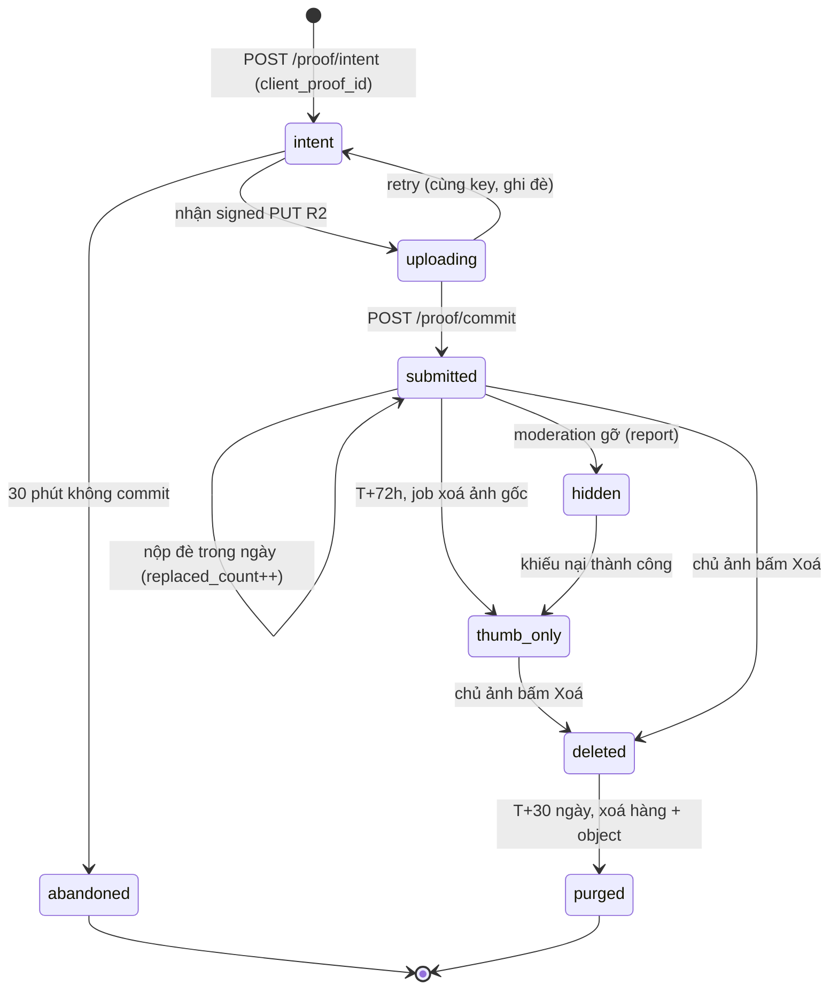
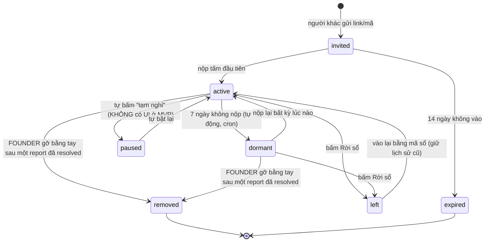
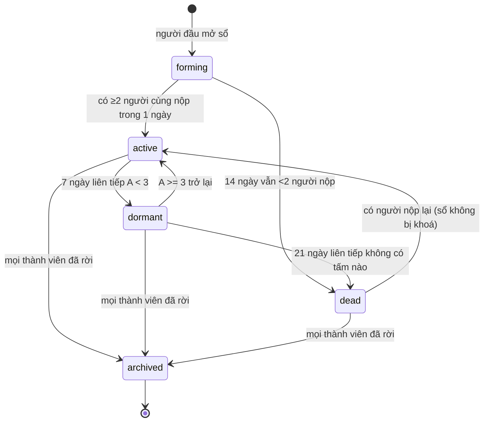
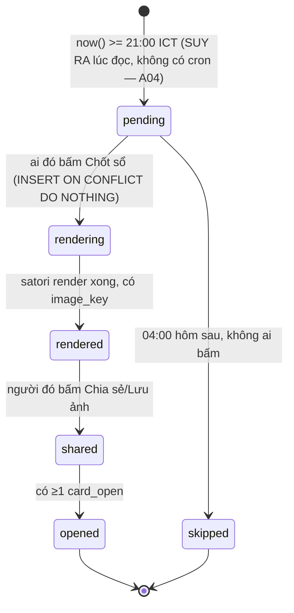
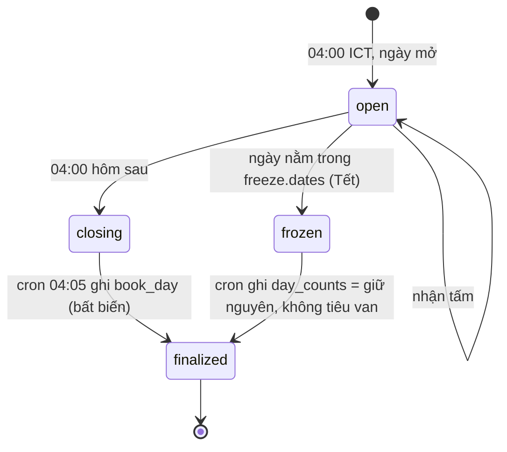

# 04 — DATA MODEL & ĐẶC TẢ CƠ CHẾ LÕI (Chốt Sổ)

_Viết 03/09/2026. Nguồn duy nhất: `/home/huypq/teemi/docs/plan/01-dinh-nghia-san-pham-v2.md`. Mọi con số cơ chế ở đây phải khớp §4 của tài liệu đó; chỗ nào tôi thấy nó chưa đủ để code được, tôi ghi vào §9 "Bất đồng" thay vì tự đổi._
_Mục tiêu: một người ngồi xuống mở editor là gõ được, không phải hỏi lại._

> **[ĐỐI CHIẾU TRỌNG TÀI — 2026-09-03]**
> Tài liệu này **đã được đối chiếu với bảng phán quyết trọng tài ngày 2026-09-03**. Mọi hằng số, ngưỡng, ngày tháng và tên bảng trong file lấy từ **`/home/huypq/teemi/docs/plan/_rulings.md`** (mục A — Từ điển giá trị chuẩn, A01–A123).
> Luật đọc: khi file này và `_rulings.md` khác nhau, **`_rulings.md` thắng**. Khi tài liệu khác (`01`…`10`) khác file này ở phần **schema hoặc thuật toán**, **file này thắng** (nguyên tắc chủ quyền lĩnh vực: `04` = SCHEMA + THUẬT TOÁN, A32).
> Sổ cái pw duy nhất: **`docs/adr/pw-ledger.md`** (A87) — tài liệu này không tự khai khoản đối trừ.
> File ADR duy nhất: **`docs/adr/ADR-000-bat-bien.md`** (A103) — mọi tham chiếu "ADR-001"/"ADR-002" trong bản cũ đã đổi thành "ADR-000 §2"/"ADR-000 §3".
> Danh sách nội dung đã bị cắt khỏi MVP-0 và điều kiện mở lại: xem mục **11. ĐÃ CẮT** ở cuối file.
> Bất đồng của tài liệu này **với chính bảng phán quyết** (đã thi hành đầy đủ, chỉ ghi nhận): mục **12**.
> Việc còn chờ founder quyết (không tự quyết): **§10.2 — D-01, D-06, D-04b**.
> _Vòng soát lại 2026-09-04: thi hành nốt A03/A04/A05 (cron), A14 (`roster_size` vào rollover), A21 (H1 hai giai đoạn), A37 (nhãn `[chưa đo]`), A42 (§8.5), A61/S17 (kick), A65 (gói 7 câu), A70 (quy đổi 4,0 người/sổ), A86 (lưới 30 ngày · màn Của tôi), A103 (ADR-001), C08 (sổ cái), S01 (dấu vết `heart` còn sót ở §5.2 và §6.2)._

---

## 0. QUY ƯỚC TÊN & PHẠM VI

| Chữ trong sản phẩm | Bảng | Ghi chú |
|---|---|---|
| sổ | `book` | **[CHỐT 2026-09-03, A30/C52] `book` / `book_id` THẮNG, hết tranh luận.** v2 §6 mục 14 viết `group_id`; luật P10 của v2 đọc lại thành "cột đầu tiên của mọi bảng và mọi event là **khoá sổ (`book_id`)**". Ngôn ngữ đặt tên schema: **tiếng Anh** (A29). Ghi vào `docs/adr/ADR-000-bat-bien.md` §2 |
| thành viên | `membership` | quan hệ người ↔ sổ |
| người | `person` | không phải "user" — không có tài khoản, không có mật khẩu |
| kèo | `goal` | free-text, **không taxonomy** (§4.8) |
| tấm | `proof` | 1 tấm = 1 ảnh + 1 nhãn + 1 người + 1 ngày |
| ngày của sổ | `book_day` | bản ghi bất biến, do cron 04:05 viết |
| card chốt sổ | `card` | |

**KHÔNG tồn tại và sẽ không được tạo:** `season`, `boss`, `boss_hp`, `damage_log`, `leaderboard`, `rank`, `trust_score`, `reaction`, `message`, `wallet`, `item`, `inventory`. Lý do và điều kiện mở lại: v2 §6 mục 1, 6, 12. Nếu một PR tạo bảng có tên nằm trong danh sách này, CI phải fail — xem §8.4.

**Không có season ⇒ không có state machine season.** Câu hỏi trong đề bài về `season: upcoming→running→ended` không có câu trả lời trong sản phẩm này; thay vào đó tôi đặc tả state machine của `book_day` (§2.5), thứ thực sự tồn tại.

---

## 1. SCHEMA — POSTGRES DDL

### 1.1. Nền: extension, hàm ngày, hàm danh tính

```sql
create extension if not exists pgcrypto;

-- ============================================================
-- NGÀY CỦA SỔ: 04:00 → 03:59:59 hôm sau, Asia/Ho_Chi_Minh
-- ICT = UTC+7 cố định. VN không có DST từ 1975 [FACT].
-- +7h (ICT) − 4h (cutoff) = +3h = 10800 giây.
-- Hàm này IMMUTABLE có chủ ý: nó KHÔNG dùng bảng timezone của
-- hệ thống (AT TIME ZONE chỉ là STABLE, không dùng được trong
-- generated column). Nếu VN có DST, đây là ĐIỂM SỬA DUY NHẤT.
-- ============================================================
create or replace function ict_book_date(ts timestamptz)
returns date
language sql
immutable
as $fn$
  select ((timestamp 'epoch'
           + ((extract(epoch from ts)::bigint + 10800) * interval '1 second'))::date)
$fn$;

-- Mốc bắt đầu (04:00 ICT) và kết thúc của một book_date — dùng cho cron & test
create or replace function ict_day_start(d date) returns timestamptz
language sql immutable as $fn$
  -- 04:00 ICT = 21:00 UTC hôm trước. Số học thuần, không đụng bảng timezone.
  select to_timestamp(((d - date 'epoch')::bigint * 86400) + 14400 - 25200)
$fn$;

-- ============================================================
-- DANH TÍNH: KHÔNG dùng Supabase Auth (ADR-000 §2: không khoá cứng).
-- Server tự ký JWT HS256 {sub: person_id, role:'authenticated'}
-- bằng chính JWT secret của project ⇒ RLS chạy như bình thường,
-- và gỡ khỏi Supabase là đổi một hàm.
-- ============================================================
create or replace function current_person_id() returns uuid
language sql stable as $fn$
  select coalesce(
    nullif(current_setting('request.jwt.claims', true)::jsonb ->> 'sub',''),
    nullif(current_setting('app.person_id', true),'')   -- đường server-side/cron
  )::uuid
$fn$;
```

### 1.2. Người, thiết bị

```sql
create table person (
  id            uuid primary key default gen_random_uuid(),
  display_name  text not null,
  avatar_seed   text not null default gen_random_uuid()::text,
  is_16_plus    boolean not null default false, -- age gate ≥16, CỜ TỰ KHAI. KHÔNG lưu ngày sinh.
  age_gate_at   timestamptz,                    -- thời điểm tick cờ, để chứng minh đã hỏi
  created_at    timestamptz not null default now(),
  last_seen_at  timestamptz not null default now(),
  deleted_at    timestamptz,                    -- soft delete
  anonymized_at timestamptz,                    -- đã ẩn danh hoá, KHÔNG hoàn tác được
  constraint person_name_len check (char_length(display_name) between 1 and 24)
  -- KHÔNG có CHECK nào gọi now(): Postgres cấm hàm không-IMMUTABLE trong CHECK,
  -- CREATE TABLE sẽ lỗi. Kiểm tra tuổi làm ở tầng ứng dụng, lúc nhập.
);

-- KHÔNG có: email, phone, password_hash, oauth_id, face_embedding, birth_year.
-- Không có cột nào ở trên là quyết định pháp lý, không phải quyết định lười.

create table device (
  id           uuid primary key default gen_random_uuid(),
  person_id    uuid not null references person(id) on delete cascade,
  token_hash   bytea not null,   -- sha256(secret trong localStorage). KHÔNG lưu secret gốc
  ua_family    text,             -- 'zalo-webview'|'chrome-android'|... để debug §10(h)
  created_at   timestamptz not null default now(),
  last_seen_at timestamptz not null default now(),
  revoked_at   timestamptz
);
create unique index device_token_uq on device(token_hash) where revoked_at is null;
create index device_person_idx on device(person_id);
```

### 1.3. Sổ, thành viên, kèo

```sql
create type book_status  as enum ('forming','active','dormant','dead','archived');
create type member_status as enum ('invited','active','paused','dormant','left','removed');
create type proof_status  as enum ('xong','toang');   -- VẮNG KHÔNG PHẢI MỘT GIÁ TRỊ

create table book (
  id           uuid primary key default gen_random_uuid(),
  code         char(6) not null,          -- mã gõ tay, đường thoát hiểm khi Zalo chặn link (§9 mục 7)
  name         text not null,
  created_by   uuid not null references person(id),
  created_at   timestamptz not null default now(),
  started_on   date not null,             -- = ict_book_date(created_at)
  status       book_status not null default 'forming',
  status_since timestamptz not null default now(),
  branch       char(1) not null default 'A',  -- H3: 'A' có kèo, 'B' không kèo
  rotation_idx int not null default 0,        -- ai chốt sổ ngày mai (§4.7)
  archived_at  timestamptz,
  constraint book_code_fmt   check (code ~ '^[2-9ACDEFGHJKMNPQRTUVWXY]{6}$'),
  -- [CHỐT 2026-08-28, QĐ-12] Bảng chữ 28 ký tự: 8 chữ số 2-9 + 20 chữ cái
  -- A C D E F G H J K M N P Q R T U V W X Y.
  -- Loại: 0/O, 1/I/L (đọc nhầm nhau), B (vs 8), S (vs 5), Z (vs 2).
  -- 28^6 = 481.890.304 ≈ 481 triệu tổ hợp — dư cho mọi quy mô trong hồ sơ này.
  -- Lý do KHÔNG dùng regex cũ '^[2-9A-HJ-NP-Z]{6}$': dải J-N CHỨA chữ L,
  -- đúng ký tự dễ đọc nhầm thành 1/I trên ảnh JPEG đã qua nén của Zalo —
  -- mà mã in trên card là đường thoát hiểm duy nhất khi Zalo chặn domain (08 UX-2).
  -- Bảng chữ này phải nằm trong remote_config để sửa được không cần deploy.
  --
  -- [CHỐT 2026-09-03, A42/A45/C32] HAI CHUỖI, KHÔNG ĐƯỢC TRỘN:
  --   book.code       = khoá VÀO sổ, in lên card, gõ tay được.
  --   card.share_token = chỉ để XEM trang public, nằm trong slug (§1.6).
  -- Hai chuỗi sinh RIÊNG, không suy ra được từ nhau, và slug công khai
  -- KHÔNG được chứa code6 như substring (A44 — có test CI ở 08 §2.2).
  --
  -- ĐIỀU KIỆN DÙNG code6 (A45): mã chỉ mở được cửa khi CẢ HAI đúng
  --   (a) sổ đang có < 8 người (trần A46), VÀ
  --   (b) card in mã đó <= 7 ngày tuổi.
  -- Ngoài hai điều kiện này, mã trả về lỗi "Mã đã hết hạn" — không phải
  -- khoá vào vô điều kiện (03 §9 B2). Kiểm tra ở tầng ứng dụng, vì nó
  -- phụ thuộc card chứ không phụ thuộc riêng hàng book. +0,10 pw cho việc
  -- tách hai chuỗi, đã ghi vào docs/adr/pw-ledger.md.
  constraint book_name_len   check (char_length(name) between 1 and 24),
  constraint book_branch_ok  check (branch in ('A','B'))
);
create unique index book_code_uq on book(code);
create index book_status_idx on book(status, status_since);

create table membership (
  book_id      uuid not null references book(id) on delete cascade,
  person_id    uuid not null references person(id) on delete cascade,
  status       member_status not null default 'invited',
  status_since timestamptz not null default now(),
  joined_at    timestamptz,
  left_at      timestamptz,
  invited_by   uuid references person(id),
  rotation_pos int not null,          -- thứ tự vào sổ = thứ tự xoay vòng chốt sổ
  keep_proofs_on_leave boolean not null default true,  -- §6.4
  paused_until timestamptz,           -- [CHỐT 2026-09-03, A50/C34/S06] CÓ TRONG SCHEMA
                                      -- TỪ COMMIT ĐẦU, KHÔNG CÓ UI Ở MVP-0.
                                      -- Nút "Nghỉ 7 ngày" của 06 §9 BĐ-5 BỊ BÁC ở MVP-0
                                      -- (khoản trả bù "Tết freeze" đã bị 07 tiêu).
                                      -- Chi phí một cột = 0; chi phí một migration sau
                                      -- khi có dữ liệu lịch sử thì không. Khi cột này
                                      -- có giá trị > now(), người đó bị loại khỏi A
                                      -- đúng như status='paused' (§4.3).
                                      -- Hệ quả bắt buộc ghi kèm: không có nút Nghỉ thì
                                      -- "người bận" và "người bị đẩy ra" sinh chuỗi event
                                      -- GIỐNG HỆT NHAU ⇒ HM-4 ở 06 §4.2 phải mang nhãn
                                      -- "MƠ HỒ CÓ CHỦ Ý".
  primary key (book_id, person_id)
);
create index membership_person_idx on membership(person_id) where status = 'active';
create index membership_book_idx   on membership(book_id, status);

-- Trần 8 người/sổ (v2 §9 mục 1: "sổ kín ≤8 người" — con số này đã đi vào
-- câu hỏi gửi luật sư, nên nó là RÀNG BUỘC PHÁP LÝ, không phải UX).
create or replace function enforce_book_cap() returns trigger
language plpgsql as $fn$
declare n int;
begin
  select count(*) into n from membership
   where book_id = new.book_id and status in ('invited','active','paused','dormant');
  if n > 8 then
    raise exception 'BOOK_FULL: sổ % đã đủ 8 người', new.book_id using errcode='23514';
  end if;
  return null;
end $fn$;
create constraint trigger membership_cap after insert or update on membership
  deferrable initially deferred for each row execute function enforce_book_cap();

create table goal (
  id            uuid primary key default gen_random_uuid(),
  book_id       uuid not null references book(id) on delete cascade,
  person_id     uuid not null references person(id) on delete cascade,
  goal_text     text not null,
  is_custom     boolean not null default false,  -- KHÔNG lưu preset_id (§4.8)
  effective_from date not null,
  created_at    timestamptz not null default now(),
  constraint goal_len check (char_length(goal_text) between 1 and 30)
);
create unique index goal_current_uq on goal(book_id, person_id, effective_from);
create index goal_lookup_idx on goal(book_id, person_id, effective_from desc);
```

> **`preset_id` không có mặt trong schema này, và đó là cả một quyết định pháp lý.** v2 §4.8: tám `preset_id` gắn với từng người = taxonomy sức khoẻ = đường ngắn nhất mất miễn trừ Điều 38.2 Luật 91/2025. Một cột text tự do thì không. `is_custom` được giữ vì nó là metadata nhập liệu, không phải phân loại nội dung — **cần kiểm chứng lại với luật sư: đây là câu số 6 trong gói 7 câu (A65), xem §8.2**.

### 1.4. Tấm (proof) — bảng nóng nhất

```sql
create table proof (
  id              uuid primary key default gen_random_uuid(),
  book_id         uuid not null references book(id) on delete cascade,
  person_id       uuid not null references person(id) on delete cascade,
  client_proof_id uuid not null,                    -- idempotency key do client sinh
  intent_at       timestamptz,                      -- giờ SERVER lúc POST /proof/intent
  submitted_at    timestamptz not null default now(),
  -- Biên nộp muộn kỹ thuật 120s (§3.4): bấm Gửi lúc 03:59:40, mạng 3G, commit
  -- lúc 04:00:20 ⇒ vẫn tính cho ngày cũ. Hằng số 120 ở đây là TRẦN CỨNG của DB;
  -- giá trị vận hành nằm ở remote_config.proof.upload_grace_sec và phải ≤ 120
  -- (một CI check assert điều đó — nếu không, đây là vi phạm P6).
  book_date       date generated always as (ict_book_date(
                    case when intent_at is not null
                          and submitted_at - intent_at <= interval '120 seconds'
                         then intent_at else submitted_at end)) stored,
  status          proof_status not null,
  orig_key        text,                             -- R2: orig/<book>/<date>/<person>/<cpid>.jpg
  thumb_key       text,                             -- R2: thumb/... (vĩnh viễn)
  bytes_orig      int,
  orig_expires_at timestamptz,                      -- submitted_at + 72h
  replaced_count  smallint not null default 0,      -- số lần nộp đè trong ngày
  deleted_at      timestamptz,
  deleted_by      uuid references person(id),
  hidden_at       timestamptz,                      -- do moderation, khác deleted
  constraint proof_bytes_sane check (bytes_orig is null or bytes_orig <= 800000)
);

-- MỘT TẤM / NGƯỜI / NGÀY. Nộp lại = UPDATE hàng này, không INSERT hàng mới (§4.2).
-- [A33/C02] Khoá duy nhất là BỘ BA (book_id, person_id, book_date). Khoá hai cột
-- (person_id, book_date) mà 03 §3.2 đề nghị BỊ BÁC: nó chặn cứng đa sổ ở tầng CSDL,
-- tức biến một quyết định sản phẩm có thời hạn thành một ràng buộc vĩnh viễn.
-- [A101/S02/C25] Trần "1 sổ / thiết bị" ở MVP-0 là quyết định CÓ Ý THỨC và được
-- thực thi ở TẦNG ỨNG DỤNG, không ở tầng CSDL. Hệ quả đã ghi ra thay vì để nó xảy ra
-- âm thầm: hệ số lan truyền G ≡ 0 trong 12 tháng đầu. Trần 3 sổ/thiết bị là hằng số
-- đặt trước cho v1.1, CHƯA CÓ HIỆU LỰC.
-- Chống double-submit / retry mạng
create unique index proof_client_uq      on proof(client_proof_id);
-- Đọc màn Sổ hôm nay (+ lưới 30 ngày khi nó được mở lại ở T13+ — A86: lưới 30 ngày
-- ĐÃ BỊ CẮT khỏi MVP-0; index vẫn giữ vì nó phục vụ màn Sổ hôm nay, chi phí = 0)
create index proof_book_day_idx  on proof(book_id, book_date desc)
  where deleted_at is null and hidden_at is null;
-- Tính A (Active) trong cửa sổ 7 ngày
create index proof_active_idx    on proof(book_id, person_id, book_date desc)
  where deleted_at is null;
-- Job dọn ảnh gốc hết hạn
create index proof_ttl_idx       on proof(orig_expires_at) where orig_key is not null;
```

> **`proof_status` chỉ có hai giá trị, và VẮNG cố ý không phải một trong hai.** Đây là nguyên tắc P2 (v2 §7) được thực thi ở tầng CSDL chứ không ở tầng UI: **không tồn tại được một hàng dữ liệu biểu diễn "người X hôm nay vắng"**. Không có hàng thì không có gì để render thành ô trống có tên. Một test CI quét cây render là hàng rào thứ hai; ràng buộc enum này là hàng rào thứ nhất và nó không thể bị lách bằng một PR vội.

### 1.5. Ngày của sổ — bản ghi bất biến do cron viết

```sql
create table book_day (
  book_id        uuid not null references book(id) on delete cascade,
  book_date      date not null,
  day_number     int  not null,        -- tăng vô điều kiện kể từ started_on
  active_count   smallint not null,    -- A (trượt 7 ngày) — CỘT BÁO CÁO, KHÔNG dùng làm mẫu số q_c
  roster_size    smallint not null,    -- [CHỐT 2026-08-28, QĐ-03] MẪU SỐ ĐÓNG BĂNG của q_c.
                                       -- = số người đã nộp ≥1 tấm trong 3 ngày đầu của sổ,
                                       -- ghi một lần ở ngày 3 và GIỮ NGUYÊN 14 ngày tiếp theo.
                                       -- Sau ngày 17 của sổ: đóng băng lại theo cohort mới.
  k_required     smallint not null,    -- k
  present_count  smallint not null,    -- xong + toang
  xong_count     smallint not null,
  toang_count    smallint not null,
  is_full_table  boolean not null,     -- "đủ mâm": present = A_eff VÀ A_eff >= 2 (§9.3)
  is_frozen      boolean not null default false,  -- Tết freeze
  day_counts     boolean not null,
  misses_7d      smallint not null,    -- số ngày hụt trong cửa sổ 7 ngày kết thúc ở đây
  streak_after   int not null,
  proof_total_after int not null,      -- KHÔNG BAO GIỜ GIẢM (xem §6.3)
  finalized_at   timestamptz not null default now(),
  primary key (book_id, book_date)
);
create index book_day_recent_idx on book_day(book_id, book_date desc);

-- Bất biến P1 ở tầng CSDL: không cột nào giảm, ngoài streak, và streak chỉ giảm về 0.
create or replace function book_day_monotonic() returns trigger
language plpgsql as $fn$
declare prev book_day%rowtype;
begin
  select * into prev from book_day
   where book_id = new.book_id and book_date = new.book_date - 1;
  if found then
    if new.day_number <= prev.day_number
       or new.proof_total_after < prev.proof_total_after then
      raise exception 'P1_VIOLATION: cột đơn điệu bị giảm ở %/%', new.book_id, new.book_date;
    end if;
    if new.streak_after < prev.streak_after and new.streak_after <> 0 then
      raise exception 'P1_VIOLATION: streak giảm mà không về 0 (% -> %)',
        prev.streak_after, new.streak_after;
    end if;
  end if;
  return new;
end $fn$;
create trigger book_day_monotonic_trg before insert or update on book_day
  for each row execute function book_day_monotonic();
```

> Trigger này là bản DB của test 10.000 mô phỏng ở v2 §4.10 hạng mục 10. Test bắt lỗi trước khi deploy; trigger bắt lỗi sau khi deploy. Chi phí: ~15 dòng.

> **[CHỐT 2026-08-28 — QĐ-03] Vì sao có `roster_size`, và vì sao nó phải có TRƯỚC dòng code đầu tiên.**
> `06-metrics-va-gia-thuyet.md` §9 BĐ-1 chứng minh bằng ví dụ số: nếu mẫu số của `q_c` là `active_count` (Active trượt 7 ngày), thì **`q_c` TĂNG khi sổ chết**. Sổ 5 người, 3 người bỏ: người bỏ rơi khỏi mẫu số sau 7 ngày, còn lại 2 người chăm chỉ ⇒ `q_c` nhảy từ 0,54 lên 0,90 và GT-01 vẫn PASS trong khi sổ đã mất 60% thành viên. Đó là một chỉ số **đảo dấu**, tệ hơn không có chỉ số.
> **Luật chốt:**
> - `q_c_roster = sum(present_count) / sum(roster_size)` — **đây là con số so với ngưỡng** (0,45 đèn xanh / 0,35 đèn đỏ ở G0, GT-01).
> - `q_c = sum(present_count) / sum(active_count)` — giữ lại làm **cột báo cáo phụ**, không bao giờ dùng để ra quyết định đi/dừng.
> - Google Sheet của Bước 0 phải có **cả hai cột** kể từ ngày 08/09/2026. `roster_size` được chốt ở cuối ngày 3 (10/09) và **không được sửa sau đó**.
> - **Hạn: 07/09/2026.** Sau ngày 08/09 không sửa hồi tố được, vì roster ngày 1–3 không tái dựng lại được từ dữ liệu đã thu.

### 1.6. Card và mở card

> **[CHỐT 2026-09-03, A27/S01/C03] Bảng `heart` và nút thả tim ẩn danh đã bị CẮT khỏi MVP-0.** Mục này trước đây tên "Card, mở card, thả tim". Xem mục **11. ĐÃ CẮT** để biết điều kiện mở lại.

```sql
create table card (
  id          uuid primary key default gen_random_uuid(),
  book_id     uuid not null references book(id) on delete cascade,
  book_date   date not null,
  rendered_by uuid not null references person(id),
  rendered_at timestamptz not null default now(),
  image_key   text,                 -- R2: card/<book>/<date>-<asset_nonce>.png, TTL 90 ngày
                                    -- [CHỐT 2026-08-28 QĐ-07; nonce bổ sung 2026-09-04, `11` §1.2]
                                    -- Hết 90 ngày: THAY bằng một ảnh tĩnh trung tính
                                    -- ("Sổ này đã lưu ở chotso.vn"), KHÔNG trả 404.
                                    -- Lý do: card sống trong lịch sử chat Zalo mãi mãi;
                                    -- một dãy ảnh vỡ trong nhóm là thiệt hại thương hiệu
                                    -- diễn ra chậm và không ai báo (03 §9 B3).
  next_closer uuid references person(id),   -- "mai tới lượt Linh"
  share_token text not null,        -- token trong link dán vào Zalo — CHỈ ĐỂ XEM
                                    -- [CHỐT 2026-09-03, A42/C32] Sinh ĐỘC LẬP HOÀN TOÀN
                                    -- với book.code: hai bảng chữ khác nhau, hai nguồn
                                    -- ngẫu nhiên khác nhau, KHÔNG suy ra được từ nhau,
                                    -- và slug công khai không được chứa code6 (A44).
  share_expires_at timestamptz not null      -- TTL 7 NGÀY (A42) — đã chốt, không còn là
    default (now() + interval '7 days'),     -- câu hỏi mở (§8.5 cũ). Hết hạn ⇒ trang public
                                    -- trả về trang "Link này đã hết hạn", KHÔNG 404 trần.
                                    -- 24h giết phép đo M2 (card dán tối nay, bạn mở trưa
                                    -- hôm sau đã chết); vĩnh viễn để lộ lưới ảnh của người
                                    -- 16 tuổi ra ngoài nhóm mãi mãi. 7 ngày là điểm giữa
                                    -- đã chốt. Trang public BẮT BUỘC gắn <meta name="robots"
                                    -- content="noindex,nofollow"> + chặn ở robots.txt.
  open_count  int not null default 0,

  -- ── [BỔ SUNG 2026-09-04 — `11` §1.2, BẮT BUỘC TRƯỚC COMMIT ĐẦU] ──────────────
  asset_nonce text not null default encode(gen_random_bytes(8),'hex'),
                                    -- 16 ký tự hex = 64 bit (encode() của Postgres chỉ
                                    -- hỗ trợ hex/base64/escape — base64 có ký tự '/' và
                                    -- '+' nên không dùng được trong key R2). Key R2 thật là
                                    --   card/<book_id>/<book_date>-<asset_nonce>.png
                                    -- KHÔNG phải card/<book_id>/<book_date>.png.
                                    -- LÝ DO (lỗ hổng thật, không phải lý thuyết):
                                    -- card ĐƯỢC THIẾT KẾ để dán vào nhóm Zalo ⇒ book_id
                                    -- rời vòng bí mật ngay lần dùng đầu. Với key cũ, bất
                                    -- kỳ ai nhận ĐÚNG MỘT card đều đổi <date> trong URL
                                    -- để tải TOÀN BỘ card của sổ đó, mọi ngày, 90 ngày,
                                    -- mà không cần vào sổ, không chạm rate limit nào
                                    -- (CDN tĩnh). book_id là UUID v4 nên KHÔNG đoán được
                                    -- — nhưng nó ĐI BỘ ĐƯỢC. nonce chặn việc đi bộ.
                                    -- Vẽ lại card ⇒ sinh nonce MỚI ⇒ bản cũ thành URL
                                    -- mồ côi, lifecycle dọn, không cần purge từng edge.
  person_ids  uuid[] not null default '{}',
                                    -- những person có Ô trong card này. Không có cột này
                                    -- thì luồng xoá ảnh (§6.2) KHÔNG tìm được card nào
                                    -- chứa mặt người vừa yêu cầu xoá, phải quét toàn sổ.
  rerendered_at timestamptz         -- lần vẽ lại gần nhất do yêu cầu xoá (§6.2)
);
-- MỘT CARD / SỔ / NGÀY. Hai người bấm "Chốt sổ" cùng lúc ⇒ người ghi trước lên card.
create unique index card_one_per_day_uq on card(book_id, book_date);
create unique index card_share_uq on card(share_token);

create table card_open (
  card_id   uuid not null references card(id) on delete cascade,
  person_id uuid,                     -- null = người chưa vào sổ
  opener_hash bytea not null,         -- sha256(device token | ip+ua) — chống đếm trùng
  opened_at timestamptz not null default now(),
  primary key (card_id, opener_hash)
);
create index card_open_time_idx on card_open(card_id, opened_at);
-- H1 tính TRỰC TIẾP từ bảng này. Không có bảng này thì không đo được H1,
-- và H1 là giả thuyết sống-chết của cả hướng.
-- [CHỐT 2026-09-03, A21/A22/C21] HAI GIAI ĐOẠN ĐO H1, KHÔNG ĐƯỢC TRỘN:
--   Bước 0 (08–21/09/2026): KHÔNG có code, KHÔNG có bảng này. Thiết bị đo là
--     SHORTLINK THEO NGÀY THEO SỔ của bên thứ ba — 8 sổ × 14 ngày = 112 link (A22),
--     chỉ số tên là `click-shortlink`. Ảnh Canva dán vào Zalo KHÔNG sinh sự kiện mở.
--     Ở Bước 0, H1 CHỈ CÓ QUYỀN DỪNG (< 40% ⇒ DỪNG). KHÔNG CÓ QUYỀN ĐI.
--   Beta (từ 02/12/2026): bảng này chạy, event 14 `card_opened` là số thật.
--     Ngưỡng "≥60% Active mở trong 24h" chỉ được dùng TỪ TUẦN 2 CỦA BETA trở đi.

-- [CẮT 2026-09-03 — A27/S01/C03] Bảng `heart` (nút thả tim ẩn danh trên trang public,
-- v2 §4.9) ĐÃ BỊ XOÁ khỏi schema MVP-0. Ba tài liệu độc lập (03 §10 c7, 04 §9.4,
-- 07 MVP-0) cùng chọn nó làm ứng viên cắt ⇒ nó KHÔNG còn là "tiền" để đối trừ, nó chỉ
-- là một khoản cắt đã chi một lần vào MVP-0 của 07 (QĐ-05b, ghi ở pw-ledger.md).
-- Hệ quả phải ghi rõ, không được giấu: HM-1, HM-3, event 25 `heart_sent` và trường
-- `hearts_recv_14d` CHẾT THEO ⇒ bộ chỉ số tác hại còn 7 chỉ số (A27) và chỉ còn phát
-- hiện RÚT LUI, không phát hiện LOẠI TRỪ. Thay thế gần nhất: HM-8 + `pulse_survey`
-- (event 30, BẮT BUỘC — A28). Điều kiện mở lại: xem mục 11.
```

### 1.7. An toàn, moderation, cấu hình, sự kiện

```sql
create type report_reason as enum ('nudity','violence','harassment','minor','other');
create type report_action as enum ('removed','kept','account_blocked','escalated');

create table report (
  id           uuid primary key default gen_random_uuid(),
  proof_id     uuid references proof(id) on delete set null,
  book_id      uuid not null references book(id) on delete cascade,
  reporter_id  uuid references person(id) on delete set null,
  reason       report_reason not null,
  note         text,
  created_at   timestamptz not null default now(),
  sla_due_at   timestamptz generated always as (created_at + interval '48 hours') stored,
  resolved_at  timestamptz,
  action       report_action,
  constraint report_note_len check (note is null or char_length(note) <= 500)
);
create index report_open_idx on report(sla_due_at) where resolved_at is null;
-- [CHỐT 2026-08-28, QĐ-17] SLA LÀ HAI CON SỐ CHO HAI ĐỐI TƯỢNG, không phải một:
--   (a) 48 giờ  — cam kết với KHIẾU NẠI NGƯỜI DÙNG. Đây là cột sla_due_at ở trên.
--   (b) 24 giờ, khẩn cấp 6 giờ — YÊU CẦU CỦA CƠ QUAN NHÀ NƯỚC. Luật định,
--       không thương lượng (Luật ANM 116/2025). Không đo bằng cột này; nó đi qua
--       script khoá sổ khẩn cấp trong RUNBOOK.md + công tắc remote_config
--       'service.paused'. Trang chính sách phải in CẢ HAI con số.

-- [CHỐT 2026-08-28, QĐ-16] AUTO-HIDE TOÀN CỤC: ngay khi report đầu tiên được tạo
-- cho một proof, set proof.hidden_at = now() (ẩn với TẤT CẢ, không chỉ người báo).
-- Founder xử trong 48h; nếu report sai thì set hidden_at = null (khôi phục).
-- Chi phí ~0: cột hidden_at đã có, policy proof_read đã lọc nó.
-- Lý do: nghĩa vụ "biện pháp kỹ thuật để phát hiện, ngăn chặn, gỡ bỏ KỊP THỜI"
-- (Luật ANM 116/2025 Điều 16 khoản 3). Thiết kế cũ của 08 §6.4 (ẩn chỉ với người
-- báo cáo, flag client-side) để nội dung vi phạm hiển thị với 4 người còn lại
-- trong tối đa 48 giờ — không thoả nghĩa vụ đó.
create or replace function auto_hide_on_report() returns trigger
language plpgsql as $fn$
begin
  update proof set hidden_at = now()
   where id = new.proof_id and hidden_at is null and deleted_at is null;
  return new;
end $fn$;
create trigger report_auto_hide after insert on report
  for each row when (new.proof_id is not null)
  execute function auto_hide_on_report();

-- [CHỐT 2026-08-28, QĐ-19] BẢNG AUDIT_LOG — nghĩa vụ lưu >=2 năm (05 GIAI ĐOẠN 2).
-- "Rẻ nhất khi làm sớm, không thể làm bù": không có bảng này từ ngày đầu thì
-- 2 năm lịch sử không tái dựng được. 0,15 pw, đã ghi vào docs/adr/pw-ledger.md.
create table audit_log (
  id         bigserial primary key,
  at         timestamptz not null default now(),
  person_id  uuid references person(id) on delete set null,
  book_id    uuid references book(id) on delete set null,
  action     text not null,      -- 'session_start'|'proof_commit'|'report_create'|
                                 -- 'moderation_hide'|'moderation_restore'|'data_export'|
                                 -- 'data_delete'|'admin_pause'|'gov_request'
  ip_trunc   inet,               -- IPv4 /24 hoặc IPv6 /48 — KHÔNG lưu IP đầy đủ
  ua_family  text,
  detail     jsonb,
  retain_until date not null default ((now() + interval '25 months')::date)
  -- default, KHÔNG generated: một generated column không được gọi now() (không IMMUTABLE).
  -- Cùng lớp lỗi với hai CHECK person_age_gate / person_birth_year_sane đã bị xoá ở §1.2.
);
create index audit_log_at_idx on audit_log(at desc);
create index audit_log_person_idx on audit_log(person_id, at desc);

create table block (
  blocker_id uuid not null references person(id) on delete cascade,
  blocked_id uuid not null references person(id) on delete cascade,
  book_id    uuid not null references book(id) on delete cascade,
  created_at timestamptz not null default now(),
  primary key (blocker_id, blocked_id, book_id)
);

create table moderation_evidence (      -- xem §6.5: nghĩa vụ pháp lý > quyền xoá
  proof_id     uuid not null,
  report_id    uuid not null references report(id) on delete cascade,
  object_key   text not null,
  retain_until date not null,           -- created + 90 ngày
  created_at   timestamptz not null default now(),
  primary key (report_id, proof_id)
);

create table remote_config (            -- P6: không hằng số ma trong code
  key        text primary key,
  value      jsonb not null,
  updated_at timestamptz not null default now(),
  note       text
);
insert into remote_config(key,value,note) values
  ('day.cutoff_hour',        '4',      'ranh giới ngày, giờ ICT'),
  -- day.close_time: cờ "sẵn sàng chốt" SUY RA từ giờ server mỗi lần đọc màn Sổ hôm nay.
  -- KHÔNG có cron 21:00 (A04/C15 — job mo_chot_so đã bị CẮT, −0,10 pw, xem §3.5).
  ('day.close_time',         '"21:00"','giờ sổ sẵn sàng chốt, suy ra từ giờ server'),
  ('threshold.k_small',      '1',      'A <= 2'),
  ('threshold.k_large',      '2',      'A >= 3 — ngưỡng phẳng, KHÔNG ceil(0,6A)'),
  ('threshold.active_window','7',      'ngày, để tính A'),
  ('streak.rest_days',       '2',      'van/cửa sổ 7 ngày trượt'),
  ('proof.orig_ttl_hours',   '72',     ''),
  ('proof.thumb_px',         '320',    ''),
  ('proof.upload_grace_sec', '120',    'biên nộp muộn kỹ thuật, §3.4'),
  ('book.member_cap',        '8',      ''),
  ('book.code_alphabet',     '"23456789ACDEFGHJKMNPQRTUVWXY"', '28 ký tự, QĐ-12'),
  ('card.image_ttl_days',    '90',     'QĐ-07: hết hạn thì THAY ảnh tĩnh, không 404'),
  ('legal.visits_amber',     '6000',   'QĐ-04 đèn vàng monthly_visits'),
  ('legal.visits_red',       '8500',   'QĐ-04 đèn đỏ monthly_visits — dừng nhận sổ mới'),
  ('legal.persons_amber',    '600',    'QĐ-04 đèn vàng monthly_active_persons'),
  ('legal.persons_red',      '850',    'QĐ-04 đèn đỏ monthly_active_persons'),
  ('service.paused',         'false',  'công tắc khoá sổ khẩn cấp, RUNBOOK.md'),
  ('freeze.dates',           '[]',     'RỖNG ở MVP-0. Tết Đinh Mùi: xem khối ngay dưới');

-- [CHỐT 2026-09-03, A119/A120/C06] NGÀY TẾT — ĐÃ SỬA VÀ KHOÁ.
-- Mùng 1 Tết Đinh Mùi = 06/02/2027 (thứ Bảy). "17/02/2027" là mùng 1 Tết Bính Ngọ
-- 2026 — SAI, và nếu để nguyên thì hệ thống đóng băng nhầm 8-14 ngày SAU khi Tết
-- đã kết thúc. Cửa sổ freeze đúng (09 §6.2):
--     03/02/2027 04:00 ICT  ->  13/02/2027 03:59 ICT
--   = book_date từ '2027-02-03' đến '2027-02-12', ĐÚNG 10 NGÀY.
-- Ví dụ giá trị khi bật (một ngày bất kỳ trong cửa sổ, ví dụ mùng 1 - 2 ngày là
-- '2027-02-05'; ví dụ cũ '2027-02-16' nằm NGOÀI cửa sổ và đã bị xoá):
--   update remote_config set value = to_jsonb(array(
--     select (date '2027-02-03' + i)::text from generate_series(0,9) i))
--    where key = 'freeze.dates';
--   -- => ["2027-02-03","2027-02-04","2027-02-05", ... ,"2027-02-12"]
-- [A86/A121/S07] Tết freeze ĐÃ BỊ CẮT khỏi MVP-0 (12 tuần kết thúc 29/11/2026, còn
-- Tết rơi 06/02/2027 — vẫn ngoài cửa sổ). Thứ GIỮ LẠI ở MVP-0 là ĐÚNG MỘT HẰNG SỐ:
-- key này + hàm thuần đọc nó (§4.1), sửa bằng một câu UPDATE, không cần deploy, 0 pw.
-- Sáu thành phần còn lại của "Tết Mode" (tần suất card 1/3 ngày, 2 dòng copy riêng,
-- 3 preset Tết) build ở T13-T18, HẠN HOÀN THÀNH 25/01/2027.

create table safety_keyword (
  pattern text primary key,
  bucket  text not null       -- 'eating_disorder' | 'self_harm' | 'other'
);
insert into safety_keyword(pattern,bucket) values
  ('kcal','eating_disorder'),('calo','eating_disorder'),('cân','eating_disorder'),
  ('kg','eating_disorder'),('giảm cân','eating_disorder'),('nhịn','eating_disorder'),
  ('ăn kiêng','eating_disorder'),('nhịn ăn','eating_disorder'),
  ('eat clean','eating_disorder'),('detox','eating_disorder');

create table event (                   -- analytics, append-only
  id           bigserial primary key,
  name         text not null,
  occurred_at  timestamptz not null default now(),
  book_date    date generated always as (ict_book_date(occurred_at)) stored,
  book_id      uuid,
  person_id    uuid,
  session_id   uuid,
  props        jsonb not null default '{}'::jsonb,
  schema_ver   smallint not null default 1
);
create index event_name_time_idx on event(name, occurred_at desc);
create index event_book_idx      on event(book_id, book_date);
create index event_time_brin     on event using brin(occurred_at);

create table exit_survey (
  person_id  uuid references person(id) on delete set null,
  book_id    uuid references book(id) on delete set null,
  choice     text not null,   -- 'ban_be_khong_nop'|'ngai'|'quen'|'khong_thich_keo'|'khac'
  created_at timestamptz not null default now()
);

create table request_idem (            -- §5.1
  key         text primary key,
  person_id   uuid,
  endpoint    text not null,
  status_code smallint not null,
  response    jsonb,
  created_at  timestamptz not null default now()
);
create index request_idem_gc_idx on request_idem(created_at);
```

### 1.8. RLS — mẫu đầy đủ cho dữ liệu sổ private

```sql
-- Hàm SECURITY DEFINER để tránh RLS đệ quy khi policy của proof phải hỏi membership
create or replace function is_member(b uuid) returns boolean
language sql stable security definer set search_path = public as $fn$
  select exists (select 1 from membership
                  where book_id = b and person_id = current_person_id()
                    and status in ('active','paused','dormant'))
$fn$;

alter table book       enable row level security;
alter table membership enable row level security;
alter table goal       enable row level security;
alter table proof      enable row level security;
alter table book_day   enable row level security;
alter table card       enable row level security;
alter table person     enable row level security;

-- SỔ: chỉ thành viên đọc được. Trang public dùng RPC riêng (bên dưới), không dùng policy.
create policy book_read  on book for select using (is_member(id));
create policy book_write on book for update using (created_by = current_person_id());

-- THÀNH VIÊN: thấy đồng đội trong sổ mình có mặt
create policy mem_read   on membership for select using (is_member(book_id));
create policy mem_self   on membership for update
  using (person_id = current_person_id());   -- rời sổ = tự đổi status

-- KÈO: chỉ thành viên thấy. goal_text KHÔNG BAO GIỜ ra khỏi hai màn ở §4.8.
create policy goal_read  on goal for select using (is_member(book_id));
create policy goal_write on goal for insert with check (person_id = current_person_id()
                                                        and is_member(book_id));

-- TẤM: đọc trong sổ, ghi chỉ của mình, KHÔNG có policy DELETE ⇒ client không xoá cứng được
create policy proof_read on proof for select
  using (is_member(book_id) and deleted_at is null and hidden_at is null
         and not exists (select 1 from block
                          where blocker_id = current_person_id()
                            and blocked_id = proof.person_id
                            and block.book_id = proof.book_id));
create policy proof_insert on proof for insert
  with check (person_id = current_person_id() and is_member(book_id));
create policy proof_update on proof for update
  using (person_id = current_person_id())
  with check (person_id = current_person_id());

-- NGÀY CỦA SỔ: đọc được, KHÔNG ai ghi được từ client (chỉ cron dùng role service)
create policy bday_read on book_day for select using (is_member(book_id));

-- NGƯỜI: chỉ thấy người cùng sổ
create policy person_read on person for select using (
  id = current_person_id() or exists (
    select 1 from membership m1 join membership m2 using (book_id)
     where m1.person_id = current_person_id() and m2.person_id = person.id
       and m1.status in ('active','paused','dormant')));

-- TRANG PUBLIC (người chưa vào sổ, mở từ link mời): KHÔNG mở RLS.
-- Một RPC security definer trả về đúng những trường được phép (§4.6 bảng được nói/cấm nói).
create or replace function public_book_view(p_share_token text)
returns table (book_name text, day_number int, proof_total int, streak int,
               tiles jsonb)   -- tiles: [{thumb_url, label, first_name}] — ẢNH MỜ phía client
language sql stable security definer set search_path = public as $fn$
  select b.name, d.day_number, d.proof_total_after, d.streak_after,
         coalesce(jsonb_agg(jsonb_build_object(
            'thumb', p.thumb_key, 'label', p.status, 'name', left(pe.display_name,10))
            order by p.submitted_at) filter (where p.id is not null), '[]'::jsonb)
    from card c
    join book b on b.id = c.book_id
    join book_day d on d.book_id = c.book_id and d.book_date = c.book_date
    left join proof p on p.book_id = c.book_id and p.book_date = c.book_date
         and p.deleted_at is null and p.hidden_at is null
    left join person pe on pe.id = p.person_id
   where c.share_token = p_share_token
   group by b.name, d.day_number, d.proof_total_after, d.streak_after
$fn$;
revoke all on function public_book_view(text) from public;
grant execute on function public_book_view(text) to anon;
-- Hàm này KHÔNG trả goal_text. Đây là chỗ P3 dễ bị phá nhất — thêm một cột ở đây
-- là đủ để kèo của một đứa 17 tuổi ra khỏi sổ. Test CI phải assert danh sách cột.
```

---

## 2. BẢNG TRẠNG THÁI (STATE MACHINE)

### 2.1. Tấm (proof)



Ghi chú: `submitted → seen` **không tồn tại**. Không có read-receipt cho từng tấm — đó là một affordance áp lực xã hội, và v2 §7 P9 cấm. Cái duy nhất được đo là `card_open` ở cấp card, không ở cấp tấm của một người cụ thể.

### 2.2. Thành viên (membership)



- `dormant` là **suy ra**, không phải hành động: nó chỉ là "không có tấm nào trong 7 ngày". Vì `A` (Active) cũng định nghĩa bằng đúng điều kiện đó, `dormant` không cần UI và không cần thông báo — thông báo "bạn đã ngủ đông" là một nút tiêu cực trá hình (P9).
- `paused` tồn tại trong enum **và** cột `membership.paused_until` có trong schema từ commit đầu (§1.3), **không có UI ở MVP-0** (A50/S06). Chi phí: một giá trị enum + một cột = 0 pw. Lý do giữ: nếu H2 rơi vùng xám vì "đi du lịch / thi cử", cái cần thêm là một nút, không phải một migration. Hệ quả bắt buộc ghi kèm: không có nút Nghỉ thì "người bận" và "người bị đẩy ra" sinh chuỗi event **giống hệt nhau** ⇒ HM-4 ở `06` §4.2 phải mang nhãn **"MƠ HỒ CÓ CHỦ Ý"**.
- `removed` **[A61/S17/C39] KHÔNG có "chủ sổ" nào đặt được trạng thái này.** Không tồn tại vai chủ sổ, không tồn tại UI gỡ thành viên ở MVP-0. `removed` **chỉ** do founder đặt bằng tay từ `/admin` sau một `report` đã `resolved` (ca moderation). Đá người tự do là công cụ bắt nạt.
- **[CHỐT 2026-08-28, QĐ-18] KHÔNG có vai "chủ sổ" và KHÔNG có chức năng kick ở MVP.** `08-ux-flow-va-tone.md` §6.5 đúng: một UI kick tốn ≥0,4 pw cho một tính năng mà tác dụng chính là drama, và v2 không có vai chủ sổ. Vì vậy trong MVP, `removed` chỉ do **founder** đặt bằng tay từ `/admin` sau khi xử lý một `report`, và nó **bắt buộc** kèm: (a) thông báo cho người bị gỡ, (b) đường tải dữ liệu của họ về ⚠️ **đường tải về đó chưa có chủ — xem khối D-06 ở §10.2**. Trường event `was_kicked` đổi tên thành `was_removed_by_moderation` và ở MVP nó **luôn hiếm** — nếu nó > 2% thì đó là tín hiệu moderation, không phải tín hiệu sản phẩm. Hệ quả phải ghi rõ: **nghi thức kick 7 ngày grace + export ZIP mà `_issues-digest.md` #20 yêu cầu KHÔNG tồn tại ở MVP, vì thứ nó bảo vệ (bị nhóm đá) cũng không tồn tại ở MVP.**

### 2.3. Sổ (book)



**[A12/A38] `archived` CHỈ có một lối vào: mọi thành viên đã rời.** Bản trước vẽ thêm cạnh `dead --> archived: 180 ngày` — cạnh đó **đã bị xoá**, vì nó biến "sổ ngủ lâu" thành "sổ bị dọn", đúng thứ A38 cấm. Sổ `dead` 180 ngày chỉ **chuyển thumbnail sang lớp lưu trữ lạnh (R2 IA), KHÔNG xoá** (§6.1). Chỉ sổ `archived` mới được dọn, và chỉ sau **báo trước 30 ngày + có đường tải về** (⚠️ đường tải về đó chưa có chủ — xem khối D-06 ở §10).

`group_alive = A ≥ 3` là định nghĩa đã chốt ở v2 §8 (dòng retention). Ở đây nó thành `book.status ∈ {active}`; `dormant` là "chưa chết nhưng không được đếm là sống". **Cột `status` là thứ dashboard đọc; không có định nghĩa thứ hai trong repo.** (r04 §13 nói ≥3, §64 nói ≥2 — bản này chốt ≥3, hết.)

> **[CHỐT 2026-08-28, QĐ-15] BẢNG ÁNH XẠ `book.status` → TRẠNG THÁI UI.** `08-ux-flow-va-tone.md` §7.2 phân loại màn 1 theo `A` với một ngưỡng riêng ("Ngủ đông = 0 tấm trong 14 ngày"), tức một định nghĩa thứ hai cho cùng một khái niệm. Chốt: **`book.status` là nguồn duy nhất**, UI đọc nó, và ngưỡng 14 ngày của `08` bị bỏ. Ánh xạ:
>
> | `book.status` | Điều kiện | Trạng thái UI ở màn 1 (`08` §7.2) |
> |---|---|---|
> | `forming` | chưa có ≥2 người cùng nộp 1 ngày | **Sổ mới** — hiện lời mời + mã sổ |
> | `active`, `A ≥ 3` | — | **Sống** — layout mặc định |
> | `active`, `A = 2` | — | **Còn hai** — bỏ chữ "cả nhóm", nút Chốt sổ vẫn còn |
> | `active`, `A = 1` | — | **Còn một** — chỉ còn lưới ảnh của mình, không có card |
> | `dormant` | 7 ngày liên tiếp `A < 3` | **Ngủ đông** — lưới ảnh lên đầu, nút chính đổi thành "Chốt sổ lại" _(ở MVP-0 là lưới ngày gần nhất; lưới 30 ngày mở ở T13+, A86)_ |
> | `dead` | 21 ngày liên tiếp không tấm nào | **Ngủ đông** (cùng layout), thêm dòng "Sổ này ngủ từ &lt;ngày&gt;. &lt;N&gt; tấm vẫn còn đây" |
> | `archived` | mọi thành viên đã rời | Chỉ còn trang tải dữ liệu về |

### 2.4. Card



**`skipped` KHÔNG ảnh hưởng `book_day.day_counts`** (P11, v2 §4.7). Có unit test riêng cho đúng câu này.

### 2.5. Ngày của sổ (thay cho "season" — season không tồn tại)



---

## 3. ĐỊNH NGHĨA "MỘT NGÀY" — SPEC, KHÔNG MƠ HỒ

### 3.1. Ranh giới

```
NGÀY D  = [ D 04:00:00.000 ICT , D+1 03:59:59.999 ICT ]
ICT     = UTC+7 CỐ ĐỊNH (VN bỏ DST từ 1975)
book_date(ts) = floor_date( ts + 3 giờ ), tính trên UTC
```

Một tấm nộp lúc **01:30 ngày 15/09** có `book_date = 2026-09-14`. Một tấm nộp lúc **04:01 ngày 15/09** có `book_date = 2026-09-15`.

### 3.2. Múi giờ lấy từ đâu

**Không lấy từ đâu cả.** Múi giờ là hằng số của hệ thống, không phải thuộc tính của người dùng. `person` **không có cột `timezone`** và sẽ không có (v2 §6 mục 18: đa múi giờ mở khi >5% người dùng ngoài VN).

- Thiết bị đang ở múi giờ khác → **không có gì thay đổi**: server tính `book_date` từ `submitted_at` của server.
- Người dùng đổi múi giờ (đi du lịch) → **không có gì thay đổi**. Không có state để hỏng.
- Hệ quả phải nói thật với người dùng: một người đang ở Nhật (UTC+9) nộp lúc 05:00 giờ Nhật = 03:00 giờ VN → tính cho **hôm trước**. Màn Nộp hiển thị một dòng nhỏ `Đang tính cho ngày 14/09` khi `|tz_client − ICT| ≥ 1 giờ`. Một dòng chữ, 0 pw, xoá một lớp khiếu nại.
- Đồng hồ client **không bao giờ** được dùng để quyết định `book_date`. Client chỉ dùng nó để hiển thị.

### 3.3. Nộp muộn

**Không tồn tại khái niệm "nộp muộn".** Ranh giới 04:00 **chính là** grace period, và nó đã được chọn cố ý (v2 §4.1: một dòng code, xoá một trạng thái thất bại nhân tạo). Không có thêm lớp thứ hai. Cụ thể:

| Tình huống | Xử lý |
|---|---|
| Nộp 23:50 | ngày hôm đó |
| Nộp 02:00 sáng hôm sau | vẫn ngày hôm trước |
| Nộp 04:30 | ngày mới. **Không có nút "nộp bù hôm qua"** |
| Muốn sửa tấm đã nộp, trong cùng ngày | được, ghi đè (`replaced_count++`) |
| Muốn sửa tấm ngày hôm trước | **không**. `book_day` đã `finalized` và bất biến |

Lý do từ chối nộp bù: nộp bù là một cơ chế cho phép *một người* thay đổi *con số công khai của cả sổ* sau khi con số đó đã hiển thị. Đó là đường vào của mọi tranh cãi, và nó phá bất biến "book_day bất biến" mà toàn bộ §1.5 dựa vào.

### 3.4. Biên nộp muộn kỹ thuật (grace period duy nhất, 120 giây)

Vấn đề thật: người dùng bấm Gửi lúc **03:59:40**, mạng 3G, upload xong lúc **04:00:20** → mất một ngày vì lý do kỹ thuật.

```
book_date := ict_book_date( COALESCE(intent_at, submitted_at) )
CHỈ khi:  submitted_at − intent_at ≤ 120 giây
      VÀ  ict_book_date(intent_at) ≠ ict_book_date(submitted_at)
```

`intent_at` là timestamp **server** ghi lúc `POST /proof/intent` (lúc client bấm chọn ảnh xong), không phải giờ client. Cron chạy 04:05 — sau biên 120 giây + 3 phút đệm — nên không bao giờ có tấm rơi vào ngày đã `finalized`. Hằng số nằm ở `remote_config.proof.upload_grace_sec`.

### 3.5. Rollover

```
04:00:00 ICT  ngày đóng (logic)
04:05:00 ICT  cron `rollover`  — biểu thức UTC: `5 21 * * *`   [A03]
              với mỗi book có status != 'archived'
              → tính và INSERT book_day cho ngày vừa đóng
04:10:00 ICT  job đối soát TTL ảnh gốc — biểu thức UTC: `10 21 * * *`  [A05]
              xoá object R2 có orig_expires_at < now()
21:00:00 ICT  KHÔNG CÓ CRON NÀO CHẠY. Cờ "sẵn sàng chốt" được SUY RA
              từ giờ server mỗi lần đọc màn Sổ hôm nay.
```

> **[A03/A04/C15] Hai điều phải đọc cùng nhau ở đây.**
> (a) Lịch cron của `rollover` là **`5 21 * * *` UTC = 04:05 ICT**, không phải `0 21 * * *`. `0 21 * * *` chạy đúng 04:00:00 ICT — **trước cả biên 120 giây của §3.4** ⇒ một tấm bấm Gửi lúc 03:59:40 và commit lúc 04:00:20 sẽ rơi vào một `book_day` **đã finalized** ⇒ vỡ bất biến "`book_day` bất biến" mà toàn bộ §1.5 dựa vào. 5 phút đệm = 120 giây biên + 180 giây dự phòng.
> (b) Job cron 21:00 (`mo_chot_so`) **ĐÃ BỊ CẮT** (−0,10 pw, ghi ở `docs/adr/pw-ledger.md`). v2 §4.7 nói rõ hệ thống **không gửi gì** lúc 21:00; "sẵn sàng chốt" là một phép so sánh `now() >= 21:00 ICT` chạy lúc đọc, không phải một job. Xem mục **11. ĐÃ CẮT**.

Rollover **batch**, không realtime — vừa là quyết định kỹ thuật vừa là **lá chắn pháp lý**: nó phá vế "nhiều người chơi tương tác **đồng thời** qua máy chủ" trong định nghĩa G1 của NĐ 147/2024 (v2 §4.1). Nếu một ngày nào đó có người đề xuất "cập nhật realtime cho đã", đây là dòng phải đọc lại trước.

Trong ngày, màn Sổ hôm nay đọc từ **view** `today_view` tính trực tiếp trên `proof` — không ghi gì, không khoá gì.

---

## 4. THUẬT TOÁN TÍNH NGÀY / CHUỖI — PSEUDOCODE + BẢNG SỐ

Không có boss, không có damage, không có HP. Thứ duy nhất phải tính đúng là: **A, k, day_counts, streak, proof_total**.

### 4.1. Pseudocode

```python
CFG = remote_config()          # P6: không hằng số ma

def rollover(book, D):                      # D = ngày vừa đóng
    lock_advisory(book.id)                  # một cron, một sổ, một lúc
    if exists book_day(book.id, D): return  # idempotent: đã chốt thì thôi

    prev   = book_day(book.id, D - 1)       # có thể None (ngày đầu)
    W      = CFG['threshold.active_window'] # 7
    frozen = D in CFG['freeze.dates']

    # --- roster_size: MẪU SỐ ĐÓNG BĂNG của q_c (A14/QĐ-03). NOT NULL ở §1.5,
    #     nên rollover BẮT BUỘC ghi nó, nếu không INSERT sẽ lỗi ngay ngày 1.
    #     Luật: đếm ở cuối ngày 3 của sổ, rồi GIỮ NGUYÊN 14 ngày tiếp theo.
    day_in_book = (prev.day_number + 1) if prev else 1
    if day_in_book <= 3:
        roster = count(distinct p.person_id                       # tạm, chưa đóng băng
                       for p in proofs(book, book.started_on .. D)
                       if not p.deleted_at)
    elif day_in_book <= 17:                                       # 3 + 14
        roster = book_day(book.id, book.started_on + 2).roster_size   # đóng băng ngày 3
    else:
        roster = book_day(book.id, D - 1).roster_size             # cohort mới, xem ghi chú §1.5

    # --- A: Active. Chỉ đếm membership đang active/paused? KHÔNG: paused bị loại.
    A_today = count(distinct p.person_id
                    for p in proofs(book, D-W+1 .. D)
                    if not p.deleted_at
                    and membership(book, p.person_id).status == 'active')
    A_prev  = prev.active_count if prev else 0

    # --- k: NGƯỠNG PHẲNG, có TRỄ MỘT NGÀY (xem §4.3 — sửa lỗi của v2 §4.4)
    A_eff = min(A_today, A_prev) if prev else A_today
    k = CFG['threshold.k_small'] if A_eff <= 2 else CFG['threshold.k_large']

    # --- đếm tấm của đúng ngày D
    P     = [p for p in proofs(book, D) if not p.deleted_at and not p.hidden_at]
    xong  = count(p for p in P if p.status == 'xong')
    toang = len(P) - xong
    present = len(P)                        # unique index đảm bảo 1 tấm/người/ngày

    # --- ngày có tính không
    if frozen:
        day_counts = prev.day_counts if prev else False   # ngày Tết: trung tính
    else:
        day_counts = (A_eff > 0) and (present >= k)

    # --- van ngày nghỉ: 2 ngày hụt/cửa sổ 7 ngày trượt
    window = last_n_book_days(book, D-1, n=W-1)           # các ngày ĐÃ chốt
    misses_7d = count(d for d in window if not d.day_counts and not d.is_frozen)
    if not day_counts and not frozen:
        misses_7d += 1

    # --- chuỗi
    prev_streak = prev.streak_after if prev else 0
    if frozen:
        streak = prev_streak                              # đóng băng, không tiêu van
    elif day_counts:
        streak = prev_streak + 1
    elif misses_7d <= CFG['streak.rest_days']:            # 2
        streak = prev_streak                              # van đỡ: KHÔNG tăng, KHÔNG đứt
    else:
        streak = 0                                        # cột DUY NHẤT được giảm

    write book_day(
        book_id=book.id, book_date=D,
        day_number      = (prev.day_number + 1) if prev else 1,   # tăng vô điều kiện
        active_count    = A_today, roster_size = roster, k_required = k,
        present_count   = present, xong_count = xong, toang_count = toang,
        is_full_table   = (A_eff >= 2 and present == A_eff),
        is_frozen       = frozen, day_counts = day_counts,
        misses_7d       = misses_7d, streak_after = streak,
        proof_total_after = (prev.proof_total_after if prev else 0) + present  # CHỈ CỘNG
    )
    emit_event('book_day_finalized', ...)
```

Ba dòng đáng chú ý, vì chúng là toàn bộ chỗ có thể sai:

1. `proof_total_after = prev + present` — **cộng dồn từ lịch sử, không phải `SELECT count(*)`**. Đây là lý do xoá ảnh không làm con số công khai tụt (§6.3). Nếu ai đó "tối ưu" thành `count(*)`, P1 vỡ ngay hôm đó.
2. `streak = prev_streak` khi van đỡ — chuỗi **đóng băng**, không tăng. Chuỗi là "số ngày sổ có mặt liên tiếp", ngày nghỉ không phải ngày có mặt. Tăng cũng được, nhưng đóng băng khớp với chữ "ngày nghỉ" hơn và khó cãi hơn.
3. `A_eff = min(A_today, A_prev)` — xem ngay dưới.

### 4.2. Bảng ví dụ 1 — một sổ 5 người, 14 ngày, `q_c_roster = 0,486`

`A = 5` suốt, `roster_size = 5` (cả 5 người nộp trong 3 ngày đầu), `k = 2`, van = 2/7 ngày.

> **[TÍNH LẠI 2026-09-04 — A15/A17] Tiêu đề cũ ghi `q_c ≈ 0,53`. Con số đó KHÔNG khớp với chính bảng dưới.**
> Tổng `present` của 14 dòng = 3+2+1+4+5+2+0+3+1+3+2+1+3+4 = **34 tấm**. Mẫu số đóng băng = `roster_size × 14 ngày` = 5 × 14 = **70**.
> ⇒ `q_c_roster = 34 / 70 = **0,486**` — **không phải 0,53**.
> Giá trị chuẩn `q_c = 0,53` (A17) là **giả định thiết kế** `[suy luận, chưa đo — giả thuyết H2]`, không phải kết quả của bảng này. Bảng này là một quỹ đạo **hợp lệ nhưng thấp hơn giả định**: `0,486 ≥ 0,45` ⇒ vẫn **vượt ngưỡng ĐI** của A16 (DỪNG `< 0,35` · vùng xám 0,35–0,45 · ĐI `≥ 0,45`), nhưng chỉ dư **3,6 điểm** thay vì 8 điểm như con số 0,53 gợi ý. Giữ bảng nguyên trạng và sửa nhãn, vì bảng dùng để kiểm chứng bất biến P1, không dùng để chứng minh giả định `q_c`.

| Ngày | present | day_counts | misses_7d | streak | proof_total | day_number | Ghi chú |
|---|---|---|---|---|---|---|---|
| D1 | 3 | ✓ | 0 | 1 | 3 | 1 | |
| D2 | 2 | ✓ | 0 | 2 | 5 | 2 | |
| D3 | 1 | ✗ | 1 | **2** | 6 | 3 | van đỡ, chuỗi đóng băng |
| D4 | 4 | ✓ | 1 | 3 | 10 | 4 | |
| D5 | 5 | ✓ | 1 | 4 | 15 | 5 | **đủ mâm** → card vàng |
| D6 | 2 | ✓ | 1 | 5 | 17 | 6 | |
| D7 | 0 | ✗ | 2 | **5** | 17 | 7 | van thứ hai |
| D8 | 3 | ✓ | 2 | 6 | 20 | 8 | |
| D9 | 1 | ✗ | **3** | **0** | 21 | 9 | **đứt**. Card: "Chuỗi bắt đầu lại từ hôm nay" — không nêu tên ai |
| D10 | 3 | ✓ | 3 | 1 | 24 | 10 | |
| D11 | 2 | ✓ | 3 | 2 | 26 | 11 | |
| D12 | 1 | ✗ | 3 | **0** | 27 | 12 | đứt (hụt D7·D9·D12 trong cửa sổ D6–D12) |
| D13 | 3 | ✓ | 2 | 1 | 30 | 13 | D7 rơi khỏi cửa sổ |
| D14 | 4 | ✓ | 2 | 2 | 34 | 14 | |

Kiểm chứng P1 trên bảng: `day_number` và `proof_total` **đơn điệu tăng ở cả 14 dòng**; `streak` giảm đúng 2 lần và cả 2 lần đều về đúng 0. Đây chính là assert của test 10.000 mô phỏng.

### 4.3. Bảng ví dụ 2 — người vào giữa chừng, người rời, và LỖI mà `k` không trễ sẽ gây ra

Sổ có An, Bình, Chi. **Ơn vào ngày D4. Bình rời ngày D6.**

> **[SỬA 2026-09-04] Hàng D1 của bảng cũ ghi `A_prev = 0, A_eff = 0, k = 1` — mâu thuẫn với pseudocode §4.1.** Ở ngày đầu `prev is None` ⇒ `A_eff = A_today = 3` (không phải 0), và `day_counts = (A_eff > 0) and (present >= k)` với `A_eff = 0` sẽ trả **False**, tức bảng cũ đánh ✓ cho một ngày mà code tính là ✗. Kết quả cuối không đổi (present = 3 ≥ k = 2 ⇒ vẫn ✓), nhưng hai con số ở giữa đã được sửa cho khớp code.

| Ngày | Ai nộp | A_today | A_prev | A_eff | k | present | day_counts | `k` KHÔNG trễ thì sao? |
|---|---|---|---|---|---|---|---|---|
| D1 | An, Bình, Chi | 3 | — (chưa có `prev`) | **3** | 2 | 3 | ✓ | ✓ |
| D2 | An, Chi | 3 | 3 | 3 | 2 | 2 | ✓ | ✓ |
| D3 | An | 3 | 3 | 3 | 2 | 1 | ✗ (hụt 1) | ✗ |
| D4 | Ơn (mới), An | 4 | 3 | 3 | 2 | 2 | ✓ | ✓ |
| D5 | **chỉ Ơn** | 4 | 4 | 4 | 2 | 1 | ✗ (hụt 2) | ✗ |
| D6 | An, Ơn (Bình rời) | **3** | 4 | 3 | 2 | 2 | ✓ | ✓ |
| D7 | Chi | 3 | 3 | 3 | 2 | 1 | ✗ (hụt 3) → **đứt** | ✗ |

Trường hợp bộc lộ lỗi rõ nhất là một sổ **2 người** (k=1, ngày nào cũng tính khi 1 người nộp) mà có **người thứ 3 vào và nộp một mình ngày đầu**: `A_today` nhảy lên 3 → `k` lên 2 → `present = 1 < 2` → **sổ mất ngày, mất chuỗi, đúng vào ngày có thêm bạn.** Với `A_eff = min(A_today, A_prev)`, ngày đó `A_eff = 2`, `k = 1`, ngày vẫn tính; `k` chỉ lên 2 **từ ngày hôm sau**.

> **Đây là một lỗi thật của v2 §4.4 mà tài liệu đó không nêu** — cùng họ với lỗi `ceil(0,6×A)` gãy đơn điệu ở A=4 mà v2 đã bắt được. Sửa: một hàm `min()`. Chi phí 0. Ghi vào §9.

Ba quy tắc phái sinh, viết ra để không phải suy luận lại:

| Tình huống | Quy tắc |
|---|---|
| Người mới vào giữa chừng | Tấm của họ tính **từ ngày họ nộp**. `book_day` cũ **không** tính lại. `k` chỉ tăng từ ngày kế tiếp (`A_eff`) |
| Người `paused` | **Loại khỏi A**. Không làm `k` tăng, không bị tính là hụt |
| Người `left` | **Loại khỏi A ngay ngày rời**, kể cả khi tấm cũ còn trong cửa sổ 7 ngày. Tấm cũ vẫn nằm trong `proof_total` (§6.4) |
| Người `dormant` | Vẫn là `membership.status='active'` — `dormant` chỉ là nhãn suy ra. **Không** loại khỏi A theo trạng thái; họ tự rơi khỏi A vì không có tấm trong 7 ngày |
| Sổ còn 1 người | `A=1 → k=1` → ngày vẫn tính khi người đó nộp. Đây là "chế độ sống một mình" của v2, không cần code riêng |
| `A = 0` | `day_counts = false`, **streak không đứt** (van vẫn chạy), `day_number` vẫn tăng. Sau 7 ngày → `book.status = dormant` |

---

## 5. IDEMPOTENCY & ĐỒNG THỜI

### 5.1. Quy tắc chung

Mọi endpoint ghi nhận `Idempotency-Key` (UUIDv7 do client sinh, lưu trong `sessionStorage` cho tới khi nhận 2xx):

```
POST /api/*  với header Idempotency-Key: <uuid>
 1. INSERT INTO request_idem(key, ...) ON CONFLICT DO NOTHING
 2. nếu 0 hàng được ghi  → SELECT response, trả lại NGUYÊN response cũ (200/201)
 3. nếu 1 hàng           → chạy thật, UPDATE request_idem với kết quả
 4. GC: xoá key > 24h
```

### 5.2. Sáu ca cụ thể

> _[CẮT 2026-09-03 — S01/C03] Hàng thứ bảy "Thả tim spam" đã bị xoá cùng bảng `heart`. Xem mục **11. ĐÃ CẮT**._

| Ca | Xảy ra gì | Cơ chế bảo vệ | Kết quả người dùng thấy |
|---|---|---|---|
| **Hai người nộp cùng giây** | 2 INSERT vào `proof`, khác `person_id` | Không đụng nhau: khoá duy nhất là `(book_id, person_id, book_date)`. **Không có hàng tổng hợp nào bị hai bên cùng UPDATE** — vì `book_day` chỉ do cron ghi | Cả hai thành công. Không ai chờ ai |
| **Retry upload** (mạng rớt giữa PUT) | Client PUT lại cùng file | Key R2 tất định: `orig/<book>/<date>/<person>/<client_proof_id>.jpg`. PUT là ghi đè, idempotent theo bản chất | Không có ảnh mồ côi. Không tốn thêm slot |
| **Double-submit** (bấm Gửi 2 lần) | 2 lần `POST /proof/commit` cùng `client_proof_id` | `unique(client_proof_id)` + `request_idem` | Lần 2 trả lại kết quả lần 1. **Không** tạo tấm thứ hai |
| **Nộp đè trong ngày** (đổi ảnh) | `client_proof_id` MỚI, cùng `(book,person,date)` | `INSERT ... ON CONFLICT (book_id,person_id,book_date) DO UPDATE SET orig_key=…, status=…, replaced_count=replaced_count+1` | Ảnh cũ bị thay. Key R2 cũ đưa vào hàng đợi xoá |
| **Hai người bấm Chốt sổ cùng lúc** | 2 INSERT vào `card` | `unique(book_id, book_date)` + `ON CONFLICT DO NOTHING RETURNING`. Trả 0 hàng ⇒ đọc card đã có | Cả hai thấy **cùng một card**, tên người bấm trước. Không có 2 card khác nhau trong nhóm Zalo |
| **Cron chạy hai lần** (deploy trùng, retry) | 2 lần `rollover(book, D)` | `pg_advisory_xact_lock(hashtext(book_id))` + `if exists book_day → return` | `book_day` chỉ được ghi một lần, vĩnh viễn |

### 5.3. Luồng nộp tấm — 3 bước, chịu được mất mạng

```
1) POST /proof/intent  {book_id, client_proof_id}
   → server ghi intent_at, trả {proof_id, put_url_orig, put_url_thumb}
   → idempotent theo client_proof_id
2) PUT trực tiếp lên R2 (client nén 1080px q=0,72, strip EXIF, sinh thumb 320px)
   → không đi qua server ⇒ egress $0 và server không bao giờ giữ ảnh trong RAM
3) POST /proof/commit  {client_proof_id, status: 'xong'|'toang', bytes}
   → server HEAD object để xác nhận tồn tại, rồi mới ghi orig_key/thumb_key
```

Bước 2 không có server ở giữa **cũng là một quyết định pháp lý**: ảnh không đi qua tiến trình của mình thì bề mặt lưu trữ tạm bằng 0.

---

## 6. VÒNG ĐỜI DỮ LIỆU

### 6.1. TTL theo loại object

| Object | Kích thước | Nơi | TTL | Cơ chế |
|---|---|---|---|---|
| Ảnh gốc 1080px q=0,72 | **~110 KB** `[chưa đo — A37: phải đo trên 20 ảnh Android thật trước khi tin]` | R2 `orig/` | **72 giờ** (A36) | R2 Lifecycle rule trên prefix + job đối soát 04:10 |
| Thumbnail 320px | **~18 KB** (A39) | R2 `thumb/` | **vĩnh viễn** (A38 — đến khi chủ ảnh xoá). ⚠️ Vế *"sổ ngủ 180 ngày ⇒ R2 Infrequent Access"* **KHÔNG thi hành ở MVP-0** [`11` §7.4, 04/09/2026]: ở trần 60 sổ toàn bộ `thumb/` là **0,83 GB**, nằm trong free tier 10 GB ⇒ IA tiết kiệm **0đ** trong khi làm Class B đắt **2,5×** và thêm phí lấy dữ liệu **$0,01/GB**, đúng vào lúc một sổ ngủ được đánh thức. Lớp Standard, **KHÔNG xoá** | lifecycle chuyển lớp lưu trữ, không có rule xoá |
| Card PNG 4:5 | **~150 KB** [CHỐT 2026-08-28, QĐ-07 — một con số duy nhất, thay cho 150 KB ở `03` §2.5 và 180 KB ở bản trước của bảng này] | R2 `card/` | **90 ngày**, sau đó **thay bằng ảnh tĩnh trung tính cùng key** (không 404) | Lifecycle + job thay ảnh. Card cũ vẫn render lại được từ `book_day` |
| Bằng chứng moderation | ~110 KB `[chưa đo — cùng nguồn với ảnh gốc, A37]` | R2 `evidence/` (bucket riêng, không public) | **90 ngày** | `moderation_evidence.retain_until` |
| Hàng `proof` đã xoá mềm | — | Postgres | **30 ngày** rồi purge | job hằng ngày |
| `event` | — | Postgres | **13 tháng** | đủ để so cohort năm trước; partition theo tháng, drop partition |
| `request_idem` | — | Postgres | **24 giờ** | |
| Sổ `archived` (mọi thành viên đã rời) | thumb + số đếm | | **180 ngày** + báo trước 30 ngày + đường tải về, rồi chỉ giữ `book_day` | |

Kiểm chứng kinh tế: 10.000 sổ × 20 MB/năm ≈ 200 GB × $0,015/GB/tháng ≈ **$3/tháng**, egress $0 (v2 Bảng 6). TTL 72h là thứ giữ con số này ở mức $3 thay vì ~$45.

> **[CHỐT 2026-08-28 — QĐ-11] Thumbnail KHÔNG bị xoá theo lịch dọn chi phí.** `10-mo-hinh-kinh-doanh.md` §5 mục 12 (bản trước) đặt luật "sổ 0 tấm trong 90 ngày ⇒ xoá thumbnail". Đó là xoá đúng tài sản mà v2 §4.2, bảng này, và `08` §7.2 cùng hứa giữ vĩnh viễn — và xoá đúng ở **trạng thái phổ biến nhất** của vòng đời sản phẩm (sổ ngủ đông). Con số ngay trên bác lập luận chi phí: toàn bộ thumbnail của **10.000 sổ** tốn **$3/tháng**. Luật mới: sổ ngủ 180 ngày ⇒ chuyển thumbnail sang **lớp lưu trữ lạnh**, không xoá. Chỉ xoá khi `book.status = 'archived'` (mọi thành viên đã rời) + báo trước 30 ngày + có đường tải về.

### 6.2. Xoá tài khoản — xoá gì, và KHÔNG xoá được gì

Hai lựa chọn rõ ràng, **không có nút thứ ba**:

> **[A86 — 2026-09-04] Chỗ đặt nút này KHÔNG còn là "màn Của tôi".** Màn Của tôi đã bị cắt khỏi MVP-0 (xuống 0,00 pw, A86). Ở MVP-0 hai nút xoá nằm trong **overlay Cài đặt của màn 1**, cùng chỗ với liên kết Chính sách. Cơ chế dưới đây không đổi — chỉ đổi nơi bấm.

| Lựa chọn | Xoá | Giữ | Vì sao giữ |
|---|---|---|---|
| **"Xoá dữ liệu của tôi"** | `device` (mọi token), `is_16_plus` + `age_gate_at`, `display_name` → `"Thành viên cũ"`, `avatar_seed` reset, `goal.goal_text` → `NULL` | hàng `person` (id, `anonymized_at`), `proof` (thumbnail + nhãn + ngày) | Xem dưới |
| **"Xoá dữ liệu VÀ mọi tấm của tôi"** | tất cả ở trên **+** mọi `proof.thumb_key`, `orig_key` (object bị xoá thật), `proof.deleted_at` được set | hàng `proof` rỗng (không object, không nội dung) + `book_day.proof_total_after` | Xem §6.3 |

**Thứ KHÔNG xoá được, nói thẳng ở màn Chính sách:**

1. **Số đếm lịch sử của sổ** (`day_number`, `proof_total_after`, `streak`). Đây là **thống kê tổng hợp đã ẩn danh** của một nhóm, không phải dữ liệu cá nhân của một người. Nếu xoá được, một người rời sổ sẽ làm con số công khai của 4 người còn lại tụt — đúng thứ P1 tồn tại để cấm. _[cần kiểm chứng: đây là lập luận của tôi, không phải ý kiến luật sư. Đây là **câu số 7 trong gói 7 câu** của A65 — xem §8.3.]_
2. **Bằng chứng moderation** đang trong 90 ngày, nếu tấm đó là đối tượng của một `report`. Nghĩa vụ lưu vết theo NĐ 147/2024 đứng trên yêu cầu xoá của chính người bị báo cáo. Phải ghi vào ToS bằng một câu người thường đọc hiểu.
3. **`event`** đã bắn — nhưng chúng chỉ chứa `person_id` (uuid vô nghĩa sau khi `person` đã ẩn danh hoá), không chứa tên, không chứa `goal_text`. Xem §7.

> ### 🔴 [BỔ SUNG 2026-09-04 — `11` §1.3] Xoá ảnh phải xoá cả CARD đã in mặt người đó
>
> Bảng trên xoá `proof.thumb_key` và `proof.orig_key`. Nó **không chạm** `card/…png` — trong khi mỗi card là **một bản sao đã nướng chín** thumbnail của người đó, **công khai trên `cdn.chotso.vn`, cache 1 năm, sống tới 90 ngày**. Nghĩa là ở bản trước, người dùng bấm *"xoá mọi tấm của tôi"*, nhận màn xác nhận, và ảnh của họ **vẫn công khai tối đa 90 ngày**. Với Luật 91/2025 + NĐ 356/2025 + **NĐ 330/2026** (phạt tới **1,5 tỷ đ với cá nhân**, hiệu lực 19/08/2026) đây không phải rủi ro lý thuyết.
>
> **Bắt buộc, +0,08 pw, là nghĩa vụ luật định chứ không phải tuỳ chọn:**
>
> ```
> khi proof của person P bị xoá cứng:
>   1. xoá object thumb/ và orig/                          (đã có ở bảng trên)
>   2. select * from card where book_id = :book and person_ids @> array[:P]
>   3. với mỗi card đó:
>        a. vẽ lại card KHÔNG có ô của P  →  asset_nonce MỚI
>        b. update card set image_key = <key mới>, rerendered_at = now()
>        c. xoá object R2 theo key CŨ
>        d. purge cache CDN theo đúng key cũ (1 lệnh API Cloudflare)
>        e. audit_log('card_rerendered_after_erasure', book_id, book_date)
>   4. SLA: xong trong 24 GIỜ, cùng SLA object R2
> ```
>
> Vì sao **vẽ lại** chứ không **xoá trần**: xoá trần làm lịch sử chat Zalo vỡ (ảnh gãy) — đúng thứ QĐ-07 dựng cả cơ chế "ảnh tĩnh trung tính, KHÔNG 404" để tránh.

**SLA:** thao tác xoá có hiệu lực **tức thì trên UI**, object R2 bị xoá **trong 24 giờ**, **card có mặt người đó được vẽ lại trong 24 giờ** (`11` §1.3), backup cuốn hết trong **90 ngày**. Bốn con số này phải nằm trong trang Chính sách, vì hứa "xoá ngay lập tức" là hứa sai.

> **[SỬA 2026-09-04] "30 ngày" → "90 ngày".** Con số 30 ngày chỉ đúng khi bản sao duy nhất là backup của Supabase (giữ 7 ngày). Từ khi có **bản sao ngoại tuyến hằng tuần** (`11` §4.2 — bắt buộc, vì R2 **không có backup nào**), thời hạn công bố phải là **90 ngày**, hoặc phải cam kết xoá tay trong bản sao. Chọn 90 ngày: thận trọng hơn **và** trung thực hơn. Con số này in vào Chính sách ⇒ **không sửa lại được sau 07/09/2026**.
>
> **Thứ KHÔNG xoá được, phải nói thẳng ở màn Chính sách (mục 4 mới):** card **đã được gửi vào một cuộc trò chuyện Zalo** nằm ngoài tầm với của mọi biện pháp kỹ thuật — Zalo giữ bản sao của chính nó, mỗi người nhận giữ một bản. Câu phải in: *"Chúng tôi xoá được bản trên máy chủ của mình. Chúng tôi không xoá được bản đã gửi đi."*

### 6.3. Vì sao xoá ảnh không làm con số của sổ tụt

Đây vừa là quyết định sản phẩm vừa là ràng buộc kỹ thuật, và nó phải được viết thành code từ ngày đầu:

```
proof_total_after(D) = proof_total_after(D-1) + present(D)     ✓ đúng
proof_total_after(D) = SELECT count(*) FROM proof WHERE ...    ✗ SAI — P1 vỡ
```

`proof_total` là **sổ cái các sự kiện đã xảy ra**, không phải phép đếm số hàng còn sống. Một người xoá ảnh của họ = ảnh biến mất khỏi lưới ảnh của sổ (ô trở thành ô mờ không tên; ở MVP-0 lưới đó là lưới **của ngày hôm nay** trên màn 1 — **lưới 30 ngày đã bị cắt khỏi MVP-0, A86**, mở lại ở T13+), nhưng "sổ này đã có 71 tấm" vẫn là một sự thật lịch sử. Cùng logic áp cho `day_counts` của ngày đã `finalized`: xoá ảnh **không** làm một ngày đã tính thành không tính.

### 6.4. Người rời sổ

| Dữ liệu | Xử lý mặc định | Người rời có đổi được không |
|---|---|---|
| Tấm cũ (thumbnail) | **giữ nguyên, vẫn hiện trong lưới ảnh của sổ**, vẫn hiện tên _(lưới 30 ngày: T13+, A86)_ | Có — checkbox `keep_proofs_on_leave` ở màn Rời sổ, mặc định **giữ** |
| Tên hiển thị | giữ | Nếu bỏ chọn: → `"Thành viên cũ"` |
| `goal_text` | **xoá ngay** | không hỏi — kèo là dữ liệu nhạy cảm nhất trong hệ thống |
| Tấm mới | không thể nộp | — |
| `proof_total`, `day_number`, `streak` của sổ | không đổi | không |
| Được tính vào `A` | **không, từ ngày rời** | — |

Lý do mặc định là **giữ**: một tấm ảnh đã gửi vào một nhóm là một hành động xã hội đã hoàn tất; xoá hồi tố toàn bộ dấu vết của một người khỏi ký ức chung của 4 người khác là một thao tác **có hại cho bên thứ ba**, không phải một quyền mặc nhiên. Nhưng người rời **luôn** phải có nút xoá — nên nó là checkbox, không phải chính sách cứng.

### 6.5. Người dưới 16 tuổi bị phát hiện sau khi vào

Luật ANM 116/2025 Điều 16.2. Age gate tự khai không hoạt động (v2 §9 mục 3 nói thẳng như vậy). Khi có `report` với `reason='minor'` và moderation xác nhận:

```
person.deleted_at = now()          -- khoá ngay, không chờ
mọi proof của person → hidden_at = now()
mọi proof → purge sau 7 ngày (NGẮN hơn 30 ngày thường)
event('minor_account_removed', {book_id, detected_via:'report'})
```

Đây là con đường xử lý duy nhất được viết sẵn. Không có "chế độ trẻ em".

---

## 7. EVENT SCHEMA CHO ANALYTICS

Nguyên tắc P10 (đã viết lại theo A30/C52): **cột đầu tiên của mọi bảng và mọi event là KHOÁ SỔ — `book_id`.** Chữ `group_id` không còn tồn tại ở bất kỳ đâu trong repo. Event nào không gắn được vào một sổ thì phải giải thích được tại sao. **Không event nào chứa `goal_text`, tên người, hay URL ảnh** (P3).

### 7.1. Danh sách event

> **[CHỐT 2026-08-28 — QĐ-02] ĐÂY LÀ DANH MỤC EVENT DUY NHẤT CỦA TOÀN BỘ HỒ SƠ.** Trước ngày này tồn tại ba danh mục không tương thích: `04` (28 event), `06` §0 (14 event E1–E14, tên khác), `08` §9 (3 event UX nữa) — và cả ba đều tự tuyên bố "phải có trước dòng code đầu tiên, thêm sau là mất toàn bộ lịch sử". Danh mục dưới đây là **hợp nhất**: khung của `04` + `pulse_survey` của `06` E13 + ba trường `member_left` của `06` BĐ-4 + ba event phễu nộp của `08` §9. Tổng **32 event**. `06` §0 và `08` §9 **không còn tự khai danh mục** — chúng tham chiếu về đây.
>
> **Giá đã ghi lại:** v2 §4.10 hạng mục 8 cấp **0,5 pw** cho "analytics cấp sổ + 4 event an toàn + exit survey" — tức cho ~14 event, không phải 32. Định giá lại: **0,65 pw** (32 event + 2 counter pháp lý), đã ghi vào `docs/adr/pw-ledger.md` với khoản đối trừ tương ứng.
| # | Event | Bắn khi | Props | Phục vụ metric |
|---|---|---|---|---|
| 1 | `book_created` | mở sổ xong | `book_id, creator_id, branch, name_len` | funnel hình thành sổ |
| 2 | `invite_link_created` | sinh link/mã | `book_id, person_id, channel:'link'\|'code'` | mẫu số P(sổ hình thành) |
| 3 | `invite_link_opened` | ai đó mở link | `book_id, is_member:bool, referrer_kind` | tỉ lệ mở lời mời |
| 4 | `member_joined` | nộp tấm đầu | `book_id, person_id, rotation_pos, seconds_since_invite` | **P(sổ hình thành từ 6 lời mời) — con số 20,5% ở v2 §8** |
| 5 | `goal_set` | chọn kèo | `book_id, person_id, is_custom, chars` | ma sát của bước kèo (H3) |
| 6 | `goal_changed` | đổi kèo | `book_id, person_id, days_since_last` | |
| 7 | `safety_screen_shown` | trúng từ khoá | `book_id, reason_bucket` | **event an toàn #3 (v2 §8)** |
| 8 | `proof_intent` | bấm chọn ảnh | `book_id, person_id, book_date` | phễu nộp: intent → commit |
| 9 | `proof_committed` | nộp xong | `book_id, person_id, book_date, status, bytes, seconds_from_intent, is_replace` | **q_x, q_c, tỉ lệ TOANG** |
| 10 | `proof_failed` | upload lỗi | `book_id, stage:'put'\|'commit', err_code, ua_family` | §10(h): webview Zalo trên ROM nào hỏng |
| 11 | `proof_deleted_by_self` | tự xoá tấm | `book_id, person_id, age_hours` | **event an toàn #4** |
| 12 | `card_rendered` | bấm Chốt sổ | `book_id, person_id, book_date, seconds_after_2100` | ai chốt, có xoay vòng không |
| 13 | `card_shared` | bấm Chia sẻ/Lưu | `book_id, method:'share'\|'save'` | tỉ lệ card thật sự ra khỏi web |
| 14 | `card_opened` | mở link card | `book_id, card_id, is_member, hours_since_render` | **H1.** ⚠️ [A21/C21] Ngưỡng "mở trong 24h ≥ 60%" **chỉ dùng từ tuần 2 của beta** (02/12/2026 trở đi), khi event này là số thật. Ở Bước 0 (08–21/09) event này **không tồn tại** — thiết bị đo là `click-shortlink` (112 link, A22) và H1 ở Bước 0 **chỉ có quyền DỪNG khi < 40%, KHÔNG có quyền ĐI** |
| 15 | `book_day_finalized` | cron 04:05 | `book_id, book_date, A, roster_size, k, present, xong, toang, day_counts, streak, is_full_table, misses_7d` | **mọi thứ ở §4, `group-D14` / `sổ-D28` (A23 — tên chuẩn của OMTM là `sổ-D28`), `group_alive`** |
| 16 | `full_table_hit` | đủ mâm | `book_id, A` | tần suất jackpot vs bảng 3 |
| 17 | `streak_broken` | streak → 0 | `book_id, streak_was, misses_7d` | van 2 ngày có đủ không |
| 18 | `milestone_hit` | 25/50/100/250/500 tấm | `book_id, milestone` | |
| 19 | `member_dormant` | 7 ngày không nộp | `book_id, person_id, last_proof_days` | cảnh báo sớm sổ chết |
| 20 | `member_left` | rời sổ | `book_id, person_id, misses_7d, was_removed_by_moderation:bool, kept_proofs:bool, days_in:int, toang_14d:int` | **event an toàn #1** + HM-2/HM-4. `hearts_recv_14d` **đã bị bỏ** cùng với nút thả tim (QĐ-05b). `was_kicked` đổi tên theo QĐ-18 |
| 21 | `report_created` | báo cáo | `book_id, reason, target_is_member` | **event an toàn #2a** |
| 22 | `report_resolved` | xử lý xong | `book_id, reason, action, hours_to_resolve` | **event an toàn #2b — đo SLA 48h** |
| 23 | `block_created` | chặn người | `book_id` | tín hiệu xung đột trong sổ |
| 24 | `exit_survey_answered` | 1 câu khi rời | `book_id, choice` | phân biệt "TOANG bị coi là nhục" vs "mọi người đang thắng" (§9 mục 10) |
| 25 | ~~`heart_sent`~~ | — | — | **CẮT khỏi MVP-0 cùng nút thả tim (QĐ-05b).** Giữ số 25 trống, KHÔNG tái sử dụng — tái dùng số làm hỏng mọi truy vấn lịch sử. Mở lại ở T13+ nếu nút thả tim được mở lại |
| 26 | `book_status_changed` | forming→active→… | `book_id, from, to, day_number` | vòng đời sổ |
| 27 | `silence_window_day` | ngày 8/11/14 Bước 0 | `book_id, book_date` | **đánh dấu cửa sổ im lặng — H2/H3 chỉ đọc ngày có cờ này** |
| 28 | `visits_alert` | `monthly_visits` chạm ngưỡng | `level:'amber'\|'red', visits_count, window_start` | **[CHỐT 2026-08-28, QĐ-04] đèn vàng 6.000 / đỏ 8.500.** Đây là nhánh **bind trước** của NĐ 147/2024 |
| 29 | `persons_alert` | `monthly_active_persons` chạm ngưỡng | `level:'amber'\|'red', persons_count, window_start` | đèn vàng 600 / đỏ 850 |
| 30 | `pulse_survey` | 1 câu, ngày 7 và ngày 21 của mỗi thành viên | `book_id, person_id, wave:1\|2, choice` | **`06` §4.3: exit survey chỉ nghe được người ĐÃ bỏ đi.** Pulse nghe được người còn ở lại nhưng đang mệt — nguồn duy nhất cho HM-4 sau khi nút Nghỉ bị hoãn |
| 31 | `submit_started` | mở màn Nộp | `book_id, person_id, entry:'card'\|'direct'\|'notif'` | `08` §9 — phễu nộp, mẫu số của tỉ lệ bỏ giữa chừng |
| 32 | `submit_abandoned` | rời màn Nộp không commit | `book_id, person_id, step:'pick'\|'compress'\|'upload'\|'label'` | `08` §9 — bước nào giết nhiều người nhất trong webview Zalo |

> **Ba event bị BỎ khỏi bản hợp nhất, có lý do:** (a) `08` đề nghị `submit_committed` — trùng hoàn toàn với event 9 `proof_committed`, dùng lại event 9. (b) `06` E7 `heart_sent` — chết cùng nút thả tim (QĐ-05b). (c) `06` đề nghị `member_blocked` — trùng event 23 `block_created`, giữ tên của `04`.
>
> **Bảng đổi tên `06` → bản hợp nhất** (dùng khi đọc `06`): `proof_submitted` → `proof_committed` (9) · `card_generated` → `card_rendered` (12) · `member_blocked` → `block_created` (23) · `was_removed` → `was_removed_by_moderation` (20).

Event 27 đáng nói riêng: nếu không có nó, cửa sổ im lặng phải xác định bằng trí nhớ founder khi phân tích, và toàn bộ H2/H3 mất tính khách quan. Một cột boolean bắn từ dashboard, chi phí gần bằng 0, giá trị = độ tin cậy của quyết định ngày 22/09.

### 7.2. Ba truy vấn phải chạy được ngay ngày đầu

```sql
-- [CHỐT 2026-08-28, QĐ-03] q_c và q_x, MẪU SỐ ĐÓNG BĂNG (roster_size), trong cửa sổ im lặng.
-- q_c_roster là con số SO VỚI NGƯỠNG. q_c_sliding chỉ là cột báo cáo phụ và
-- KHÔNG BAO GIỜ được dùng để ra quyết định đi/dừng (nó TĂNG khi sổ chết — 06 §9 BĐ-1).
with sw as (select book_id, book_date from event where name='silence_window_day')
select d.book_id,
       sum(d.present_count)::numeric / nullif(sum(d.roster_size),0)   as q_c_roster,  -- <== NGƯỠNG
       sum(d.xong_count)::numeric    / nullif(sum(d.roster_size),0)   as q_x_roster,  -- <== NGƯỠNG
       sum(d.present_count)::numeric / nullif(sum(d.active_count),0)  as q_c_sliding, -- báo cáo
       sum(d.xong_count)::numeric    / nullif(sum(d.active_count),0)  as q_x_sliding  -- báo cáo
  from book_day d join sw on sw.book_id=d.book_id and sw.book_date=d.book_date
 group by 1;

-- H1: tỉ lệ mở card trong 24h. [A21/C21] Truy vấn này CHỈ chạy được TỪ BETA
-- (02/12/2026) — ở Bước 0 không có bảng card_open, H1 đo bằng click-shortlink (A22).
-- Ngưỡng >= 60% chỉ có hiệu lực TỪ TUẦN 2 CỦA BETA. Trước đó H1 chỉ có quyền DỪNG (<40%).
select c.book_id,
       count(distinct o.person_id)::numeric / nullif(max(d.active_count),0) as open_rate_24h
  from card c
  join book_day d on d.book_id=c.book_id and d.book_date=c.book_date
  left join card_open o on o.card_id=c.id and o.opened_at < c.rendered_at + interval '24 hours'
 group by 1;

-- sổ-D28: sổ còn 'alive' (A>=3) ở ngày thứ 28, TRÊN COHORT TUẦN 1-4 (QĐ-13).
-- Cohort quyết định = các sổ có started_on trong 02/12/2026 .. 29/12/2026.
-- Đọc ngày 26/01/2027. n dự kiến ~24 => KTC 95% khoảng ±17 điểm: luôn in kèm n.
select count(*) filter (where d.active_count >= 3)::numeric / count(*) as book_d28,
       count(*) as n
  from book b join book_day d on d.book_id=b.id and d.day_number = 28
 where b.started_on between date '2026-12-02' and date '2026-12-29';
```

---

## 8. BÀI TOÁN CHƯA GIẢI XONG / QUYẾT SAU

| # | Vấn đề | Vì sao chưa quyết được hôm nay | Hạn chót |
|---|---|---|---|
| 8.1 | **Danh tính chỉ bằng `localStorage`**: xoá cache trong webview Zalo = mất sổ. Zalo webview có xoá storage khi dọn app không? | Phải đo trên máy thật — chính là câu hỏi §10(h) của v2 | Buổi kiểm chứng 04/09 |
| 8.2 | **`is_custom` trên `goal`** có phải là taxonomy tối thiểu không | **[A65/C40] Đây là CÂU HỎI SỐ 6 trong gói 7 câu gửi luật sư — MỘT email, MỘT lần trả phí, ngân sách 5.000.000–15.000.000đ (A66).** Không mua thư ý kiến 1 câu 3–5 triệu nữa. Danh sách 7 câu hợp nhất nằm ở `05` §11 và thay mọi danh sách rời trước đó (v2 §12, `03` §10, §8 này) | **Gửi 03/09/2026** (A104); trả lời dự kiến trước 22/09 |
| 8.3 | **`proof_total` không giảm khi xoá ảnh** — lập luận "thống kê tổng hợp" có đứng được trước Luật 91/2025 không | **[A65/C40] CÂU HỎI SỐ 7 trong cùng gói 7 câu**, cùng email, cùng lần trả phí. Nếu không đứng được, cần tách `proof_total_display` khỏi `proof_total_legal` (**+0,1 pw, CHƯA ghi vào `docs/adr/pw-ledger.md`** vì nó là khoản có điều kiện) | **Gửi 03/09/2026** (A104); trả lời dự kiến trước 22/09 |
| 8.4 | **Test CI cấm bảng/cột** (`boss`, `hp`, `damage`, `rank`, `score`) — chưa viết | Chỉ là một grep trên thư mục migration, ~20 dòng | trước commit đầu |
| 8.5 | ~~**Chống lạm dụng trang public**: `share_token` hết hạn sau bao lâu~~ | **[ĐÃ CHỐT 2026-09-03 — A42/QĐ-36] TTL = 7 NGÀY. Hết là câu hỏi mở.** `share_token` sinh **độc lập hoàn toàn** với `book.code` (hai bảng chữ, hai nguồn ngẫu nhiên, không suy ra được từ nhau), slug công khai **không được chứa `code6` như substring** (A44, có test CI), trang public bắt buộc `<meta name="robots" content="noindex,nofollow">` + chặn ở `robots.txt`. Lý do loại hai phương án kia: **24 giờ giết phép đo M2** (card dán tối nay, bạn mở trưa hôm sau đã chết link); **vĩnh viễn** để lộ lưới ảnh của người 16 tuổi ra ngoài nhóm mãi mãi. Đã ghi vào §1.6 (`card.share_expires_at`). Còn lại **một** việc kỹ thuật: hết hạn ⇒ trả trang "Link này đã hết hạn", **KHÔNG 404 trần** | ĐÃ ĐÓNG 03/09 |
| 8.6 | **Partition `event` theo tháng** — chưa cần ở 30 sổ, cần ở 10.000 sổ | **[TÍNH LẠI — A70]** Hệ số quy đổi duy nhất của hồ sơ là **4,0 người/sổ**, không phải 5. Ước lượng đúng: 30 sổ × **4,0** người × ~8 event/ngày ≈ **960 hàng/ngày** (≈ 350k hàng/năm). Không phải vấn đề trong 12 tháng | khi >50k hàng/ngày |
| 8.7 | **`opener_hash` cho `card_open`** dùng gì khi không có device token (người ngoài sổ) _(vế "heart" đã bị xoá cùng bảng `heart` — S01/C03)_ | `sha256(ip + ua + salt_ngày)` là ước lượng thô, đếm trùng ở nhà mạng NAT. Chấp nhận sai số cho H1 hay cần chính xác hơn? | trước Bước 0 kết thúc |
| 8.8 | **Backfill khi luật sư bắt chuyển data về VN** | `StorageAdapter` interface đã có trong **`docs/adr/ADR-000-bat-bien.md` §2** (A103 — không còn file ADR-001); nhưng Postgres thì chưa có kế hoạch di chuyển cụ thể | khi có trả lời luật sư |
| 8.9 | **Nhánh B (không kèo) dùng chung schema** — `goal` rỗng, `proof.status` mặc định `'xong'`. Có làm lệch `q_c` so sánh không? | `q_c` = có mặt, không phụ thuộc nhãn ⇒ so sánh vẫn hợp lệ. Nhưng `q_x` **không định nghĩa được** cho nhánh B — H3 chỉ được so `q_c` | đã quyết, ghi lại ở đây để không quên |

---

## 9. BẤT ĐỒNG VỚI ĐỊNH NGHĨA SẢN PHẨM v2

**9.1. `k` tính từ `A` của cùng ngày là một lỗi cùng họ với lỗi `ceil(0,6×A)` mà v2 đã bắt.** v2 §4.4 viết `A = số người đã nộp ≥1 tấm trong 7 ngày gần nhất`, `k = 2 nếu A ≥ 3`. Nếu `A` tính bao gồm ngày đang xét, thì **ngày một người bạn mới nộp tấm đầu tiên có thể là ngày sổ mất chuỗi**: sổ 2 người (k=1) → người thứ 3 nộp một mình → A=3 → k=2 → present=1 < 2 → hụt. Sổ bị phạt vì có thêm bạn. **Đề nghị sửa: `k` tính trên `A_eff = min(A(D), A(D−1))`.** Một hàm `min()`, 0 pw, phải vào trước commit đầu vì sau đó là dữ liệu lịch sử.

> **[ĐÃ XỬ 2026-09-03 — A06/A07/C19/C36] `04` THẮNG, bất đồng này ĐÓNG.** Trọng tài áp nguyên tắc 3 (tài liệu bắt được lỗi toán học của nguồn thì thắng nguồn). Giá trị chuẩn nay là: **`A_eff = min(A(D), A(D−1))`** · **`k = 1` nếu `A_eff ≤ 2`; `k = 2` nếu `A_eff ≥ 3`**. Công thức `ceil(0,6×A)` **đã chết** (gãy đơn điệu ở A=4). `02` US-11, `07` T5 mục 4 và `08` §7.2 luật 2 phải sửa theo file này.

**9.2. v2 không nói `streak` tăng hay đóng băng trong ngày được van đỡ.** §4.5 chỉ nói "hai ngày hụt đầu tiên không làm đứt chuỗi". Tôi chọn **đóng băng** (không tăng). Nếu founder muốn "tăng" thì phải sửa cả câu chữ trên card, vì "chuỗi 6" mà có 2 ngày không ai nộp là một con số nói dối, và nói dối về con số là cách nhanh nhất mất niềm tin của đúng tệp người dùng này. Cần chốt bằng một dòng trong ADR-000.

> **[ĐÃ XỬ 2026-09-03 — A11] ĐÓNG BĂNG là giá trị chuẩn, bất đồng này ĐÓNG.** Hành vi của van đã chốt đủ ba vế: ngày được van đỡ ⇒ chuỗi **đóng băng** (không tăng, không đứt) · **không** tính vào mẫu số `q_c` · **tiêu 1 slot van**. `06` và `08` phải sửa theo.

**9.3. "Đủ mâm" của v2 (`q_c^A`) không nói `A` nào.** Nếu `A=1` (sổ một người) thì `present == A` luôn đúng → ngày nào cũng "đủ mâm" → jackpot mất nghĩa ngay ở nhóm dễ tổn thương nhất. Tôi thêm điều kiện `A_eff ≥ 2` (đã vào pseudocode §4.1: `is_full_table = (A_eff >= 2 and present == A_eff)`). Ghi lại vì nó thay đổi tần suất một phần thưởng. **Lưu ý phái sinh:** cột `is_full_table` ở §1.5 mô tả "present = A và A >= 2" — chữ `A` ở đó phải đọc là `A_eff`, không phải `A_today`; đã sửa chú thích cột.

**9.4. v2 §4.10 hạng mục 9 gộp "soft delete" vào 0,5 pw cùng ToS, báo cáo/chặn, age gate, chặn từ khoá.** Riêng phần vòng đời dữ liệu ở §6 tài liệu này — hai lựa chọn xoá, purge job, evidence 90 ngày, `keep_proofs_on_leave`, xử lý minor — theo ước lượng của tôi là **0,4–0,5 pw một mình nó**, tức hạng mục 9 nhiều khả năng là **0,8–0,9 pw** chứ không phải 0,5. Đây là một khoản vượt ~0,35 pw trên trần 6,5. Theo luật đánh đổi 1-1 (P7), phải cắt một thứ khác — ứng viên rẻ nhất: **nút thả tim ẩn danh (0,2 pw)**, thứ chưa có giả thuyết nào gắn với nó. Đây là bất đồng về **ngân sách**, không phải về thiết kế, và tôi không tự cắt.

> **[CHỐT 2026-08-28] Khoản này ĐÃ ĐƯỢC XỬ LÝ ở sổ cái, và cách xử lý không phải cách đề nghị ở trên.** Ba tài liệu (`03` §10 câu 7, `04` §9.4 này, `07` MVP-0) cùng đề nghị tiêu **một** khoản cắt "nút thả tim 0,2 pw" — tức khoản đó bị bán ba lần. Từ 2026-08-28, mọi khoản thêm/cắt phải đi qua **`docs/adr/pw-ledger.md`**, và luật là: **một khoản cắt chỉ được chi một lần**. Nút thả tim đã bị chi cho MVP-0 của `07` (QĐ-05b), nên nó **không còn là tiền**.
>
> **[C08/A87 — 2026-09-04] Tài liệu này KHÔNG tự khai khoản đối trừ nữa.** Câu "đổi lấy khoản lưới 30 ngày, dòng L-09" đã bị xoá theo lệnh C08. Phát biểu đúng duy nhất được phép ở đây là: **khoản vượt ~0,35 pw của hạng mục 9 CHƯA được ghi vào `docs/adr/pw-ledger.md`**, và cho tới khi nó được ghi (kèm một khoản cắt chưa từng chi lần nào), nó vẫn nằm trong tổng backlog. Tính tại 03/09/2026 tổng backlog = **7,25 pw** trên trần cứng **6,5 pw** (A83) ⇒ kill gate 05/10 **đã kích hoạt trên giấy** ⇒ phải cắt tiếp trước 22/09 (xem khối **D-01** ở §10).

**9.5. v2 nói "không có màn Đăng nhập" nhưng RLS thì cần một chủ thể.** Không mâu thuẫn về sản phẩm, nhưng về kỹ thuật nó có nghĩa là server phải tự ký JWT (§1.1). Đây là ~0,15 pw không xuất hiện trong hạng mục 1 (0,9 pw "danh tính nhẹ"). Nhỏ, nhưng nếu bỏ qua thì cách duy nhất còn lại là chạy mọi truy vấn bằng service role và tự viết kiểm tra quyền trong code — **cách đó rẻ hơn 0,15 pw hôm nay và đắt hơn nhiều lần vào lần rò rỉ đầu tiên.** Khuyến nghị: giữ RLS.

---

## 10. CÂU HỎI MỞ CẦN FOUNDER QUYẾT

> **[SOÁT LẠI 2026-09-04]** Bản trước liệt kê 8 câu hỏi mở. Sau bảng phán quyết trọng tài ngày 03/09, **năm trong tám câu đã có câu trả lời bắt buộc** — chúng không còn là câu hỏi và được chuyển xuống bảng "đã đóng". Chỉ những gì **trọng tài tuyên bố là quyết định giá trị của founder** (mục D) mới còn ở đây, và với mỗi cái là một khối cảnh báo nêu **hai lựa chọn + khuyến nghị**, không tự quyết.

### 10.1. Năm câu đã ĐÓNG bởi phán quyết — không hỏi lại

| Câu hỏi cũ | Phán quyết | Nguồn |
|---|---|---|
| 1. `k` trễ một ngày (`A_eff = min(A_today, A_prev)`)? | **CÓ.** `A_eff = min(A(D), A(D−1))`; `k=1` nếu `A_eff ≤ 2`, `k=2` nếu `A_eff ≥ 3`. `ceil(0,6×A)` đã chết. 0 pw | A06, A07, C19 |
| 2. `streak` khi được van đỡ: đóng băng hay tăng? | **ĐÓNG BĂNG.** Không tăng, không đứt, không vào mẫu số `q_c`, tiêu 1 slot van | A11 |
| 5. `share_token` hết hạn sau bao lâu? | **7 NGÀY.** Sinh độc lập hoàn toàn với `book.code`; slug không chứa `code6`; `noindex` + `robots.txt` | A42, A44, QĐ-36 |
| 6. Đổi `group_id` → `book_id`? | **ĐỔI, ngay hôm nay.** Tên bảng `book`/`book_id`, `book_day`; ngôn ngữ schema là **tiếng Anh** | A29, A30, A31, C52 |
| 8. `paused` có UI ở MVP không? | **KHÔNG có UI ở MVP-0**, nhưng **cột `membership.paused_until` vào schema từ commit đầu** (chi phí cột = 0). Đổi lại: HM-4 ở `06` §4.2 phải mang nhãn "MƠ HỒ CÓ CHỦ Ý" | A50, S06, C34 |

### 10.2. Ba câu CÒN LẠI — cần founder quyết

> ⚠️ **KHỐI CẢNH BÁO — KHÔNG TỰ QUYẾT.** Ba mục dưới đây là **đánh đổi giá trị** hoặc **thiếu dữ liệu ngoài hồ sơ**, không phải mâu thuẫn logic. Mỗi mục nêu **đúng hai lựa chọn** và một **khuyến nghị**. Nếu founder không trả lời trước hạn, khuyến nghị **tự động có hiệu lực** và phải được ghi vào `docs/adr/ADR-000-bat-bien.md` kèm dòng "quyết định mặc định do quá hạn".

---

**🔶 D-01 — Cắt thêm 1,08 pw ở đâu? (hạn: 22/09/2026)**

Bảng US chi tiết ra **4,58 pw** cho đúng cái scope mà QĐ-25 gọi là **3,5 pw** (A85) ⇒ **thiếu 1,08 pw**. Đây là chỗ khoản vượt ~0,35 pw của §9.4 tài liệu này đổ vào.

- **Lựa chọn (a) — cắt theo thứ tự khuyến nghị của trọng tài:** (1) trang public xuống **chỉ-đọc**, không thả tim, không lưới (−0,4) · (2) preset kèo **8 → 4** (−0,15) · (3) màn 5 Ảnh chi tiết gộp thành **overlay** (−0,3) · (4) biến thể card mốc sổ (−0,25). Tổng −1,10 pw.
  ⚠️ Ràng buộc cứng lên (3): overlay **phải** vẫn chứa đủ **Báo cáo / Chặn / Xoá ảnh** — `05` §8.4 bắt buộc report + block, và màn 5 hiện là nơi **duy nhất** chứa chúng. Cắt mà làm mất report/block là vi phạm pháp lý, không phải tiết kiệm.
- **Lựa chọn (b) — không cắt, dời beta:** giữ nguyên 4,58 pw và chấp nhận beta trượt khỏi 02/12/2026. Hệ quả dây chuyền: cohort quyết định `sổ-D28` (A23) neo vào 02/12 sẽ phải neo lại, và cổng G2 26/01/2027 (A118) trượt theo.
- **KHUYẾN NGHỊ: (a).** Trần 6,5 pw (A83) là kill gate, không phải mục tiêu; dời beta làm trượt **hai** cổng thay vì cắt **bốn** thứ. Ảnh hưởng lên tài liệu này: nếu chọn (a)(1), `card_open` vẫn phải giữ nguyên (H1 sống bằng nó) — chỉ cắt phần **hiển thị**, không cắt phần **đo**.

---

**🔶 D-06 — Chức năng export (tải dữ liệu về): ai trả 0,3 pw? (hạn: 07/09/2026, trước khi viết Privacy Policy)**

Tài liệu này **hứa đường tải dữ liệu về ở ba chỗ**: §2.2 (người bị `removed` phải có đường tải dữ liệu), §2.3 (sổ `archived` → "chỉ còn trang tải dữ liệu về"), §6.1 (sổ `archived` được dọn sau báo trước 30 ngày **+ có đường tải về**). `05` §8.1 mục 7 còn công bố nghĩa vụ luật định "cung cấp bản sao trong 10 ngày". **Chức năng đó không nằm trong bất kỳ bảng pw nào của hồ sơ.**

- **Lựa chọn (a) — bản làm tay, 0 pw:** một truy vấn SQL + zip thủ công của founder, SLA 10 ngày, quy trình ghi vào `RUNBOOK.md`. Ăn vào trần vận hành 10 giờ/tuần (A92) mỗi lần có yêu cầu.
- **Lựa chọn (b) — build thật, +0,3 pw:** một endpoint sinh ZIP. Phải tìm 0,3 pw ở đâu đó, tức chồng thêm lên khoản thiếu 1,08 pw của D-01.
- **KHUYẾN NGHỊ: (a).** Ở quy mô ≤60 sổ (A93), số yêu cầu export thực tế gần 0; nhưng ba lời hứa ở trên **phải có người thực hiện được** trước khi Privacy Policy in ra. Việc bắt buộc kèm theo: **xoá P1 (bán "sổ PDF" 99k/sổ/năm) khỏi `10` §3.1** — không bán thứ luật buộc phải cho miễn phí. _(Việc đó thuộc `10`, không thuộc file này.)_

---

**🔶 D-04b (phái sinh của D-04) — mặc định khi rời sổ: giữ hay xoá tấm cũ? (hạn: 22/09/2026)**

Không nằm trong bảng D của trọng tài, nhưng cùng loại: đây là quyết định về **ký ức của người khác**, không suy ra được từ dữ liệu.

- **Lựa chọn (a) — mặc định GIỮ, kèm checkbox `keep_proofs_on_leave` (schema hiện tại):** một tấm đã gửi vào nhóm là một hành động xã hội đã hoàn tất; xoá hồi tố toàn bộ dấu vết của một người khỏi ký ức chung của 4 người khác là thao tác **có hại cho bên thứ ba**.
- **Lựa chọn (b) — mặc định XOÁ:** an toàn hơn về quyền riêng tư, nhưng làm lưới ảnh của sổ thủng lỗ chỗ mỗi lần có người rời, và mâu thuẫn với P1.
- **KHUYẾN NGHỊ: (a)**, đúng như `membership.keep_proofs_on_leave default true` đang có. `goal_text` thì **luôn xoá ngay, không hỏi** (A69) — vế đó **không phải** lựa chọn.

---

## 11. ĐÃ CẮT — nội dung đã gỡ khỏi tài liệu này và điều kiện mở lại

> Mục này là **bản kê bắt buộc** theo luật của bảng phán quyết: thứ bị cắt phải được ghi ra, không được xoá im lặng. Mỗi dòng có **điều kiện mở lại**; thứ nào không có điều kiện mở lại thì ghi rõ là vĩnh viễn. Nhắc lại luật sổ cái (A87): **một khoản cắt chỉ được chi MỘT LẦN**, và `docs/adr/pw-ledger.md` là nơi duy nhất ghi khoản chi.

| # | Đã cắt khỏi tài liệu này | Ở đâu (bản cũ) | Căn cứ | pw | Điều kiện mở lại |
|---|---|---|---|---|---|
| **11.1** | **Bảng `heart`** + nút thả tim ẩn danh trên trang public | §1.6 (mục từng tên "Card, mở card, thả tim") | A27, S01, C03 | −0,20 (đã chi cho MVP-0 của `07`, QĐ-05b — **không còn là tiền**) | **T13+**, và chỉ khi: (a) `sổ-D28 ≥ 35%` ở cổng G2 26/01/2027 (A24) **và** (b) có một giả thuyết đo được gắn với nút này — hiện chưa có cái nào |
| **11.2** | Hàng **"Thả tim spam"** trong bảng ca đồng thời | §5.2 | S01, C03 | 0 | Cùng điều kiện 11.1 |
| **11.3** | **`heart_sent`** (event số 25) + trường **`hearts_recv_14d`** trong payload `member_left` | §7.1 | A51, A52, C10 | 0 | Cùng 11.1. ⚠️ **Số 25 để trống VĨNH VIỄN, KHÔNG tái sử dụng** kể cả khi nút tim mở lại dưới tên khác — tái dùng số hiệu làm hỏng mọi truy vấn lịch sử |
| **11.4** | **Job cron 21:00 (`mo_chot_so`)** | §3.5 | A04, C15 | −0,10 (ghi ở `pw-ledger.md`) | **Không có điều kiện mở lại** ở MVP-0. v2 §4.7: hệ thống **không gửi gì** lúc 21:00. Nếu sau này có web push (S09), đây là chỗ phải đọc lại đầu tiên |
| **11.5** | **Vai "chủ sổ" + chức năng kick** (UI gỡ thành viên) | §2.2 | A61, S17, C39 | −0,40 (chưa từng được ghi là khoản thu — **không được chi**) | Chỉ mở nếu có bằng chứng từ beta rằng một sổ bị người lạ phá và moderation của founder không kịp. Mở lại thì **phải trả đủ**: 0,4 pw UI + thông báo cho người bị gỡ + đường tải dữ liệu của họ |
| **11.6** | **Nghi thức kick 7 ngày grace + export ZIP** (`_issues-digest.md` #20) | §2.2 | C39 | 0 | Tự động sống lại **cùng lúc** với 11.5 và không sớm hơn — thứ nó bảo vệ (bị nhóm đá) không tồn tại khi không có kick |
| **11.7** | **UI nút "Nghỉ 7 ngày"** | §2.2 (cột `paused_until` **GIỮ**) | A50, S06, C34 | UI: −0,10 · cột: 0 | Mở nếu **H2 rơi vùng xám** và `pulse_survey` (event 30) chỉ ra lý do vắng là "bận/thi cử" chứ không phải "chán". ⚠️ Đổi lại cho việc cắt: **HM-4 phải mang nhãn "MƠ HỒ CÓ CHỦ Ý"** bằng văn bản ở `06` §4.2 |
| **11.8** | **Sáu thành phần của "Tết Mode"** (tần suất card 1/3 ngày, 2 dòng copy riêng, 3 preset Tết) — **GIỮ đúng một hằng số** `remote_config['freeze.dates']` + hàm thuần đọc nó | §1.7, §2.5, §4.1 | A86, A121, S07, C06 | −0,10 (đã bị `07` tiêu — **không còn là tiền**) | Build ở **T13–T18, hạn hoàn thành 25/01/2027**, trước cửa sổ Tết 03/02/2027 04:00 → 13/02/2027 03:59 ICT (A120) |
| **11.9** | **Lưới 30 ngày** (mọi tham chiếu trong §6.3, §6.4 đã đổi thành "lưới ảnh của sổ") | §6.3, §6.4 | A86, S14 | −0,25 | **T13+, ưu tiên 1.** v2 §6 mục 11: "lưới 30 ngày CHÍNH LÀ memory layer". Index `proof_book_day_idx` ở §1.4 **vẫn giữ** vì nó phục vụ màn Sổ hôm nay, chi phí = 0 |
| **11.10** | **Màn "Của tôi"** — hai nút xoá chuyển vào overlay Cài đặt của màn 1 | §6.2 | A86 | −0,25 | Mở lại khi số màn vượt 7 được `docs/adr/ADR-000-bat-bien.md` cho phép (A79: 7 màn + **1 slot dự phòng ĐỂ TRỐNG**) |
| **11.11** | **Đa sổ / nút "Mở sổ mới"** — trần 1 sổ/thiết bị, thực thi ở **tầng ứng dụng**, không ở tầng CSDL | §1.4 | A101, S02, C25 | −0,15 | **v1.1.** Hằng số đặt trước là 3 sổ/thiết bị, **CHƯA có hiệu lực**. Khoá CSDL vẫn là `UNIQUE(book_id, person_id, book_date)` (A33) — cố ý **không** khoá đa sổ ở tầng dữ liệu |
| **11.12** | **Cột `birth_year`** + hai CHECK gọi `now()` (`person_birth_year_sane`, `person_age_gate`) | §1.2 | A47, A48, C18 | 0 | **VĨNH VIỄN.** Hai lý do độc lập: (a) tối thiểu hoá dữ liệu theo Luật 91/2025 (A47) · (b) Postgres **cấm** hàm không-IMMUTABLE trong CHECK ⇒ `CREATE TABLE` **sẽ lỗi** (A48). Kiểm tra tuổi làm ở **tầng ứng dụng**, lúc nhập |
| **11.13** | **Event `mau_alert`** (đèn báo "700 người") — tách thành **`visits_alert` (28)** + **`persons_alert` (29)** | §7.1 | A54, A55, C04 | +0,05 (hai counter, đã ghi sổ cái) | **Không mở lại.** Con số 700 bị **BÁC hoàn toàn**: ngưỡng NĐ 147/2024 là **OR**, nhánh 10.000 lượt/tháng bind trước ~2,5 lần ⇒ 700 báo động **muộn 2,5 lần**. `monthly_visits` phải đếm session **từ dòng code đầu**, không backfill được |
| **11.14** | **File ADR-001 và ADR-002** | §8.8 và mọi tham chiếu | A103, S21 | 0 | **VĨNH VIỄN.** Gộp vào **một** file `docs/adr/ADR-000-bat-bien.md` (3 mục: đơn vị đo · schema & đặt tên · pháp lý) + `docs/adr/pw-ledger.md` |

**Ba thứ được GIỮ và phải nói rõ vì sao (kẻo bị cắt nhầm ở vòng sau):**

| Giữ | pw | Lý do |
|---|---|---|
| Bảng **`audit_log`** (§1.7) — có từ **migration đầu tiên**, lưu **≥ 2 năm** | **+0,15** (đã ghi sổ cái) | A49, S24 — "rẻ nhất khi làm sớm, **không thể làm bù**": không có bảng này từ ngày đầu thì 2 năm lịch sử không tái dựng được |
| Event **30 `pulse_survey`** (§7.1) — **BẮT BUỘC**, bắn ngày 7 và ngày 21 | **+0,05** (đã ghi sổ cái) | A28, S25, C43 — sau khi HM-1/HM-3 chết cùng nút tim, đây là kênh **duy nhất** còn nghe được người **đang ở lại** mà mệt. Exit survey chỉ nghe được người **đã bỏ đi** |
| Tách **`book.code`** ≠ **`card.share_token`** (§1.3, §1.6) | **+0,10** (đã ghi sổ cái) | A42, A44, A45, C32 — hai chuỗi sinh riêng, không suy ra được từ nhau; slug công khai không chứa `code6` (có test CI) |
| **Trang public** (RPC `public_book_view`, §1.8) + bảng `card_open` (§1.6) | 0 (đã trong scope) | S23 — cắt trang public thì **M2 không đo được**, và M2 là 1 trong 4 tiêu chí thành công MVP. Chỉ nút thả tim bị cắt, không phải cả trang |

---

## 12. BẤT ĐỒNG VỚI PHÁN QUYẾT TRỌNG TÀI

> Theo luật hiệu lực của `_rulings.md`: agent thấy phán quyết sai thì **ghi vào đây và VẪN SỬA THEO PHÁN QUYẾT**. Ba mục dưới đây đã được thi hành đầy đủ trong file; đây chỉ là ghi nhận để founder xem lại, không phải yêu cầu hoãn.

**12.1. A17 (`q_c = 0,53`) không tương thích với bảng ví dụ §4.2, và bảng ví dụ mới là thứ được kiểm chứng.** Bảng §4.2 tổng ra `34 / 70 = 0,486`. Tôi đã sửa **nhãn** của bảng chứ không sửa bảng, vì bảng tồn tại để kiểm chứng bất biến P1 (đơn điệu của `day_number`, `proof_total`, `streak`), không phải để minh hoạ giả định `q_c`. Hệ quả cần founder biết: **giả định thiết kế 0,53 chưa có một quỹ đạo ví dụ nào trong hồ sơ chứng minh nó đạt được**; mọi bảng dẫn xuất từ 0,53 (DAU/sổ 2,12 ở A71, quy đổi ngưỡng pháp lý ở A73) đang đứng trên một số `[chưa đo]`. Không đề nghị đổi A17 — đề nghị **giữ nhãn `[chưa đo]` ở mọi nơi** và đọc lại nó ngày 22/09 khi Bước 0 có số thật.

**12.2. A65 nói "7 câu" nhưng liệt kê ra 8.** Nguyên văn C40: *3 câu của `05` + 2 câu Điều 32 BLDS + 2 câu của `04` + 1 câu máy chủ VN của `03`* = **8**. Tôi vẫn ghi "gói 7 câu" ở §8.2/§8.3 theo đúng chữ của A65, và đánh số hai câu của tài liệu này là **số 6 và số 7**. Nếu con số đúng là 8 thì đánh số ở §8.2/§8.3 phải dịch một bậc. Việc hợp nhất danh sách thuộc `05` §11, không thuộc file này — **cần `05` chốt lại tổng số trước khi bấm gửi email 03/09**.

**12.3. A14 chốt `roster_size` "đóng băng, giữ nguyên 14 ngày" nhưng không nói xử lý ngày thứ 18 trở đi.** `06` §9 BĐ-1 chỉ định nghĩa cho cửa sổ đo 14 ngày của Bước 0. Với một sổ sống 60 ngày, mẫu số phải làm gì từ ngày 18? Tôi đã chọn con số **thận trọng hơn** theo luật của đề bài: **đóng băng lại theo cohort mới** (nhánh `else` trong pseudocode §4.1), tức mẫu số không bao giờ co lại theo số người bỏ cuộc — vì mẫu số co lại chính là lỗi mà QĐ-03 tồn tại để chặn. Ghi ra vì đây là **suy luận của tôi, không phải phán quyết**, và nó cần một dòng trong ADR-000 trước commit đầu.
